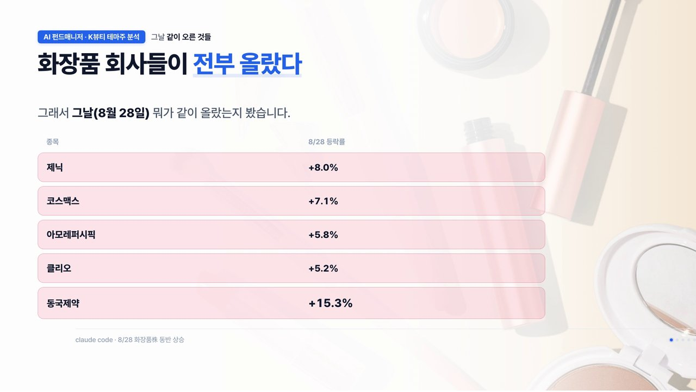
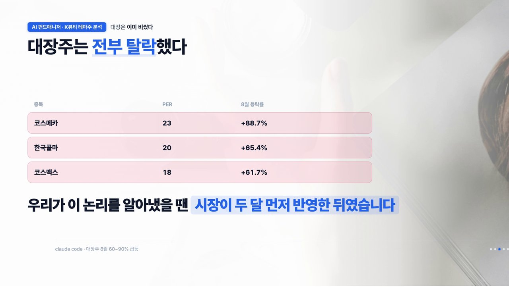
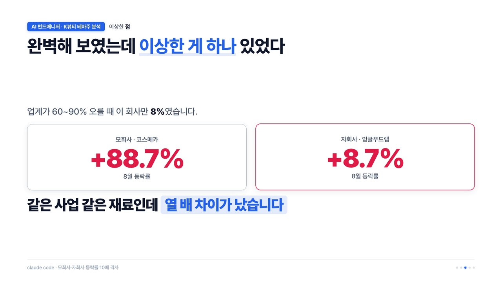
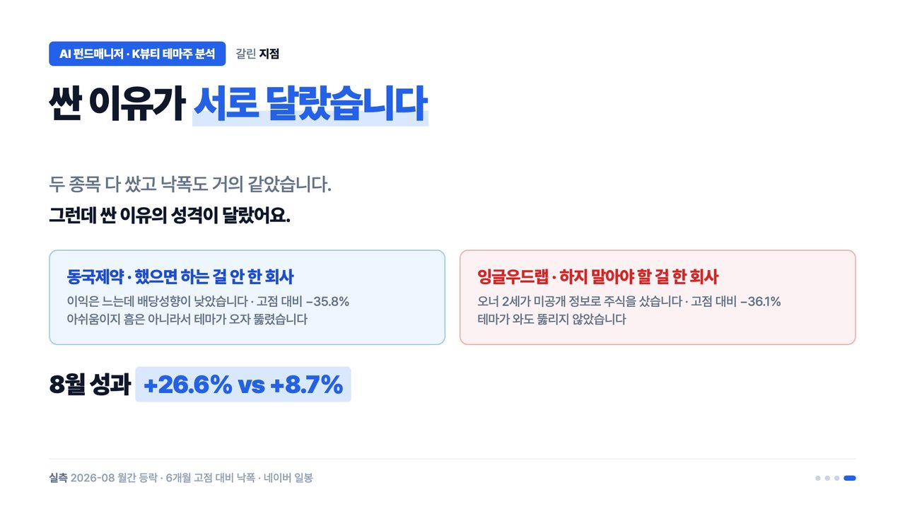
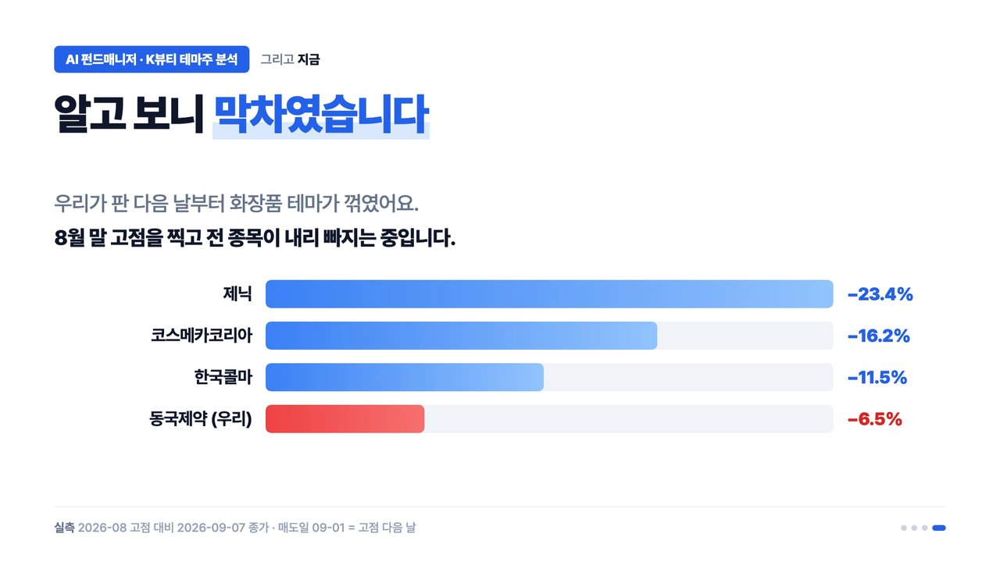

<iframe width="560" height="315" src="https://www.youtube.com/embed/Hn5eQYNUe2s" title="YouTube video" frameborder="0" allow="accelerometer; autoplay; clipboard-write; encrypted-media; gyroscope; picture-in-picture; web-share" allowfullscreen></iframe>

> 이 영상은 9월 초에 만든 것입니다. 글 속의 "지금"도 그때 기준이고, 주가 숫자는 9월 7일까지의 값이에요.

[10편](/ai-fund-manager-10) 마지막에 동국제약이 2·3회차를 담기도 전에 목표가에 닿아 팔렸다고 했죠. 9월 1일, 모의투자 알림이 와서 +26.3%에 팔았습니다. 그런데 팔고 나니 궁금해졌어요. 이거 왜 오른 거지?

## 기다리던 재료는 없었다

동국제약을 담을 때 세운 조건은 주주환원이었습니다. 배당을 늘리거나 자사주를 사면 오를 거라고 봤어요. 그래서 공시부터 뒤졌는데 아무것도 없었습니다. 6월부터 9월까지 이 회사가 낸 공시는 반기보고서 하나뿐이었어요. 우리가 기다리던 재료가 아니라 다른 이유로 오른 거였습니다.

그래서 동국제약이 크게 오른 날(8월 28일) 뭐가 같이 올랐는지 봤더니, 화장품 회사들이 전부 올라 있었어요.

처음엔 마스크 테마인가 했는데, 감염병 마스크인지 피부 마스크인지 알 수가 없어서 양쪽 종목을 다 봤습니다. 감염병 쪽은 방향이 제각각이었고, 피부 쪽은 넷이 다 같이 올랐어요. 화장품 쪽에 뭔가 있었던 거죠.

## 화장품은 왜 올랐나 — 길목은 ODM

수출 숫자를 보니 화장품 수출이 7월에 37%, 8월 초순에는 92% 늘었습니다. 작년 11월부터 아홉 달 연속 증가라, 한 철 유행이 아니었어요.

원인은 미국에 있었습니다. 미국 소비자 취향이 개인화되면서 작은 화장품 브랜드가 폭발적으로 생기고 있는데, 이 신생 브랜드들은 공장이 없어요. 기획만 하고 만드는 건 전부 남에게 맡깁니다. 그 주문을 받는 게 한국 회사들이에요. 처방 개발부터 생산·품질관리, 나라별 규제 대응까지 맡는 걸 **ODM**이라고 하는데, 작년 화장품 수출 114억 달러 중 72.5%가 중소 브랜드 물량이었습니다.

여기서 예전에 배운 게 떠올랐어요. 신재생에너지를 볼 때 돈은 발전소가 아니라 송배전, 그러니까 그 사이 길목에서 번다고 했잖아요. 화장품도 똑같았습니다. 브랜드는 떴다 지지만 그 브랜드들이 다 거쳐 가는 ODM은 계속 돈을 벌어요. 2015~2023년 연평균 매출 성장률이 ODM은 10.2%, 대형 브랜드는 2.6%였습니다.

## 30종목을 걸렀더니

그래서 ODM 18종목, 용기·원료 12종목, 합쳐서 30종목을 우리 기준으로 걸렀습니다. PER 12 이하, PBR 1.5 이하, ROE 8% 이상이에요.

**대장주는 전부 탈락했습니다.** 이유는 단순했어요. 8월 한 달에만 60~90%가 올라 이미 비싸졌거든요. 우리가 이 논리를 알아냈을 때는 시장이 두 달 먼저 반영한 뒤였습니다.

**딱 하나가 통과했습니다.** 잉글우드랩이에요. PER 5.5, PBR 0.98, ROE 16.1, 영업이익은 전년 대비 두 배로 늘었고, 미국 현지 ODM이라 고객이 바로 그 인디 브랜드들이었어요. 완벽해 보였습니다.

## 완벽해 보였는데, 혼자 안 올랐다

그런데 이상한 게 하나 있었어요. 8월에 같은 업계가 60~90% 오를 때 이 회사만 8.7%였습니다. 최대주주사인 코스메카코리아는 88.7% 올랐는데요. 같은 사업, 같은 재료인데 열 배 차이였어요.

기사를 찾아보니 8월 14일, 이 회사 오너 일가 두 사람이 미공개 정보로 이 주식을 사서 이득을 본 혐의로 재판에 넘겨졌다는 보도가 있었습니다. 재무제표 어디에도 없는 얘기였어요.

조건만 보면 모의투자에 넣을 만했지만, 넣지 않기로 했습니다. 싼 데는 이유가 있었어요. 여기서 얻은 교훈은 이겁니다. **소외된 주식을 볼 때는 재무제표만이 아니라 업종 대비 등락도 같이 봐야 한다.** 남들 다 오르는데 혼자 안 올랐다면 이유가 있는 거예요.

## 동국제약은 왜 화장품 테마로 묶였나

처음 질문으로 돌아가 보면, 동국제약은 사업 안에 화장품이 실제로 있었습니다. 헬스케어 부문이 전체의 3분의 1이고, 그 안의 4분의 3이 화장품이에요. 마데카크림 같은 것들이죠.

사실 동국제약은 모의투자에 크게 담은 종목은 아니었어요. 게이트는 통과했지만 이익이 느는 만큼 배당성향이 따라오지 않아서 낮은 비중으로만 담으려 했고, 그마저 1차 매집 중에 목표가에 닿아 버렸습니다.

잉글우드랩과 비교하면 재미있는 점이 있어요. 둘 다 고점에서 36%쯤 빠져 있었습니다. 다른 건 **싼 이유의 성격**이었어요.

동국제약은 "했으면 하는 걸 안 한" 회사였고, 잉글우드랩은 "하지 말아야 할 걸 한" 회사였습니다. 아쉬움 때문에 싼 건 테마가 오면 뚫리지만, 사고 때문에 싼 건 테마가 와도 안 뚫려요.

## 알고 보니 막차였다

그리고 지금 보니 우리가 판 게 막차였습니다. 판 다음 날부터 화장품 테마 전체가 꺾였어요. 그중 동국제약이 가장 덜 빠졌습니다.

안전마진이 두꺼우면 빠질 때도 덜 빠집니다. 펀더멘털과 안전마진을 같이 보는 이유가 여기 있어요.

## 이번 편에서 배운 것

1. 동국제약은 원칙대로 팔았고, 왜 올랐는지는 팔고 나서 알았다.
2. K뷰티 수출은 진짜였고, 진짜 수혜는 브랜드가 아니라 길목인 ODM이었다.
3. 그런데 30종목을 다 봐도 살 게 없었다. 좋은 건 이미 올랐고, 안 오른 건 이유가 있었다.
4. 소외주는 재무제표보다 업종 대비 등락을 먼저 본다.

> 이 글은 투자 자문이 아니라 제 검증 기록입니다. 판단과 책임은 본인에게 있습니다.
