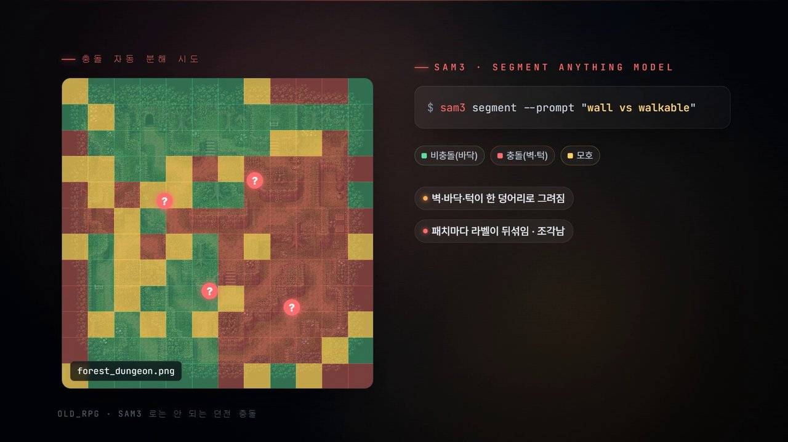
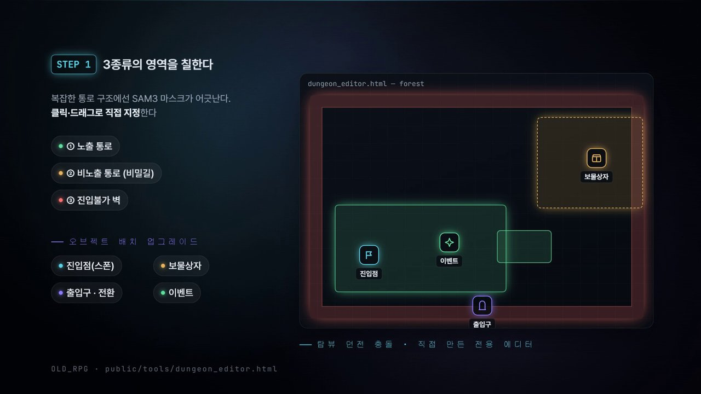
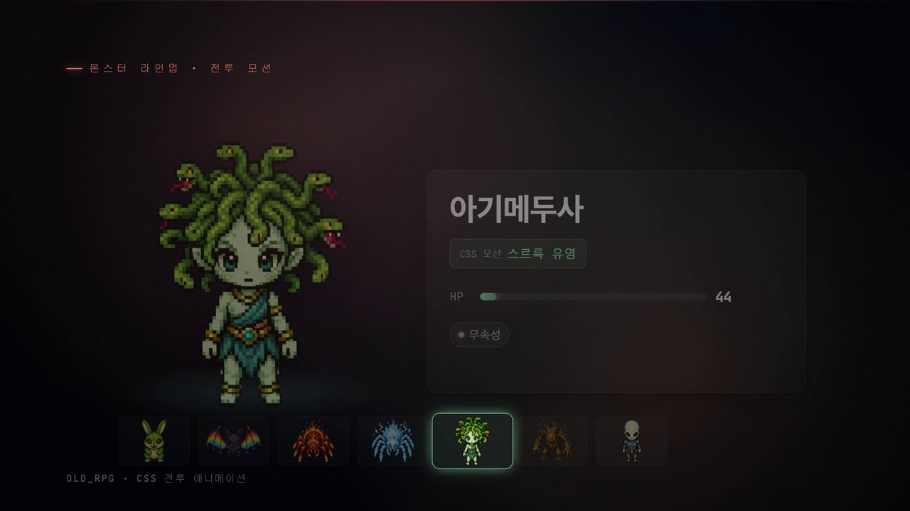
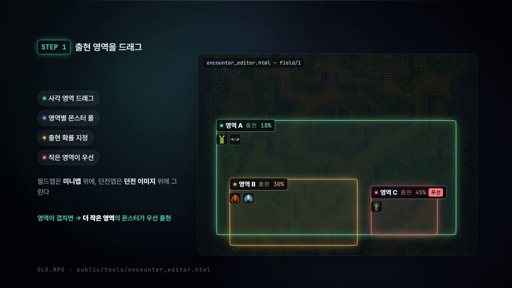
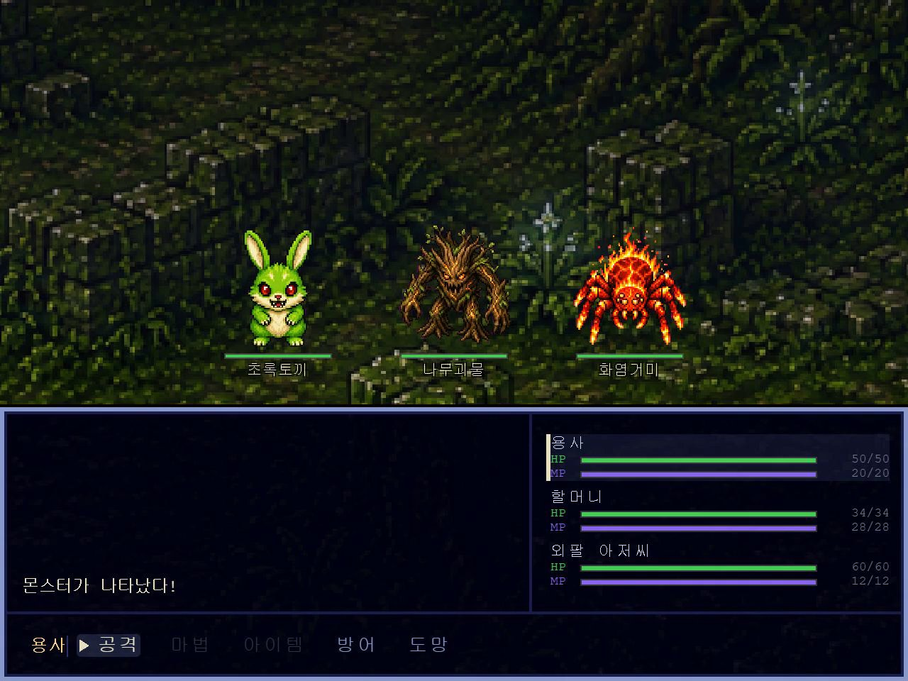
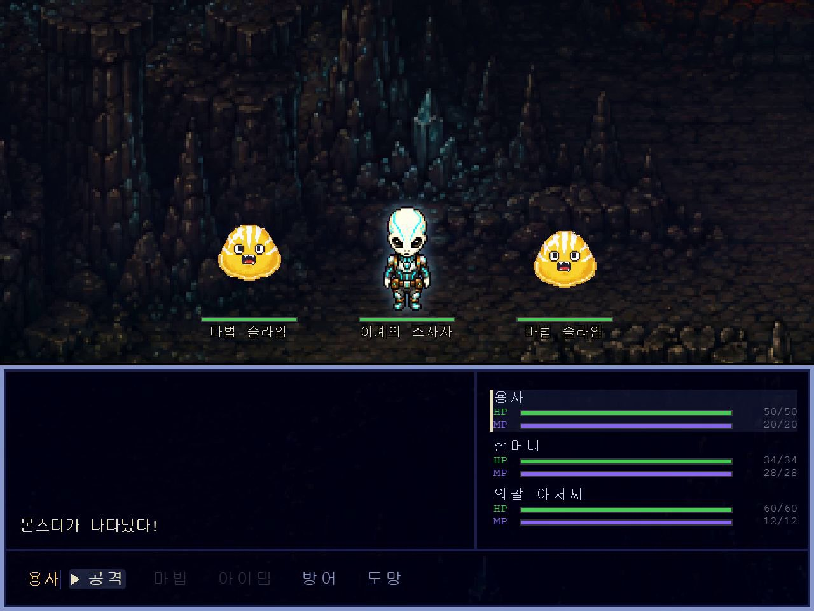
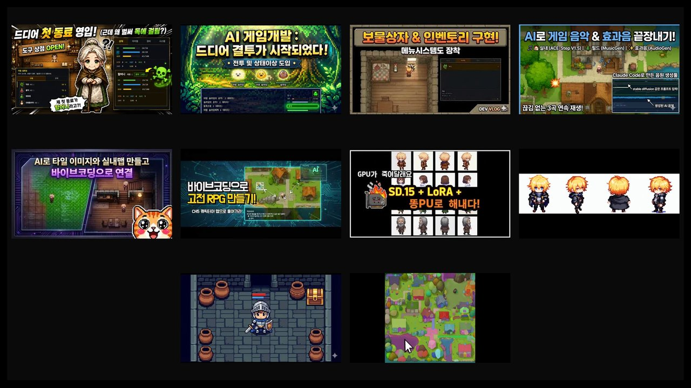
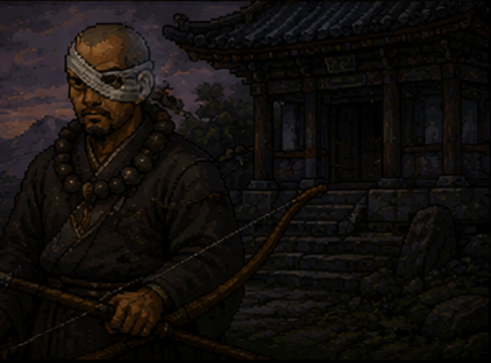
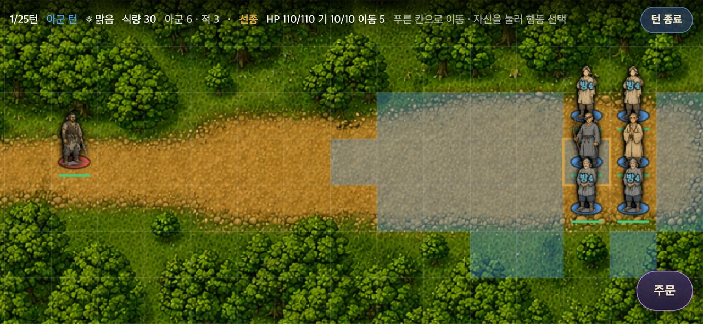

<iframe width="560" height="315" src="https://www.youtube.com/embed/xQ9cTpttf2w" title="YouTube video" frameborder="0" allow="accelerometer; autoplay; clipboard-write; encrypted-media; gyroscope; picture-in-picture; web-share" allowfullscreen></iframe>

AI로 고전 RPG를 만드는 시리즈의 마지막 편입니다. [10편](/ai-rpg-10)에서 첫 동료와 상점을 넣었으니, 이번에는 그 파티로 들어갈 던전과 중간 보스를 만들었어요.

그리고 끝이 끝은 아닙니다. 글 마지막에 **다음 시리즈 예고편**이 있어요.

## 던전 맵은 이미지로 만들었다

방식은 마을 맵 때와 같습니다. Claude Code에서 프롬프트를 짜고, ChatGPT로 숲 던전과 동굴 던전 이미지를 만들었어요. 프롬프트는 이런 식이었습니다.

```
top-down 2D JRPG forest dungeon, dense green canopy, mossy stone ledges,
winding dirt paths, hidden clearings, wooden treasure chests, a stone gate entrance, 16-bit SNES
```

## SAM3가 던전에서는 안 먹혔다

맵 이미지를 만들면 어디가 길이고 어디가 벽인지 나눠야 합니다. 예전 마을 맵은 SAM3(이미지에서 물체를 분리하는 모델)로 통과할 수 있는 영역을 아주 쉽게 나눴어요. 그런데 이번 던전 이미지에는 아쉽게도 적용하기가 어려웠습니다. 아래처럼 칸마다 길과 벽 판정이 뒤섞여 나왔어요.



그래서 방법을 바꿨습니다. 통과할 수 있는 곳을 사람이 직접 칠해서 지정하는 **웹 기반 맵 에디터**를 AI로 만들었어요. 노출 통로, 비노출 통로(비밀길), 진입 불가 영역을 클릭과 드래그로 칠하고, 보물상자·이벤트·출입구 같은 오브젝트도 같은 화면에서 놓습니다.



## 몬스터와 출현 구역

던전에서 만날 몬스터와 중간 보스 이미지도 ChatGPT가 그렸고, 움직임은 Claude Code로 애니메이션을 붙였습니다.



이 몬스터들이 맵의 특정 구역에서만 나오도록 **인카운터(출현 구역) 에디터**도 만들었어요. 구역을 드래그로 그리고, 구역마다 나올 몬스터와 출현 확률을 정합니다. 구역이 겹치면 더 작은 구역의 설정이 우선이에요.





## 배경음악은 8비트로

예전에 만든 사운드 에디터에 8비트 음악 생성 기능도 넣었습니다. 배경음악도 고전 느낌이 더 났으면 해서요.

쓰는 법은 간단합니다. 먼저 기본 멜로디 라인을 만들어 바로 들어 보고, 그 멜로디에 자동 화음과 효과를 입혀 패미콤 스타일의 8비트 음원으로 완성해요. 조금 더 발전된 16비트 슈퍼 패미콤 스타일로도 렌더링할 수 있습니다. 작곡을 몰라도 랜덤으로 꽤 괜찮은 배경음악이 나와요.

## 던전 플레이

이제 직접 플레이해 봤습니다.

- 숲 던전 초입에서 할머니와 외팔 아저씨에게 무언가 사연이 있는 듯한 이벤트가 나옵니다.
- 숲을 돌며 새 몬스터들과 싸우고, 보물상자를 찾아 열어요. 던전 가운데로 가면 신비한 기운에 파티 전체 체력이 회복되는 이벤트도 있습니다.
- 막힌 길 너머에 아이템 항아리들이 보이는데, 이곳에는 닿을 수가 없어요.
- 촌장님이 챙겨 가라던 고대 두루마리를 써 보니 특정 좌표를 알려 줍니다. 그곳에서 소중한 아이템을 얻었어요.
- 북서쪽 입구로 동굴에 들어가 동쪽으로 가다 보면 비밀 통로가 나옵니다. 여기로 가면 아까 닿지 못했던 숲 던전의 항아리 공간으로 이어져요. 맵 에디터에서 칠한 "비노출 통로"가 바로 이런 데 쓰입니다.



## 중간 보스

동굴 던전 한가운데에 닿으면 중간 보스 전투가 바로 시작됩니다. 보스 양옆에 회복 마법을 쓰는 마법 슬라임이 붙어 있어서, 슬라임부터 처리해야 해요.



사투 끝에 보스를 이겼지만, 찾고 있던 동료들의 친구는 끝내 발견하지 못했습니다. 목소리만 들리던 그 친구는 어떻게 된 걸까요? 마을로 돌아오면 동료들과 헤어지고, 촌장님은 감쪽같이 사라져 있어요. 주인공을 사지로 보내 놓고 어디로 간 걸까요? 돌아오는 길에 잘 들어 보면 숲 던전의 배경음악이 살짝 밝게 바뀌어 있습니다.

동료 없이 혼자 보스에게 바로 가는 분기도 만들어 두었어요. 대화도 달라지고 난이도도 훨씬 높습니다. 이 모드에서 보스를 이기면 할머니나 외팔 아저씨를 동료로 영입할 수 있어요. 저는 테스트용 치트로 전투만 건너뛰어 확인했습니다. 이 게임은 데모 버전이라 여기까지가 끝이에요.

## 시리즈를 마치며

이 편으로 AI로 고전 RPG 만들기 시리즈를 마무리합니다. 마을 맵부터 전투, 동료와 상점, 던전과 보스, 그리고 그걸 만들기 위한 맵·인카운터·사운드 에디터까지, 그동안 관심 있게 지켜봐 주셔서 감사합니다.



시리즈를 하며 정리된 것들은 이렇습니다.

- 이미지 생성은 그림은 잘 그리지만, 그 그림을 게임 데이터로 바꾸는 단계에서 막히는 일이 많았다. 이번엔 SAM3가 던전 이미지에서 길을 나누지 못했다.
- 그럴 때는 AI에게 그림을 더 잘 그리게 하는 것보다 **사람이 빠르게 지정할 수 있는 도구를 AI로 만드는 쪽**이 빨랐다. 맵 에디터, 인카운터 에디터, 사운드 에디터가 다 그렇게 나왔다.
- 게임 하나를 만들면서 쓸 도구들이 같이 쌓였다.

## 그리고 다음 시리즈 — 후삼국 궁예전

끝났다고 했지만 완전히 끝난 건 아닙니다. 다음에는 **고전 SRPG**, 그러니까 칸 위에서 부대를 움직이며 싸우는 전략 RPG에 도전합니다. 제목은 **후삼국 궁예전**입니다.

<iframe width="315" height="560" src="https://www.youtube.com/embed/kWr4gYvTfgI" title="후삼국 궁예전 예고편" frameborder="0" allow="accelerometer; autoplay; clipboard-write; encrypted-media; gyroscope; picture-in-picture; web-share" allowfullscreen></iframe>

> 누구인가? 누가 감히 이 미륵을 SRPG로 만들겠다는 건가?

예고편에서 내건 건 세 가지입니다. 고전 SRPG, 철저한 역사 고증, 그리고 더 강력해진 그래픽이에요.





곧 새 시리즈로 돌아오겠습니다. 다음 시간에 만나요.
