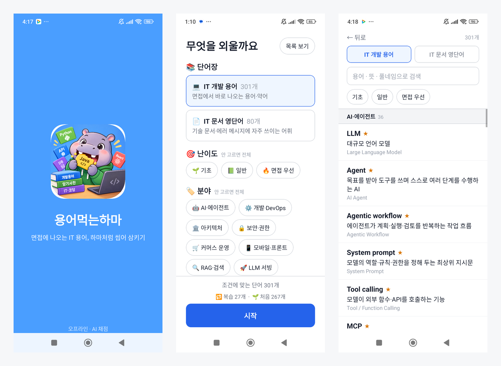
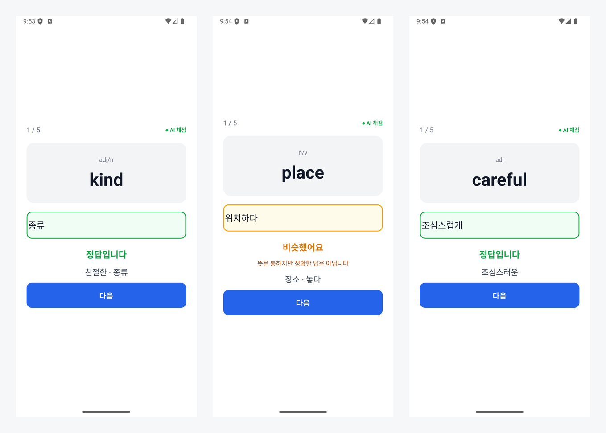
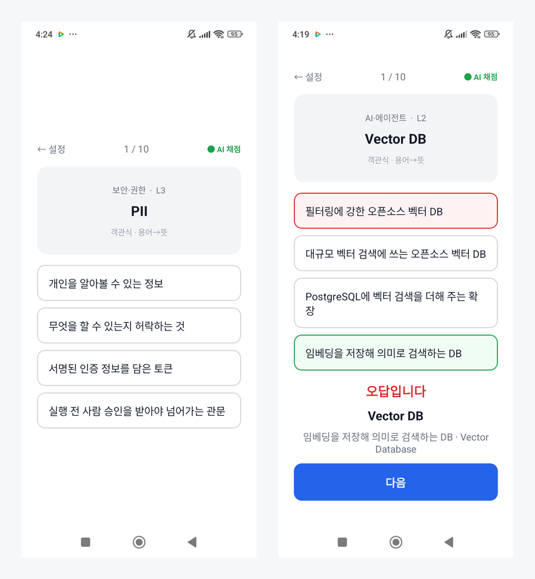
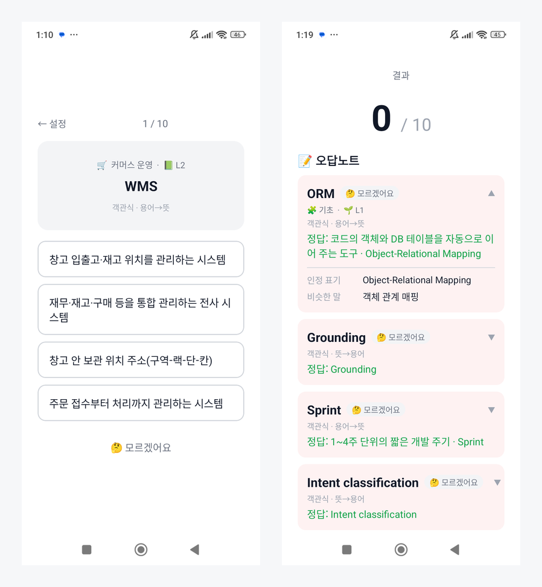

단어장 앱에서 뜻을 **직접 입력**해서 외우고 싶은데, 맞는 답을 틀렸다고 하면 금방 지칩니다. "여행하다"가 정답일 때 "여행가다"라고 쓰면 맞은 걸까요, 틀린 걸까요?

이걸 서버 없이, 인터넷 연결 없이 폰 안에서 판단하는 암기 앱을 만들었습니다. 한국어 임베딩 모델을 앱에 넣어서 기기에서 바로 채점합니다. 처음에는 영단어 앱으로 시작했고, 지금은 IT 개발 용어 391개가 기본 단어장인 **용어먹는하마**가 됐습니다.

- 깃헙: [https://github.com/reddol18/dev_keyword_test](https://github.com/reddol18/dev_keyword_test)



이름은 단기 기억을 맡는 뇌의 **해마**(hippocampus)에서 Hippo를 따왔습니다. IT 용어를 먹어 치우는 하마라는 뜻이에요.

## 시작은 단어장 앱 리뷰였다

기존 단어장 앱의 리뷰를 읽어 보니 불만이 꽤 구체적이었습니다.

- "영단어만 보고 **뜻 직접 쓰는 것**도 있었으면"
- "**복수정답도 되게** 좀 해주세요 … 진짜 스트레스 받아요"
- "단어쓰기 할때 **대문자로 계속 시작해서** 불편해요"
- "**인터넷 연결없이도** 학습할 수 있으면"

그래서 목표를 두 가지로 잡았습니다. 객관식이 아니라 직접 입력할 것, 그리고 **맞는 답을 틀렸다고 하지 않을 것.** 인터넷 없이도 돼야 하니 채점은 기기 안에서 해야 했습니다.

## 한국어 뜻 채점, 모델 하나로는 안 됐다

처음 생각은 단순했습니다. 정답과 입력한 답을 임베딩 모델로 벡터로 바꾸고, 둘이 얼마나 가까운지(코사인 유사도)로 채점하면 된다고요. 모델은 한국어 문장 임베딩 모델인 `jhgan/ko-sroberta-multitask`를 썼습니다.

그런데 실제로 재 보니 이 모델은 **반의어를 잘 구분하지 못했습니다.**

```
기억하다 ↔ 잊다       0.6520   ← 반대말인데 높다
빌려주다 ↔ 빌리다     0.6966   ← 반대말인데 높다
연습하다 ↔ 연습       0.4470   ← 같은 말인데 낮다
위치하다 ↔ 두다       0.3321   ← 유의어인데 낮다
```

반대말은 같은 문맥에 자주 나오니 벡터가 가깝게 잡히는, 임베딩 모델 전반의 한계입니다. 반대로 활용형은 확실히 잘 잡았어요.

```
조심스럽게 ↔ 조심스러운   0.9224
친절한     ↔ 친절하다     0.9232
여행가다   ↔ 여행하다     0.8798
```

그래서 모델은 **활용형 판정에만** 쓰고, 나머지는 규칙과 데이터에 맡기기로 했습니다. 채점은 이 순서로 합니다.

1. **어간이 같으면 정답.** 어미를 떼고 비교합니다. `여행하다`, `여행가다`, `여행`은 모두 `여행`이에요. 모델이 0.45로 떨어뜨리는 `연습하다`↔`연습`도 여기서 잡힙니다.
2. **데이터에 적어 둔 근접 오답이면 "비슷했어요".** 예를 들어 `place`에 `near: ["위치하다", "두다", ...]`를 넣어 둡니다. 점수는 주지 않지만 뜻은 통한다고 알려 줍니다.
3. **그래도 안 걸리면 모델이 판정.** 유사도 0.85 이상이면 정답, 0.70 이상이면 "비슷했어요", 그 아래는 오답입니다.

정답 기준을 0.85로 높게 잡은 것도 반의어 때문입니다. 반대말이 0.65~0.70까지 나오니, 기준을 낮추면 반대말을 정답으로 처리하게 됩니다.



## 폰에서 돌려 보니

서버를 두지 않은 이유는 리뷰의 "인터넷 연결 없이"도 있었지만, 그 밖에도 좋은 점이 있었습니다. 서버 유지비가 없고, 입력한 답이 기기 밖으로 나가지 않습니다. Redmi Note 14 Pro(arm64)에서 잰 값은 이렇습니다.

| 항목 | 값 |
|---|---|
| 모델 로딩 | 2.1초 (앱 시작 시 1번, 런칭 화면이 가려 줌) |
| 채점 한 번 | 40~80ms |
| 모델 크기 | 106MB (int8 양자화) |

폰에서 나온 유사도가 PC에서 파이썬으로 계산한 값과 **소수점 4자리까지 같았습니다.** int8로 줄인 모델이 ARM 폰에서도 제대로 돈다는 확인이었어요.



## IT 용어로 넓히면서 바뀐 것

영단어 앱으로 만든 뒤, IT 개발 용어 단어장을 넣었습니다. 면접 준비에 쓰려고 넣은 덱이라 ★로 면접 우선 등급을 표시해 두었고, 지금은 AI·에이전트, RAG·검색, LLM 서빙, 쿠버네티스·인프라, 제조·물류 현장 등 391개가 들어 있습니다. 덱을 넓히면서 판단이 세 번 바뀌었습니다.

### 반의어 걱정은 실측해 보니 문제가 아니었다

영단어에서 반의어가 문제였으니 IT 용어도 그럴까 봐, 고치기 전에 먼저 폰에서 쟀습니다. 측정이 맞는지 확인하려고 영단어 값부터 다시 재 봤는데, 위의 값과 소수점 4자리까지 똑같이 나왔습니다.

결과는 예상과 달랐습니다. IT 용어에는 반의어가 거의 없고, 헷갈리는 쌍은 대부분 **형제 관계**였어요(`SLA`↔`SLO`, `STT`↔`TTS`). 반의어에 가까운 `AuthN/AuthZ`(0.42), `동기/비동기`(0.68)도 전부 0.70 아래라 오답 처리됩니다. 가장 높은 형제쌍 `STT/TTS`가 0.79로 "비슷했어요"였고, 정답 기준을 넘는 쌍은 없었습니다.

이유는 뜻의 길이에 있었습니다. IT 용어의 뜻은 "내부라도 믿지 않고 매번 검증하는 보안 모델"처럼 서술형이라 깁니다. 문장이 길면 구성 단어가 달라져 벡터도 멀어지니, 짧은 단어쌍에서 생기던 문제가 덱 특성상 자연히 줄어든 거예요.

측정하다 제 실수도 하나 잡았습니다. 처음에는 덱에 없는 문장을 지어내서 어순만 뒤집어 쟀더니 0.94가 나왔어요. 실제 덱의 뜻으로 다시 재니 0.79였습니다. **덱에 없는 문제를 측정할 뻔했던 거죠.** 이 측정 기록은 이슈에 그대로 남겨 두었습니다([https://github.com/reddol18/dev_keyword_test/issues/3](https://github.com/reddol18/dev_keyword_test/issues/3)).

### 대신 IT 용어 덱에서는 주관식을 뺐다

반대로 다른 문제가 보였습니다. 391개 용어의 첫 번째 뜻은 중간값이 24자이고, 95%가 15자 이상입니다.

```
FDE → "고객 현장에 들어가 제품을 맞춰 붙이고 요구를 개발팀에 전달하는 엔지니어"
```

이건 받아쓸 수 있는 길이가 아닙니다. 뜻을 **알아도** 자기 말로 짧게 쓰게 되고, 그러면 유사도가 정답 기준을 못 넘어 오답이 됩니다. 아는데 틀리는 구조예요. 그래서 IT 용어 덱은 객관식만 내고, 뜻이 짧은 영단어 덱에서만 주관식을 유지했습니다([https://github.com/reddol18/dev_keyword_test/issues/9](https://github.com/reddol18/dev_keyword_test/issues/9)).

### 객관식은 헷갈리는 것끼리 묶어서 낸다

객관식으로 바꾸면 오답 보기가 중요해집니다. 엉뚱한 보기가 섞이면 외우지 않아도 맞히니까요. 그래서 용어마다 `confusable`에 헷갈리는 용어를 적어 두고, 이걸 오답 보기의 1순위로 씁니다. 예를 들어 `Pub/Sub`의 보기는 Event-driven, Queue, Webhook입니다.

이때 **정답과 겹치는 보기는 반드시 걸러냅니다.** 보기 후보가 정답의 뜻·별칭·근접어 중 무엇과도 겹치면 빼요. 안 그러면 정답이 2개인 문제가 나옵니다. 오답 보기를 고를 때는 임베딩을 쓰지 않았습니다. 문제마다 모델을 돌리면 시간이 더 붙는데, 보기는 "그럴듯하면" 충분해서 글자 유사도로 고릅니다.



## 잊을 때쯤 다시 나오게 — 간격 반복

단어마다 "다음에 보여 줄 날짜"를 들고 있습니다. 맞히면 간격이 1·3·7·14·30·60일로 길어지고, "비슷했어요"는 2일, 틀리면 1일로 돌아갑니다.

출제 순서는 오늘 틀린 것, 복습할 때가 된 것, 처음 보는 것 순입니다. 그런데 이 우선순위만 따르면 복습이 자리를 다 차지해서, 하루 10문제씩 90일을 풀어도 덱의 **23%밖에 못 본다**는 계산이 나왔습니다(덱이 301개였을 때 잰 값). 면접 대비라 덱을 한 바퀴 도는 것도 중요해서, 매 회차 **처음 보는 단어 자리를 2개 떼어 두도록** 했습니다. 그러면 같은 조건에서 63%까지 봅니다.

**🤔 모르겠어요** 선택지도 이 때문에 넣었습니다. 객관식은 찍어도 25%로 맞고, 맞으면 간격이 늘어서 **모르는 단어가 오히려 안 나오게** 됩니다. 모르면 찍지 말고 넘기게 하고, 그 단어는 내일 다시 꺼냅니다([https://github.com/reddol18/dev_keyword_test/issues/12](https://github.com/reddol18/dev_keyword_test/issues/12)).



## 빌드에서 막힌 것

`onnxruntime-react-native`를 Expo prebuild 환경에 붙이면서 몇 번 막혔습니다.

**1. 빌드는 성공하는데 실행하면 죽는다.** 패키지 안에 `unimodule.json`이 있어서 Expo 자동 링킹이 이걸 Expo 모듈로 착각합니다. 그래서 React Native 쪽 자동 링킹에서 빠지는데, 실제로는 Expo 모듈도 아니라 **어느 쪽에도 등록되지 않아요.** 빌드 로그에는 아무 단서가 없고, 실행하면 `Cannot read property 'install' of null`로 죽습니다. 이 파일을 지우면 정상 등록되고, 지금은 `npm install` 후 스크립트가 자동으로 처리합니다.

**2. 단어만 고치면 APK에 반영되지 않는다.** `data/*.json`만 고치고 빌드하면 `BUILD SUCCESSFUL`이 떠도 APK 안에는 옛 단어가 그대로 있습니다. Gradle이 이 JSON을 JS 번들의 입력으로 추적하지 않아서 "변경 없음"으로 보고 번들 생성을 건너뛰기 때문이에요. 빌드가 1분 안팎으로 이상하게 빨리 끝나면 의심하고, APK 안의 번들을 직접 열어 확인합니다.

```sh
tar -xf app-release.apk assets/index.android.bundle
grep -c "새로 넣은 용어" assets/index.android.bundle
```

**3. APK가 288MB였다.** 실기기에서 쓰지 않는 x86 계열을 빌드에서 빼서 181MB로 줄였습니다([https://github.com/reddol18/dev_keyword_test/issues/1](https://github.com/reddol18/dev_keyword_test/issues/1)).

## 모델을 더 작게 바꿀 수 없었던 이유

남은 181MB 중 절반이 모델 한 장(APK 안에서 86.9MB)입니다. 파라미터가 1억 1천만 개라 int8로 줄여도 이 모델로는 이게 한계예요. 더 줄이려면 작은 모델로 바꿔야 하는데, 그러면 정답 기준 0.85를 다시 잡아야 합니다.

그래서 모델을 바꾸기 전에 PC에서 먼저 확인하는 도구를 만들었습니다. 기준은 **분리 폭**입니다.

```
분리 폭 = (통과시켜야 할 활용형의 최저 유사도) - (막아야 할 대립쌍·형제쌍·어순 뒤집기의 최고 유사도)
```

이 값이 음수면 두 영역이 겹친다는 뜻이라, 기준을 어디에 둬도 오채점이 납니다. 후보 모델들을 쟀더니 이렇게 나왔습니다.

| 모델 | 파라미터 | 분리 폭 |
|---|---|---|
| **jhgan/ko-sroberta-multitask** (지금) | 110.6M | **+0.1455** |
| bongsoo/albert-small-kor-sbert-v1.1 | 11.7M | −0.0160 |
| intfloat/multilingual-e5-small | 117.7M | −0.0040 |
| snunlp/KR-SBERT-V40K-klueNLI-augSTS | 116.8M | −0.0496 |
| paraphrase-multilingual-MiniLM-L12-v2 | 117.7M | −0.2112 |

용량을 1/10로 줄일 수 있는 ALBERT 계열 모델은 대립쌍을 정답으로 처리했습니다. 양수가 나온 건 지금 모델 하나뿐이라, 용량보다 채점 정확도를 택해 그대로 두었습니다([https://github.com/reddol18/dev_keyword_test/issues/8](https://github.com/reddol18/dev_keyword_test/issues/8)).

측정하면서 하나 더 알게 된 게 있습니다. 앱이 쓰는 int8 모델 파일은 x86의 AVX512-VNNI 명령어용으로 만들어진 것이라, 이 명령어가 없는 PC에서는 짧은 구에서 폰 값과 0.1~0.26까지 차이가 납니다. 그래서 이 도구는 폰 값과 절대값을 비교하지 않고, 같은 PC에서 같은 정밀도로 **모델끼리만** 비교하도록 했습니다.

## 남은 것

- **iOS는 아직 빌드해 보지 않았습니다.** Android에서만 확인했어요([https://github.com/reddol18/dev_keyword_test/issues/4](https://github.com/reddol18/dev_keyword_test/issues/4)).
- **반의어 구분은 모델의 한계로 남아 있습니다.** IT 용어 덱에서는 실측상 오채점이 없었지만, 정답 기준 0.85는 이 한계를 전제로 잡은 값이라 낮추면 안 됩니다.

## 정리

- 임베딩 모델 하나로 채점하려던 계획은 반의어 때문에 그대로는 안 됐습니다. 모델은 잘하는 활용형 판정에만 쓰고, 어간 비교와 근접어 데이터로 나머지를 맡겼습니다.
- 걱정되는 문제는 고치기 전에 먼저 쟀습니다. IT 용어 덱의 반의어는 실측해 보니 문제가 아니었고, 진짜 문제는 뜻이 길어서 주관식이 성립하지 않는 쪽이었습니다.
- 모델을 바꾸고 싶을 때 쓸 판단 기준(분리 폭)을 먼저 만들어 두니, 용량을 줄이는 대신 지금 모델을 유지하는 결정을 수치로 내릴 수 있었습니다.

- 깃헙: [https://github.com/reddol18/dev_keyword_test](https://github.com/reddol18/dev_keyword_test) (MIT, 모델은 별도 라이선스)
