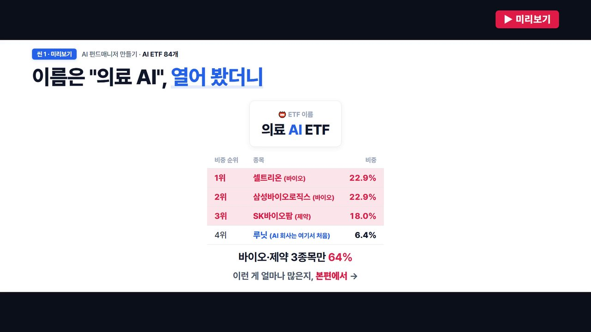
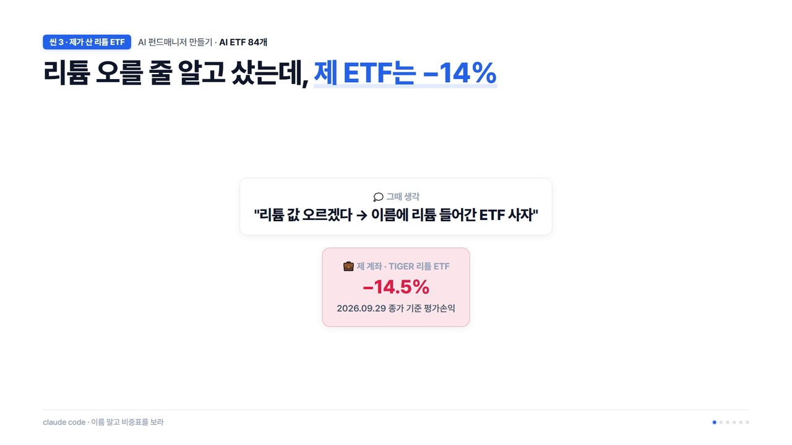
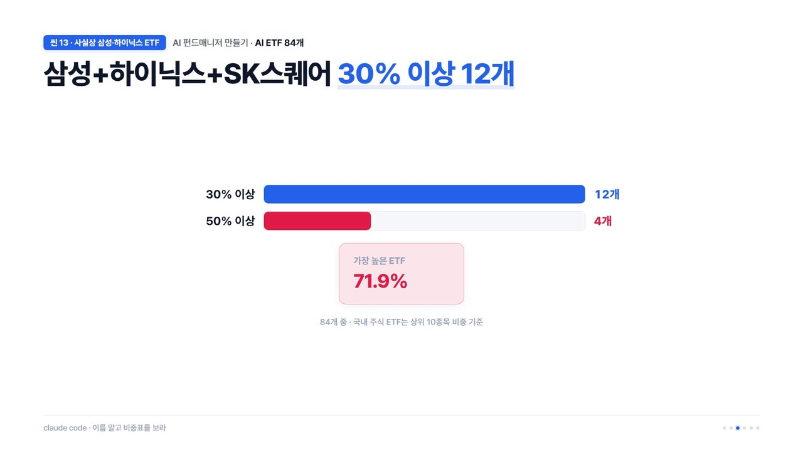
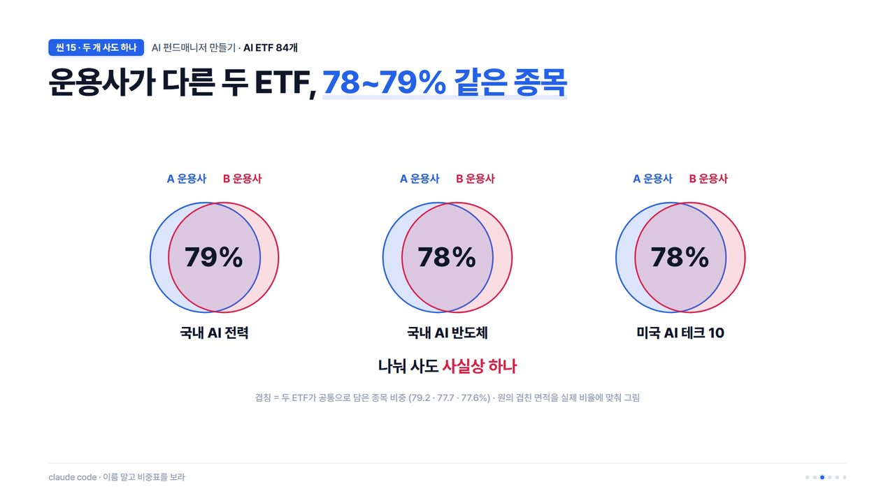
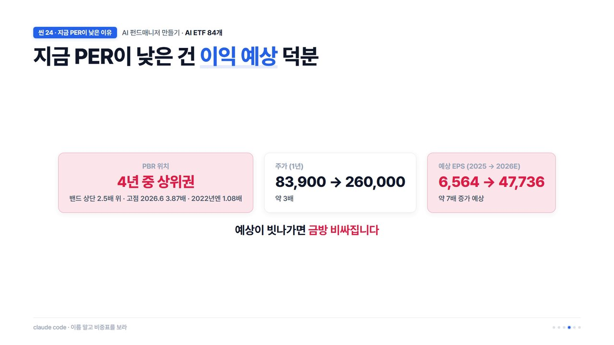
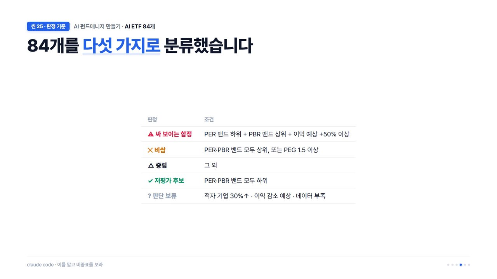
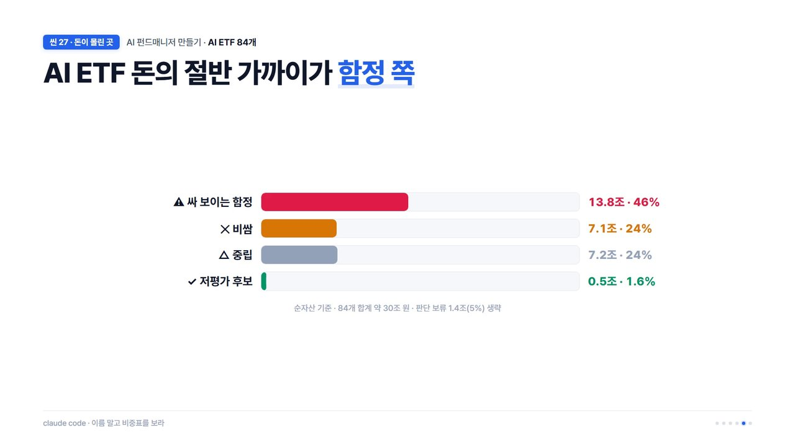
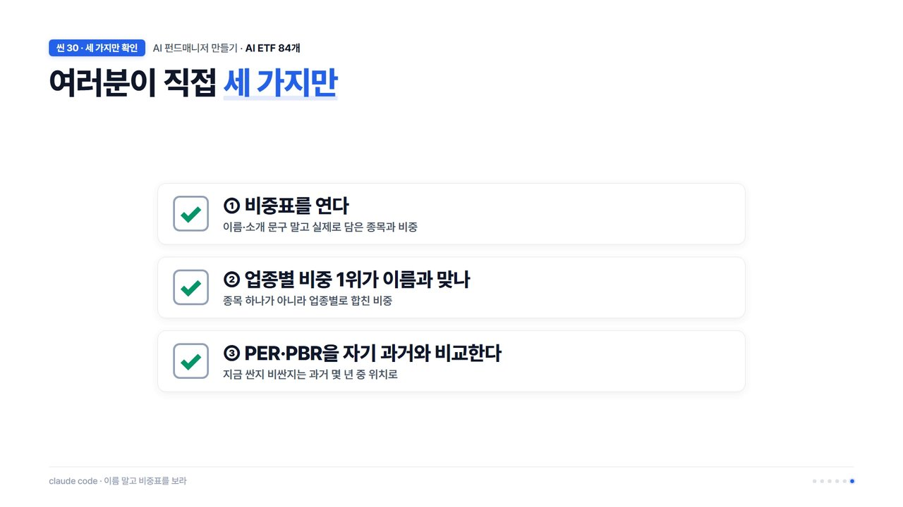

<iframe width="560" height="315" src="https://www.youtube.com/embed/Wx06el-GQTQ" title="YouTube video" frameborder="0" allow="accelerometer; autoplay; clipboard-write; encrypted-media; gyroscope; picture-in-picture; web-share" allowfullscreen></iframe>

> 이 영상은 2026년 10월 1일에 올린 것입니다. 글 속의 숫자와 아래 판정표도 그때 만든 것으로, 보유 종목은 9월 29일, 밸류 지표는 9월 29일~10월 1일 기준이에요.

이름에 "의료 AI"가 붙은 ETF를 열어 봤더니, 1위부터 3위가 바이오·제약 회사였습니다. AI 회사는 4위에서 처음 나왔어요.

## 이름만 보고 샀다가 겪은 일

이걸 다 열어 보게 된 건 제 경험 때문입니다. 리튬 값이 오를 것 같아서 이름에 리튬이 들어간 ETF를 샀는데, 영상을 만들 때 수익률이 -14.5%였어요.

구성표를 열어 보니 리튬 현물은 하나도 없었습니다. 1위는 광산 회사 주식(리오틴토 21.7%)이었어요. 이름에 리튬이 있다고 리튬을 담은 게 아니었던 거죠.

그래서 요즘 가장 뜨거운 키워드인 AI가 붙은 ETF를 전부 확인해 봤습니다. 이름만 보고 사면 저처럼 되실 분이 생길까 봐서요.

## 어떻게 조사했나

국내 상장 ETF 1,171개 중 이름에 AI가 붙은 건 84개였습니다(레버리지·인버스·채권혼합 제외). 순자산을 다 합치면 약 30조 원이에요.

판단 원칙은 하나였어요. **이름, 소개 문구, 수익률은 믿지 않고 실제로 담은 종목과 비중만 본다.**

해외 주식을 담은 54개는 비중이 공개되어 있지 않아서, 보유 주식 수 × 주가 × 환율로 직접 계산했습니다. 주식 수 순서와 비중 순서는 다르기 때문이에요. 계산이 맞는지도 54개 전부 1좌 NAV로 거꾸로 맞춰 봤고, 티커가 잘못 잡힌 종목 하나(도쿄일렉트론이 ADR로 잡혀 있던 것)를 고쳤습니다.

## 이름과 실체

**84개 중 19개는 비중 1위 업종이 IT가 아니었습니다.** "AI 전력" 안에는 변압기 회사가, "피지컬 AI" 안에서는 자동차 회사가 1위였고, "소버린 AI"에는 통신사, "고배당&AI"에는 금융주가 들어 있었어요.

**이름은 달라도 속은 같은 경우도 많았습니다.** AI에 그로스, ESG, 코리아, 온디바이스를 붙여 이름은 다 다른데, 열어 보면 1·2위가 모두 삼성전자와 SK하이닉스였어요. 삼성전자·SK하이닉스·SK스퀘어(하이닉스 지분을 가진 지주회사) 비중을 합치면 30%가 넘는 게 12개, 가장 높은 건 71.9%였습니다.

운용사가 다른 두 ETF가 78~79% 같은 종목인 경우도 여럿이었어요. 나눠 사도 사실상 하나를 산 셈입니다. ETF 안에 또 ETF를 담거나(5개), 지수 선물(2개)이나 2배 레버리지 ETF(1개)를 담은 것도 있었고요.



## 그래서 살 만한 건 있나

이름 속을 봤으니 이제 가격을 따졌습니다. 기준은 세 가지예요. 앞으로 1년 이익으로 계산한 **선행 PER**, 성장률 대비 PER인 **PEG**, 그리고 지금 값이 **자기 과거 범위(밴드)에서 어디쯤인지**.

여기서 함정이 하나 있었습니다. 앞의 ETF들 1·2위인 삼성전자 선행 PER이 5.7배, SK하이닉스가 5.1배예요. 성장률까지 감안해도 헐값처럼 보입니다.

그런데 메모리 반도체는 이익이 한 해에 몇 배로 뛰었다 꺼지기도 하는 업종이에요. 시장은 꼭대기 이익이 오래 못 간다고 보고 주가를 먼저 멈춰서, **이익이 클 때 PER이 가장 낮아 보이고 바닥에서는 반대**가 됩니다. 그래서 덜 출렁이는 회사 자산과 비교한 PBR을 같이 봤어요.

삼성전자는 2022년과 지금 PER이 모두 7배 정도인데 PBR은 1.08배에서 4년 중 상위권으로 올라와 있었습니다. 주가가 약 3배 오르는 동안 예상 EPS는 약 7배 늘어난다는 전망이라 PER이 낮게 나오는 거예요. 예상이 빗나가면 금방 비싸집니다.

이 생각으로 84개를 다섯 가지로 나눴습니다.

## 결과: 돈의 절반 가까이가 함정 쪽

| 판정 | 개수 | 순자산 |
|---|---|---|
| 싸 보이는 함정 | 14 | 13.8조 (46%) |
| 비쌈 | 13 | 7.1조 (24%) |
| 중립 | 39 | 7.2조 (24%) |
| 저평가 후보 | 6 | 0.5조 (1.6%) |
| 판단 보류 | 12 | — |

순자산이 가장 큰 국내 반도체 ETF들이 함정 쪽이었고, AI 전력기기 쪽은 PER도 PBR도 과거 최고 수준이라 비쌈이었어요. 반대로 미국 AI 빅테크와 소프트웨어는 PER 숫자만 보면 비싸 보여도 이익이 실제로 따라와서, 자기 과거보다 오히려 낮은 편이었습니다.

## 직접 확인하는 법

1. **비중표를 연다.** 운용사 홈페이지나 증권사 앱의 ETF 상세에서 볼 수 있어요. 해외 주식 ETF는 주식 수만 나올 때가 있으니 비중과 헷갈리지 마세요.
2. **비중 1위 업종이 이름과 맞는지 본다.**
3. **PER과 PBR을 자기 과거와 함께 본다.** 지금 숫자 하나만 보면 함정에 빠지기 쉬워요.

이름은 마케팅이고 비중표가 실체입니다. 저는 리튬으로 수업료를 냈으니, 여러분은 AI에서 같은 실수를 안 하셨으면 해요.

## 영상에서 약속한 84개 전체 판정표

영상 끝에서 "전체 판정표는 블로그에 올리겠다"고 약속했던 그 표입니다. **영상을 올린 2026년 10월 1일 시점에 만든 표**라, 지금 주가·실적과는 다를 수 있어요.

- 파일로 받기: [verdict84.md](/assets/files/2026/11/05/verdict84.md)

**열 읽는 법**
- **순자산(억)**: 조사 시점의 순자산
- **선행PER / PEG / 예상이익성장**: ETF가 담은 종목들의 앞으로 1년 예상 이익으로 계산한 값
- **PER밴드 / PBR밴드**: 지금 값이 자기 과거 범위에서 어디쯤인지(0 = 가장 낮음, 100 = 가장 높음). 국내 종목은 약 4년, 해외 종목은 약 3년 범위예요.
- **삼성+하이닉스+SK스퀘어**: 세 종목 비중의 합
- PEG가 `None`인 건 이익 감소가 예상되어 PEG를 계산할 수 없는 경우예요.

**주의할 경계 사례**: KODEX 미국AI메모리TOP2플러스처럼 PBR 밴드가 90대인데 규칙상 중립으로 분류된 경우가 있습니다. 함정에 가까운 위치라는 점을 함께 봐 주세요.

| 판정 | ETF | 순자산(억) | 선행PER | PEG | 예상이익성장 | PER밴드 | PBR밴드 | 삼성+하이닉스+SK스퀘어 |
|---|---|---|---|---|---|---|---|---|
| 싸보이는함정 | SOL AI반도체TOP2플러스 | 57,793 | 7.2 | 0.11 | 63.9% | 36 | 87 | 60.0% |
| 싸보이는함정 | KODEX AI반도체TOP2플러스 | 40,817 | 5.8 | 0.09 | 63.8% | 36 | 89 | 71.9% |
| 싸보이는함정 | KODEX 미국AI전력핵심인프라 | 14,924 | 31.8 | 0.43 | 74.2% | 42 | 86 | 0% |
| 싸보이는함정 | ACE AI반도체TOP3+ | 12,392 | 6.2 | 0.04 | 143.5% | 35 | 85 | 48.1% |
| 싸보이는함정 | KODEX 미국AI광통신네트워크 | 4,106 | 26.6 | 0.16 | 163.5% | 40 | 86 | 0% |
| 싸보이는함정 | SOL 글로벌AI반도체탑픽액티브 | 2,683 | 8.9 | 0.11 | 80.9% | 39 | 86 | 40.4% |
| 싸보이는함정 | RISE AI반도체TOP10 | 1,981 | 8.9 | 0.12 | 71.9% | 45 | 86 | 31.8% |
| 싸보이는함정 | KoAct 글로벌AI메모리반도체액티브 | 1,106 | 9.4 | 0.1 | 94.7% | 45 | 84 | 29.9% |
| 싸보이는함정 | DAISHIN AI반도체&인프라액티브 | 947 | 8.8 | 0.11 | 78.4% | 36 | 87 | 35.6% |
| 싸보이는함정 | TIGER AI코리아그로스액티브 | 771 | 5.8 | 0.08 | 74.1% | 19 | 87 | 55.9% |
| 싸보이는함정 | FOCUS AI코리아액티브 | 408 | 7.4 | 0.11 | 64.9% | 36 | 87 | 43.9% |
| 싸보이는함정 | RISE 글로벌AI낸드메모리반도체 | 164 | 6.9 | 0.06 | 123.2% | 33 | 82 | 42.2% |
| 싸보이는함정 | WON AI ESG액티브 | 153 | 6.0 | 0.08 | 71.7% | 21 | 88 | 53.8% |
| 싸보이는함정 | BNK 온디바이스AI | 138 | 7.7 | 0.08 | 93.5% | 43 | 87 | 38.7% |
| 비쌈 | KODEX AI전력핵심설비 | 32,295 | 29.7 | 0.93 | 32.0% | 79 | 88 | 0% |
| 비쌈 | SOL AI반도체소부장 | 11,962 | 30.9 | 0.36 | 86.1% | 69 | 84 | 0% |
| 비쌈 | TIGER 코리아AI전력기기TOP3플러스 | 10,166 | 32.8 | 1.31 | 25.0% | 82 | 88 | 0% |
| 비쌈 | KODEX AI반도체핵심장비 | 4,905 | 31.8 | 0.35 | 90.6% | 68 | 83 | 0% |
| 비쌈 | RISE 현대차고정피지컬AI | 4,588 | 9.4 | 0.33 | 28.7% | 80 | 80 | 0% |
| 비쌈 | RISE AI&로봇 | 3,635 | 15.4 | 0.42 | 36.4% | 72 | 82 | 0% |
| 비쌈 | TIGER AI반도체핵심공정 | 1,492 | 30.6 | 0.81 | 37.9% | 69 | 87 | 0% |
| 비쌈 | HANARO 미국AI메모리반도체TOP4+ | 1,279 | 11.8 | 0.07 | 163.6% | 69 | 87 | 0% |
| 비쌈 | ACE 코리아AI전력TOP10 | 252 | 42.2 | 1.72 | 24.6% | 80 | 87 | 0% |
| 비쌈 | KIWOOM 한국고배당&미국AI테크 | 243 | 9.7 | 4.62 | 2.1% | 56 | 64 | 0% |
| 비쌈 | TIGER 현대차LG전자고정피지컬AI밸류체인 | 199 | 11.8 | 0.28 | 41.5% | 65 | 84 | 0% |
| 비쌈 | HANARO 미국에이전틱AI TOP2+ | 105 | 26.9 | 4.27 | 6.3% | 39 | 49 | 0% |
| 비쌈 | KIWOOM 의료AI | 59 | 21.5 | 43.0 | 0.5% | 3 | 23 | 0% |
| 중립 | TIME 글로벌AI인공지능액티브 | 20,916 | 15.9 | 0.22 | 72.3% | 49 | 64 | 0% |
| 중립 | TIGER 미국필라델피아AI반도체나스닥 | 11,049 | 22.7 | 0.23 | 99.1% | 55 | 76 | 0% |
| 중립 | TIGER 글로벌AI전력인프라액티브 | 6,352 | 26.3 | 0.27 | 98.1% | 48 | 85 | 0% |
| 중립 | TIGER 글로벌AI액티브 | 5,885 | 25.6 | 0.38 | 68.0% | 49 | 74 | 0% |
| 중립 | TIME 차이나AI테크액티브 | 3,246 | 16.2 | 0.12 | 132.1% | 60 | 83 | 0% |
| 중립 | KODEX 미국AI반도체TOP3플러스 | 2,192 | 20.2 | 0.22 | 92.1% | 40 | 71 | 0% |
| 중립 | TIGER 미국AI빅테크10 | 2,084 | 21.8 | 0.69 | 31.7% | 32 | 53 | 0% |
| 중립 | SOL 미국AI전력인프라 | 2,062 | 23.1 | 0.44 | 52.8% | 47 | 62 | 0% |
| 중립 | IBK K-AI반도체코어테크 | 1,900 | 9.7 | 0.11 | 88.7% | 49 | 86 | 40.6% |
| 중립 | SOL 미국AI소프트웨어 | 1,427 | 28.6 | 0.59 | 48.6% | 41 | 50 | 0% |
| 중립 | KODEX 미국나스닥AI테크액티브 | 1,292 | 23.5 | 0.57 | 41.3% | 38 | 63 | 0% |
| 중립 | TIGER 글로벌AI&로보틱스 INDXX | 1,039 | 27.6 | 0.82 | 33.7% | 51 | 54 | 0% |
| 중립 | KODEX 차이나AI반도체TOP10 | 1,014 | 26.3 | 0.17 | 158.9% | 51 | 83 | 0% |
| 중립 | RISE 미국AI전력인프라액티브 | 927 | 26.1 | 0.29 | 90.0% | 48 | 77 | 0% |
| 중립 | SOL 미국AI반도체칩메이커 | 917 | 25.2 | 0.23 | 108.3% | 42 | 72 | 0% |
| 중립 | RISE 미국AI밸류체인TOP3Plus | 833 | 21.1 | 0.38 | 55.5% | 41 | 73 | 0% |
| 중립 | KODEX 미국AI메모리TOP2플러스 | 747 | 11.1 | 0.07 | 163.1% | 58 | 93 | 0% |
| 중립 | TIGER 글로벌AI플랫폼액티브 | 727 | 29.6 | 0.59 | 50.0% | 44 | 68 | 0% |
| 중립 | RISE 미국AI테크액티브 | 616 | 20.9 | 0.36 | 57.9% | 40 | 67 | 0% |
| 중립 | KODEX 코리아소버린AI | 613 | 13.2 | 0.4 | 32.6% | 48 | 66 | 9.5% |
| 중립 | TIGER 글로벌온디바이스AI | 583 | 30.7 | 0.67 | 45.6% | 60 | 81 | 0% |
| 중립 | KODEX 미국AI소프트웨어TOP10 | 527 | 48.1 | 0.6 | 80.0% | 47 | 57 | 0% |
| 중립 | ACE 미국AI테크핵심산업액티브 | 514 | 26.0 | 0.39 | 66.5% | 43 | 50 | 0% |
| 중립 | HANARO 글로벌생성형AI액티브 | 485 | 24.0 | 0.43 | 55.8% | 41 | 64 | 0% |
| 중립 | KIWOOM 글로벌AI반도체 | 484 | 23.5 | 0.25 | 95.7% | 55 | 66 | 0% |
| 중립 | KoAct AI인프라액티브 | 445 | 12.8 | 0.18 | 71.9% | 63 | 87 | 15.7% |
| 중립 | TIGER 미국AI반도체팹리스 | 410 | 24.5 | 0.21 | 117.6% | 39 | 69 | 0% |
| 중립 | KODEX 차이나AI테크액티브 | 382 | 16.7 | 0.09 | 185.6% | 57 | 87 | 0% |
| 중립 | ACE 코리아AI테크핵심산업 | 338 | 15.0 | 0.44 | 34.0% | 62 | 75 | 15.0% |
| 중립 | KODEX 아시아AI반도체exChina액티브 | 310 | 14.4 | 0.17 | 82.6% | 56 | 84 | 15.2% |
| 중립 | ACE 글로벌AI맞춤형반도체 | 304 | 35.3 | 0.27 | 130.9% | 55 | 75 | 0% |
| 중립 | RISE 차이나AI반도체TOP4Plus | 245 | 25.7 | 0.15 | 166.5% | 58 | 79 | 0% |
| 중립 | 1Q K소버린AI | 236 | 16.1 | 0.79 | 20.5% | 64 | 67 | 0% |
| 중립 | KoAct 미국로봇피지컬AI액티브 | 215 | 32.8 | 0.62 | 53.0% | 47 | 66 | 0% |
| 중립 | 마이티 AI데이터센터밸류체인 | 149 | 12.5 | 0.19 | 66.4% | 56 | 73 | 20.0% |
| 중립 | WON 피지컬AI TOP2플러스액티브 | 86 | 9.5 | 0.15 | 63.2% | 53 | 88 | 28.2% |
| 중립 | TIGER 차이나AI소프트웨어 | 82 | 30.3 | 0.88 | 34.3% | 41 | 44 | 0% |
| 중립 | PLUS 차이나AI테크TOP10 | 63 | 14.0 | 0.21 | 66.4% | 51 | 33 | 0% |
| 중립 | UNICORN 생성형AI강소기업액티브 | 54 | 17.3 | 0.69 | 24.9% | 52 | 55 | 0% |
| 저평가후보 | KODEX 미국AI테크TOP10 | 3,116 | 19.1 | 0.41 | 46.1% | 26 | 48 | 0% |
| 저평가후보 | TIGER 미국AI소프트웨어TOP4Plus | 702 | 24.2 | 0.63 | 38.4% | 6 | 46 | 0% |
| 저평가후보 | HANARO 글로벌피지컬AI액티브 | 585 | 24.9 | 0.38 | 64.7% | 37 | 48 | 0% |
| 저평가후보 | KIWOOM 미국고배당&AI테크 | 270 | 10.4 | 0.25 | 41.3% | 38 | 41 | 0% |
| 저평가후보 | ACE 차이나AI빅테크TOP2+액티브 | 55 | 18.8 | 0.72 | 26.1% | 35 | 39 | 0% |
| 저평가후보 | PLUS 미국AI에이전트 | 40 | 20.6 | 0.32 | 63.6% | 32 | 35 | 0% |
| 판단보류 | RISE AI전력인프라 | 6,822 | 35.7 | None | -0.8% | 79 | 84 | 0% |
| 판단보류 | KoAct 글로벌AI&로봇액티브 | 2,682 | 28.9 | 0.41 | 70.9% | 53 | 83 | 3.5% |
| 판단보류 | TIGER 미국AI전력SMR | 1,213 | 25.2 | 0.58 | 43.7% | 36 | 45 | 0% |
| 판단보류 | TIGER 미국AI데이터센터TOP4Plus | 980 | 16.4 | 0.23 | 70.7% | 30 | 58 | 0% |
| 판단보류 | TIGER 글로벌AI사이버보안 | 642 | 29.5 | 0.46 | 63.7% | 70 | 58 | 0% |
| 판단보류 | 1Q 미국메디컬AI | 316 | 23.1 | None | -46.3% | 22 | 46 | 0% |
| 판단보류 | PLUS AI반도체소부장액티브 | 263 | 43.5 | None | -8.7% | 64 | 77 | 0% |
| 판단보류 | RISE 미국AI클라우드인프라 | 225 | 25.7 | 0.27 | 94.9% | 46 | 78 | 0% |
| 판단보류 | KIWOOM 미국AI테크하이베타 | 207 | 20.3 | 0.12 | 163.1% | 47 | 74 | 0% |
| 판단보류 | SOL 한국AI소프트웨어 | 170 | 21.7 | None | -9.2% | 54 | 50 | 0% |
| 판단보류 | HANARO 미국AI광통신TOP10 | 82 | 28.8 | 0.13 | 214.2% | 49 | 89 | 0% |
| 판단보류 | RISE AI플랫폼 | 34 | 11.8 | None | -5.9% | 26 | 39 | 0% |

> 이 글과 표는 투자 권유가 아니라 제 분석 기록입니다. 판단과 책임은 본인에게 있습니다.
