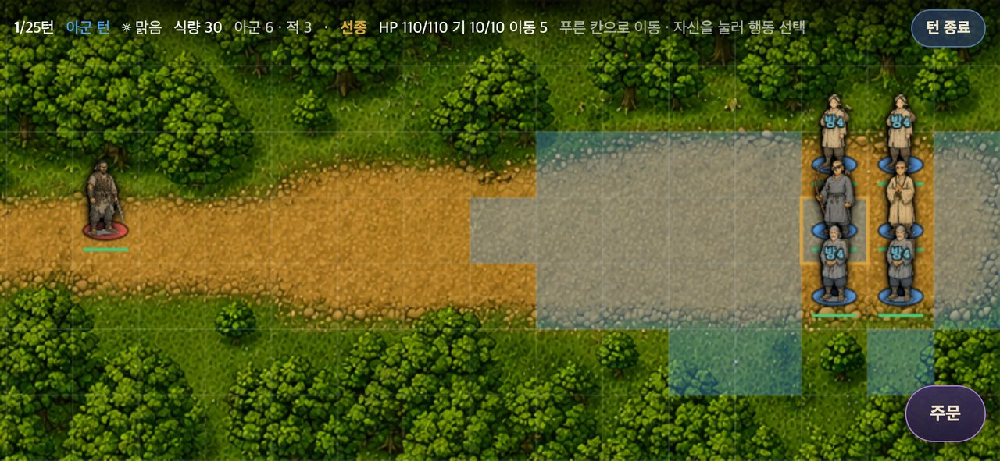
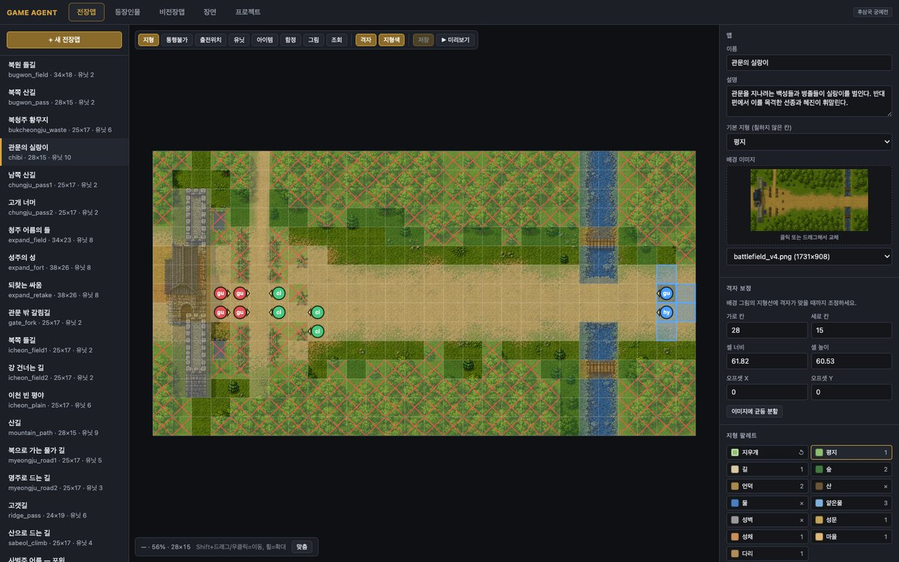
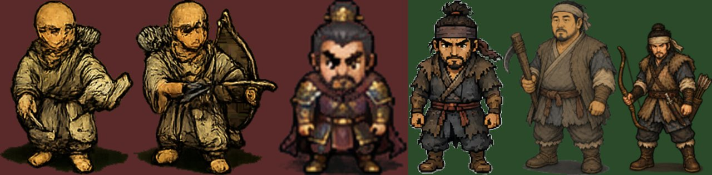
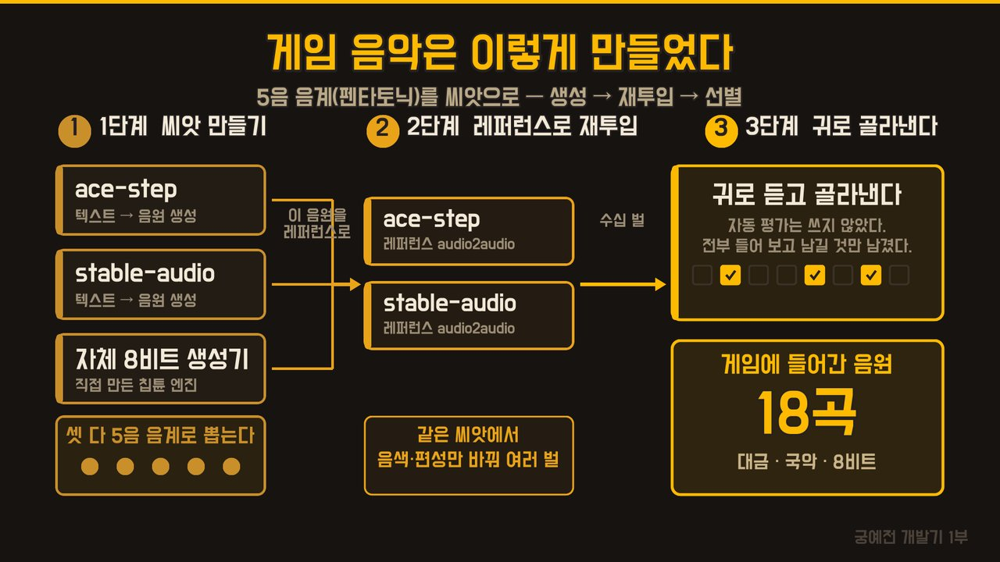
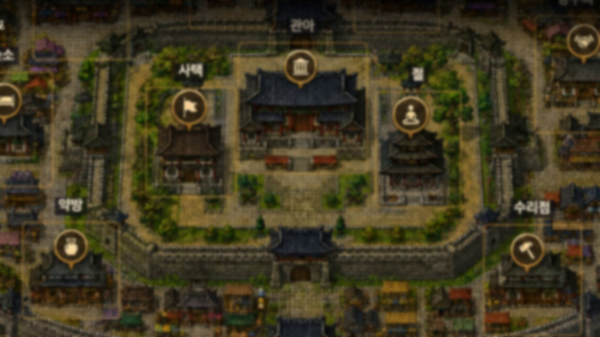
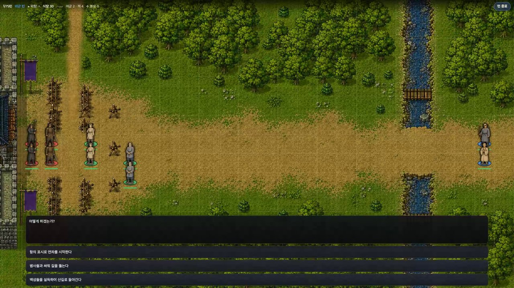
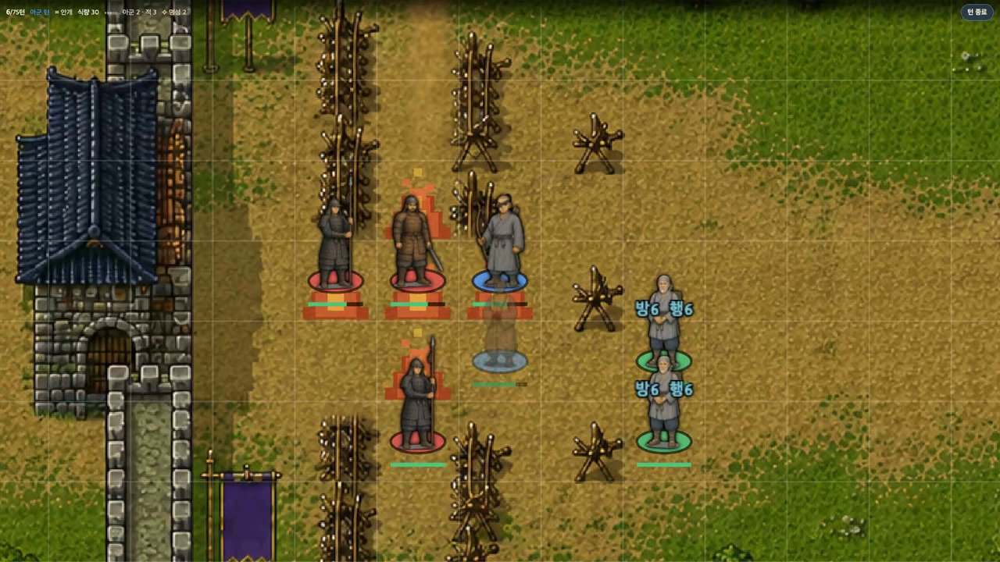

<iframe width="560" height="315" src="https://www.youtube.com/embed/yFrwR-piWXE" title="YouTube video" frameborder="0" allow="accelerometer; autoplay; clipboard-write; encrypted-media; gyroscope; picture-in-picture; web-share" allowfullscreen></iframe>

[AI RPG 11편](/ai-rpg-11)에서 예고했던 새 시리즈를 시작합니다. 지난 시리즈에서는 필드를 걷다 적을 만나면 턴제로 싸우는 정통 고전 RPG를 만들었어요. 이번엔 비슷하지만 살짝 다른 장르, **SRPG**에 도전합니다. 삼국지 공명전이나 조조전처럼 격자 위에서 유닛을 옮기고 지형을 이용해 싸우는 게임이요.

## 왜 궁예인가

소재는 후삼국의 풍운아 궁예입니다. 다들 아시는 관심법의 그분이요. 그런데 제가 다루려는 건 관심법의 시절이 아니라 그보다 앞선 청년 시절이에요.

신라 말, 천년왕국이 무너져 가던 때에 세상을 구해 보겠다고 나선 젊은 승려가 있었습니다. 법호는 선종, 훗날의 궁예예요. 나중에 폭군이 되는 사람이 이때는 백성을 구하겠다고 뛰어다닙니다. 이 시기에 있는 역사의 빈자리를 채우는 재미가 있어서 골랐어요.

## 게임보다 도구를 먼저 만들었다

SRPG는 만들 게 많습니다. 지도가 있어야 하고, 그 위에 인물을 세워야 하고, 몇 턴째에 누가 어디서 무슨 말을 하는지도 정해야 해요. 이걸 전부 키보드로 JSON 파일에 쓰면 사람이 죽습니다.

그래서 지도를 칠하고 인물을 세우고 장면을 연출하는 **종합 에디터**를 먼저 만들었어요. 지형은 그림 그리듯 칠합니다.

지우개도 있는데, 지우개가 없던 시절엔 잘못 칠한 칸을 되돌릴 방법이 없어서 산으로 덮어 버렸습니다. 산은 못 지나가니 막히긴 하거든요. 문제 해결이 아니라 증거 인멸이었죠. 이렇게 한 땀 한 땀 칠한 칸이 지금 1만 6천 개가 넘습니다.

## 역사 검수 에이전트

지도는 어떻게 해결했는데, 문제가 하나 더 있었습니다. 궁예에 대한 기록이 너무 적어요. 삼국사기에 남은 게 몇 줄 안 됩니다. 상상할 여지가 크다는 건 좋지만, 잘못하면 역사와 아예 딴 이야기가 돼요.

그래서 **역사 검수 전용 에이전트**를 따로 두었습니다. 대사를 쓸 때마다 이 에이전트에게 검사를 맡기는데, 시대에 안 맞는 말을 귀신같이 잡아내요.

- 그 시절엔 동전이 돌지 않았습니다. 그래서 이 게임의 화폐 단위는 **포**예요.
- 지명도 당시 이름을 씁니다. 원주는 북원경, 충주는 중원경이라고 불렀다고 해요.

다만 규칙을 하나 정해 뒀습니다. **사실과 다른 건 알려만 주고, 고칠지는 제가 정합니다.** 가상역사물이니까요. 모르고 틀리는 것과 알고 비트는 건 다릅니다. 검수한 내용은 전부 문서로 남겨요.



## 그림과 음악

처음엔 ChatGPT로 이미지를 뽑았는데 사용 한도에 자꾸 걸렸습니다. 한창 작업하다 막히면 흐름이 끊겨요. 그래서 과감하게 예산을 10달러 잡고 API로 붙였더니 훨씬 나아졌습니다. 물론 한 번에 잘 나오지는 않아서 퇴짜 맞은 이미지들도 있었어요.

음악은 오디오 에이전트와 따로 협업했습니다.

1. **씨앗 만들기**: ACE-Step, Stable Audio, 그리고 직접 만든 8비트 생성기로, 셋 다 동양 음악의 5음 음계로 뽑았어요.
2. **레퍼런스로 재투입**: 이렇게 나온 음원을 다시 레퍼런스로 걸어 ACE-Step과 Stable Audio에 한 번 더 넣습니다. 같은 씨앗에서 음색만 다른 곡이 여러 벌 나와요.
3. **귀로 골라내기**: 자동으로 점수 매기는 건 쓰지 않고 전부 귀로 들었습니다. 그렇게 18곡이 남았어요.

## 자유도와 분기, 그리고 버그

이 게임에서 제일 중요하게 본 건 자유도입니다. 플레이어가 고른 게 계속 쌓여서 나중에 다른 결과가 되는 것. 그래서 분기 시스템에 가장 공을 들였어요. 아직 완성 전인데도 맵 32개, 인물 83명, 이벤트 296개, 대사 2,119줄이 됐습니다.

그리고 이것 때문에 지금도 버그를 잡고 있어요. 몇 개만 소개하면 이렇습니다.

**마을에 다시 갈 때마다 화면이 흐려졌다.** 세 번 조사했는데 세 번 다 못 잡았습니다. 마을 코드만 뒤졌거든요. 진범은 전투 화면 쪽이었어요. 전투가 끝날 때마다 마을 그림의 해상도를 4분의 1로 줄여 놓고 있었고, 그걸 마을이 물려받아 선명도가 절반으로 떨어졌던 겁니다. 결국 제가 직접 찾았어요.

**병사가 백성을 안 때렸다.** 200번을 돌려도 한 번도 안 때립니다. 알고 보니 딱 코드 한 줄이 이상했고, 한 줄 고치니 200번 중 200번을 때렸어요.

**폰에서 배경음악이 안 나왔다.** 세 번을 고쳤는데 시간이 지나면 다시 안 나옵니다. 컴퓨터에서는 절대 재현이 안 되고 폰에서만 그래요.

이런 걸 적어 두는 문서가 하나 있는데, 지금 10만 자가 넘습니다. 게임 만든 기록이 아니라 반성문 대장경이에요.

## 목표는 모바일 출시

이번 시리즈의 목표는 분명합니다. **모바일 출시**예요. 영상으로만 보여 드리고 끝내지 않겠다는 뜻입니다. 그래서 처음부터 가로 화면으로 잡았고, 마우스가 아니라 손가락 기준으로 만들었어요. 터치 동작은 마우스보다 신경 쓸 게 더 많더군요. 똥겜이어도 상관없습니다. 여러분이 직접 해 볼 수 있다는 게 중요해요.

## 첫 전투: 관문 앞의 세 갈래

그렇게 첫 전투가 나왔습니다. 병사들이 관문에서 길을 막고 있어서, 유민들이 지나가지 못해요. 여기서 갈림길이 세 갈래로 나옵니다.

1. 싸워서 길을 뚫는다.
2. 백성들을 설득해서 산길로 돌아간다.
3. 항의 표시로 연좌를 시작한다.

저는 세 번째를 골랐습니다. 승려가 백성들을 앉히고, 길을 열 때까지 안 가겠다며 다 같이 염불을 외워요. 이게 실제로 효과가 있어서 백성들의 방어력이 오르고 발이 가벼워집니다. 폭력을 쓰지 않고 문제를 푸는 길이에요.

그런데 병사 하나가 귓속말로 전갈을 가져옵니다. 다 쓸어버리라는 명령이에요. 아까 버그를 고친 바로 그 장면입니다. 병사들이 백성을 때리기 시작하고, 결국 싸우게 돼요.

선종은 궁수라 앞으로 나가 멀리서 활을 쏩니다. 같이 다니는 승려 혜진은 도술을 쓰는데, 살생하지 말라고 배운 사람이 어쩔 수 없이 나서는 장면이에요. 스님의 유일한 공격 도술, 화계를 씁니다.

그런데 불이 아니라 색종이 같네요. 손으로 찍은 사각형 열몇 개가 전부입니다. 일부러 아직 안 고쳐 뒀어요.

## 다음 편

다음 편에서는 화려한 이펙트를 넣고, 지형에 따른 도술 유효타, 레벨업 시스템, 아이템 획득을 다룰 예정입니다. 아직 할 게 많지만, 그래도 어찌어찌 여기까지 왔네요. 다음 편에서 뵙겠습니다.
