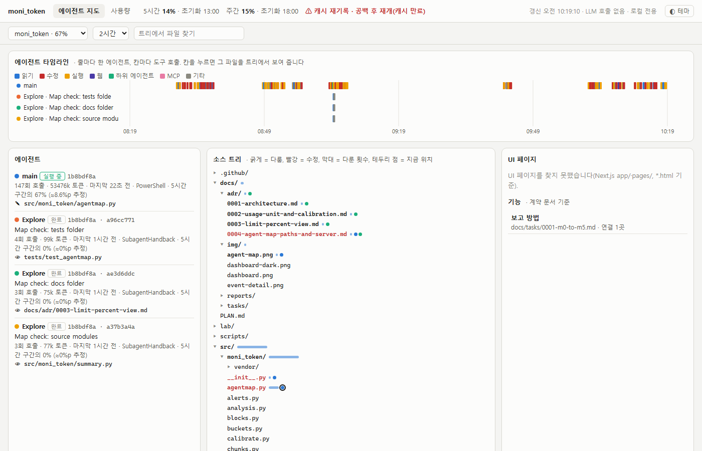
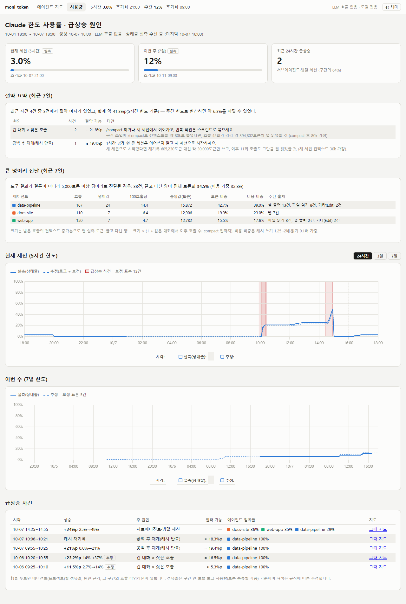
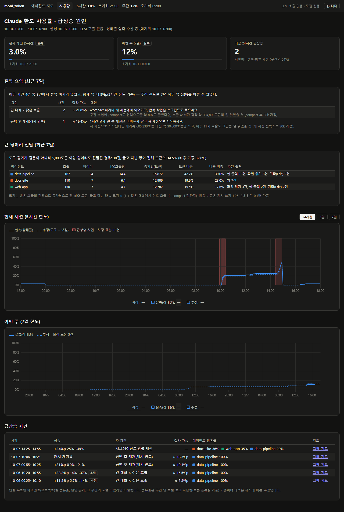

[첫 소개 글](/moni-token)에서 모니토큰(moni_token)은 "숫자가 이상할 때 여는 도구"였습니다. Claude Code의 로컬 로그만 읽어서, 한도가 갑자기 튄 구간이 **어느 세션·어떤 패턴** 때문이었는지와 **다르게 했다면 얼마나 아낄 수 있었는지**를 알려 줬죠.

그 뒤로 커밋 11개, 이슈 5개를 처리하면서 버전이 0.1에서 0.2가 됐습니다. 이제 모니토큰은 세 가지 일을 합니다.

1. **급증을 설명한다** — 원래 하던 일. 대시보드 디자인과 차트를 새로 만들었습니다.
2. **일어나는 중에 경고한다** — Claude Code 상태줄에 `⚠ +4.0%p · 원인`을 띄웁니다.
3. **에이전트가 어디서 일하는지 보여 준다** — 메인 세션과 서브에이전트의 위치를 실제 소스 트리 위에 표시합니다.

- 깃헙: [https://github.com/reddol18/moni_token](https://github.com/reddol18/moni_token)



<sub>moni_token 저장소에서 이 기능을 만들던 때의 실제 지도입니다. 빨간 파일이 수정한 파일이에요.</sub>

## 왜 지도가 필요했나

첫 버전으로 "왜 튀었는지"는 알 수 있게 됐습니다. 그런데 서브에이전트를 여러 개 돌리는 작업에서 사용량이 튀면, 그다음 궁금한 건 **누가 어디서** 일하고 있었느냐였어요. 로그에는 있는데 볼 방법이 없었습니다.

먼저 비슷한 도구를 찾아봤습니다. agents-observe, claude-hud, disler의 hooks observability, AWS CloudWatch, Claude Code OpenTelemetry까지 5종을 조사했는데, 서브에이전트 트리나 타임라인, 에이전트별 토큰을 보여 주는 도구는 있어도 **프로젝트의 실제 소스 트리 위에 위치를 찍어 주는 기능**은 없었어요.

## 에이전트 지도

`uv run moni-token map`을 실행하고 `http://127.0.0.1:4990/`을 열면 이런 것들이 보입니다.

| 영역 | 보이는 것 |
|---|---|
| 에이전트 타임라인 | 에이전트마다 한 줄, 도구 호출마다 한 칸. 읽기·수정·실행·웹·하위 에이전트·MCP로 색을 나눔. 칸을 누르면 그 파일로 이동 |
| 소스 트리 | 실제 폴더 구조. 다룬 파일은 굵게(수정은 빨강), 다룬 횟수는 막대, 지금 실행 중인 에이전트 위치는 테두리 점 |
| UI 페이지 | 실제 파일에서 찾은 화면(Next.js `app/`·`pages/`, 정적 `*.html`). 에이전트가 그 소스를 다루면 강조 |
| 기능 | 계약 문서(`docs/PLAN.md`, `SPEC.md`, `docs/tasks/*.md` 등)의 절. 그 절에 백틱으로 적힌 경로로만 파일과 연결하고, `- [x]` 항목으로 진행률 표시 |

에이전트와 프로젝트마다 **이번 5시간 구간에서 차지한 비율**도 나옵니다. 보정값으로 환산한 %p라서 추정이라고 표시해요.

### 원칙에 예외를 하나 두었다

모니토큰의 원칙 중 하나는 "대화 내용을 저장하지 않는다"입니다. 그런데 지도를 그리려면 에이전트가 어느 파일을 다뤘는지 알아야 해요. 그래서 설계 문서(ADR-0004)로 예외를 명시했습니다.

- 저장하는 건 **도구 이름과 프로젝트 기준 상대 경로**뿐입니다. 파일 내용이나 프롬프트는 저장하지 않아요.
- 서브에이전트의 작업 설명은 화면에만 보여 주고 저장하지 않습니다.
- 지도 서버는 **127.0.0.1에서만** 열립니다. 여전히 PC 밖으로는 아무것도 나가지 않아요.

- 설계 문서: [https://github.com/reddol18/moni_token/blob/main/docs/adr/0004-agent-map-paths-and-server.md](https://github.com/reddol18/moni_token/blob/main/docs/adr/0004-agent-map-paths-and-server.md)

## 사용량 화면과 지도를 한 앱으로

처음엔 정적 대시보드와 지도가 따로였습니다. 급증 사건을 보다가 그때 에이전트들이 어디 있었는지 보려면 탭을 두 개 열고 시각을 손으로 맞춰야 했어요([https://github.com/reddol18/moni_token/issues/4](https://github.com/reddol18/moni_token/issues/4)).

지금은 같은 서버의 `/usage`에서 사용량 화면을 실시간 데이터로 보여 줍니다. 두 화면 위에 같은 상단 바(5시간·주간 한도 %, 진행 중 경고)가 있고, 급증 사건마다 **"그때 지도"** 링크가 붙어서 누르면 그 사건이 끝난 시각의 지도가 열립니다. URL에 `?at=<epoch ms>`를 붙이면 과거 시점도 볼 수 있어요.



<sub>합성 데모 데이터(`scripts/demo_report.py`)로 찍은 화면입니다.</sub>

차트도 바꿨습니다. 손으로 그린 SVG를 버리고 [uPlot](https://github.com/leeoniya/uPlot)(MIT, 51KB, 저장소에 동봉)을 넣었어요. 드래그로 확대하고, 5시간 차트와 주간 차트가 커서를 공유하고, 빨간 급증 띠를 누르면 그 사건이 열립니다. OS 설정을 따라가는 다크 테마도 있어요.





## 상태줄에서 바로 경고

데스크톱 알림은 놓치기 쉬웠습니다. 그래서 급증이 진행 중이면 Claude Code 상태줄 맨 앞에 `⚠ +4.0%p · 공백 후 재개` 같은 짧은 경고를 붙였어요([https://github.com/reddol18/moni_token/issues/2](https://github.com/reddol18/moni_token/issues/2)).

상태줄을 꾸미는 도구로는 이미 [claude-hud](https://github.com/jarrodwatts/claude-hud)가 있습니다. 그 기능을 다시 만들지 않고, **claude-hud의 명령을 감싸서 그 앞에 경고만 붙이는** 쪽을 택했어요. 모니토큰이 상태줄 명령으로 남아 있어야 실측 한도 %도 계속 기록되니까요.

```json
"statusLine": {
  "type": "command",
  "command": "C:/path/to/moni_token/.venv/Scripts/moni-token-statusline.exe --wrap \"<claude-hud 명령>\""
}
```

경고 기능을 넣은 뒤에도 상태줄은 DB를 읽지 않아서, 한 번 그리는 데 약 120ms입니다(전에는 약 135ms). claude-hud를 감싸면 합계 약 0.66초인데, 그중 약 0.48초가 claude-hud 쪽이에요.

연동하면서 막힌 것도 있었습니다. claude-hud의 `/hud` 설정이 Bash 권한 문제로 실행되지 않았고, 플러그인 설치는 자동 권한 검사에 막혀 직접 설치했어요. 그래서 설치 스크립트가 하는 일(런처 복사와 설정)만 PowerShell로 재현했습니다. claude-hud는 기본값이 "주간 사용률 80% 이상일 때만 주간 표시"라서, 설정에서 0으로 바꿔야 주간 값이 항상 보였어요.

## 작업 스케줄러 등록이 명령 하나로

첫 글에서 "앞으로 할 일"로 적었던 것입니다([https://github.com/reddol18/moni_token/issues/1](https://github.com/reddol18/moni_token/issues/1)). 작업 스케줄러에 PowerShell로 직접 등록하던 절차를 없애고 명령을 만들었어요.

```powershell
uv run moni-token install-task                 # 2분마다 check, 배터리 중에도 실행
uv run moni-token install-task --no-battery    # 배터리 중에는 쉼
uv run moni-token install-task --map           # 지도 서버도 로그인할 때 자동 시작
uv run moni-token uninstall-task               # 둘 다 제거
```

기본값을 "배터리 중에도 실행"으로 둔 이유가 있습니다. 작업 스케줄러의 기본 설정은 배터리로 바뀌면 작업을 조용히 멈추는데, 그러면 노트북에서 수집도 알림도 소리 없이 끊겨요. 참고로 2분마다 도는 `check`는 한 번에 CPU 1~1.5초 정도를 씁니다.

## 쓰면서 잡힌 버그

직접 쓰면서 몇 번 데였습니다. 모두 고쳤어요.

- **트리에서 정작 다룬 파일이 안 보였다.** 다른 프로젝트의 `output/` 폴더 하나에 파일이 3,277개 있어서, 트리 전체 한도 4,000개가 차 버리고 `src/`가 잘렸어요. 폴더마다 200개 한도로 바꾸고, 다룬 파일은 항상 보이게 했습니다.
- **끝난 서브에이전트가 2분 동안 "실행 중"으로 보였다.** 실시간 보기에서는 로그의 종료 표시를 먼저 보도록 고쳤어요. 처음 열면 엉뚱한 프로젝트가 선택되던 것도, 서브에이전트가 돌고 있는 프로젝트를 기본으로 고르게 했습니다.
- **"마지막 호출 -368,386초 전".** 과거 시점 보기에서 기준 시각 이후의 호출이 섞여 들어왔어요. 상한을 두고 회귀 테스트를 넣었습니다.
- **제 실수로 급증 사건 목록이 한동안 비어 있었다.** DB 구조를 바꾸면서 사건 표가 비워졌어요. 과거 사건 300건을 다시 계산했고, 앞으로는 표가 비어 있으면 `check`가 알림 없이 스스로 복구합니다. 재계산이 1970년부터 5분 단위로 훑고 있던 비효율도 이때 찾아서, 해당 테스트가 52초에서 9.7초로 줄었어요.
- **내려받아 둔 다른 저장소의 html이 UI 페이지로 잡혔다.** 프로젝트 안에 있는 별도 git 저장소는 트리에서 빼도록 했습니다.

테스트는 69개에서 92개가 됐습니다.

## 앞으로 할 일

열려 있는 이슈가 두 개 있습니다.

**1. 파일마다 토큰 비용 표시** ([https://github.com/reddol18/moni_token/issues/6](https://github.com/reddol18/moni_token/issues/6))
지도의 파일마다, 그 파일이 컨텍스트에 더한 실측 토큰과 이후 다시 읽힌 양(횟수 × 크기)을 보여 주려고 합니다. 큰 파일을 한 번 읽으면 그 뒤 호출마다 다시 읽혀서 한도를 태우는 경우가 자주 보이는 원인이라서요.

**2. 과거 기록으로 진행률 예측** ([https://github.com/reddol18/moni_token/issues/7](https://github.com/reddol18/moni_token/issues/7))
같은 종류의 서브에이전트가 과거에 호출을 몇 번, 시간을 얼마나 썼는지(P50/P85), 체크리스트가 얼마나 빨리 완료됐는지, 남은 사용량이 5시간 한도 안에 들어오는지를 보여 주려고 합니다. 여기서도 LLM은 쓰지 않고 경험적 분위수만 쓰며, 표본이 부족하면 "기록 부족"이라고 표시할 생각이에요. 아직 착수 전이고, 구현 전에 설계 문서부터 쓸 예정입니다.

## 남은 한계

- 과거 시점의 지도에서도 트리는 **지금** 파일 기준입니다.
- "에이전트가 페이지 소스를 다룰 때 페이지 강조"는 아직 합성 테스트로만 확인했고, 실제 데이터로는 보지 못했어요.
- 에이전트 색은 7개라서 8번째부터는 같은 회색입니다.
- `install-task`는 Windows 전용이고, macOS·Linux 알림 경로는 검증하지 않았습니다.
- 기존 한계는 그대로입니다. 로그는 이 PC 것만이라 웹이나 다른 PC 사용은 빠지고, 출력 토큰이 적게 잡힐 수 있으며([https://github.com/anthropics/claude-code/issues/22671](https://github.com/anthropics/claude-code/issues/22671)), 원인 판정은 규칙 기반 추정이에요.

## 정리

- 첫 버전이 "왜 튀었나"를 답했다면, 0.2는 "**지금** 튀고 있다"와 "**누가 어디서**"를 더했습니다.
- 있는 도구는 가져다 썼습니다. 상태줄은 claude-hud를 감쌌고, 차트는 uPlot을 넣었어요.
- 원칙을 바꿀 때는 예외를 설계 문서에 적어 두었습니다. 경로는 저장하되 내용은 저장하지 않고, 서버는 로컬에서만 엽니다.

- 깃헙: [https://github.com/reddol18/moni_token](https://github.com/reddol18/moni_token) (MIT)
