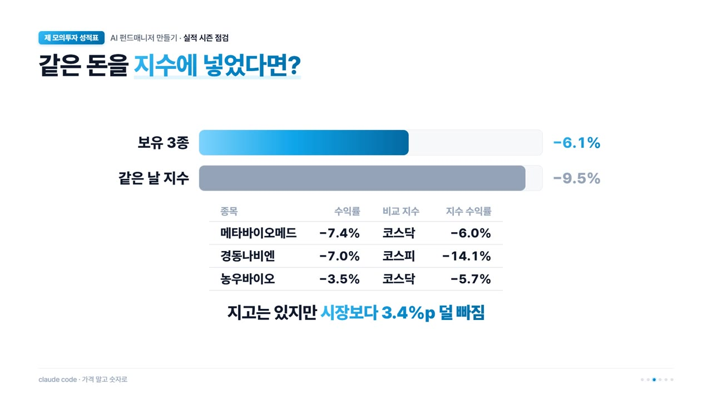
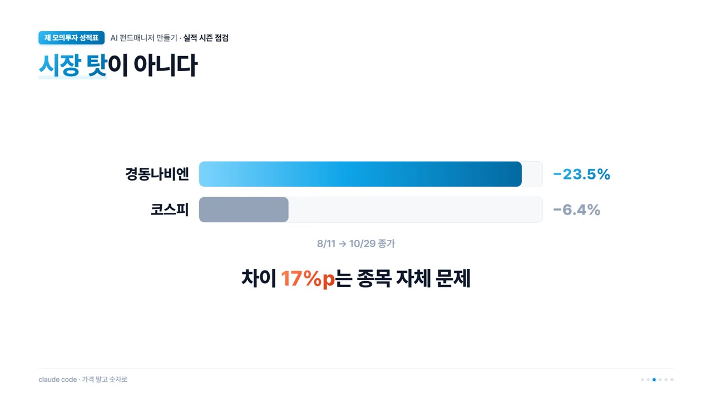
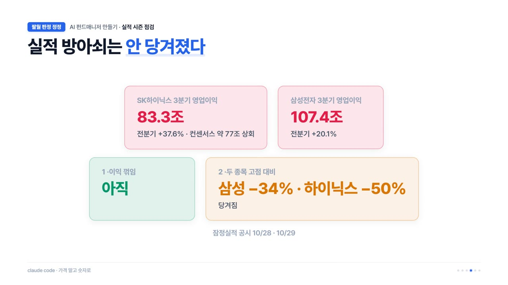
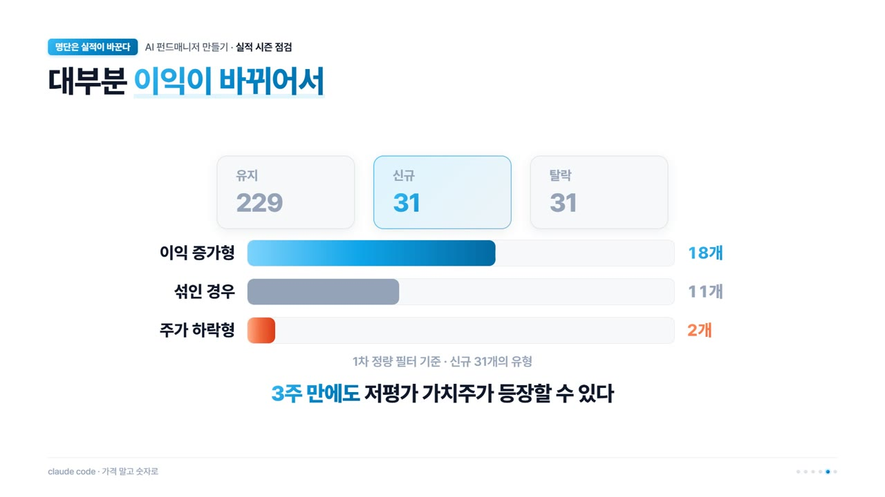

<iframe width="560" height="315" src="https://www.youtube.com/embed/G3S6SBppbBY" title="YouTube video" frameborder="0" allow="accelerometer; autoplay; clipboard-write; encrypted-media; gyroscope; picture-in-picture; web-share" allowfullscreen></iframe>

> 이 영상은 2026년 10월 30일에 올린 것입니다. 글 속의 "지금"과 숫자도 그때 기준이에요.

11월 셋째 주를 달력에 동그라미 쳐 뒀습니다. 그 주에 숫자가 바뀌는 종목들이 생길 수 있거든요. 이번 편에서는 왜 하필 그 주인지, 지금까지의 모의투자 성적표, 그리고 제가 틀린 것까지 정리했습니다.

## 실적이 반만 나온 지금은 PER이 섞여 있다

3분기 보고서 마감은 11월 14일입니다. 그래서 지금은 실적이 나온 회사와 안 나온 회사가 섞여 있어요.

PER은 주가를 지난 1년 이익으로 나눈 값입니다. 이익이 갱신된 회사와 아닌 회사는 PER을 계산하는 시점이 서로 달라요. 여기에 일회성 이익이 섞이면 PER이 싸 보이고, 작년이 바닥이었던 회사는 평범하게 벌어도 "몇 배 증가"라는 제목이 붙습니다.

그래서 실적이 다 나온 다음 한꺼번에 다시 보기로 했습니다. 그게 11월 16일 주예요.

## 모의투자 성적표 — 지고는 있지만 시장보다 덜 빠졌다

8월부터 관찰 종목을 실제 돈 없이 규칙대로만 사고팔고 있습니다. 지금 들고 있는 세 종목은 전부 마이너스이고, 합치면 -6.1%입니다. 같은 날 같은 돈을 지수에 넣었다면 -9.5%였어요.

판 종목까지 넣으면 +0.3%입니다. 솔직히 말하면 [10편](/ai-fund-manager-10)에서 목표가에 팔린 동국제약 하나 덕분이에요.

## 경동나비엔, 틀린 것 두 가지

경동나비엔은 솔직하게 말씀드릴게요. 제가 히트펌프 영상을 올린 바로 그날이 이 주식의 고점이었습니다. 그 뒤로 23.5% 빠졌는데, 같은 기간 코스피는 6.4% 빠졌어요. 시장 탓이 아니라는 거죠.

다행히 모의투자는 고점에 사지 않았습니다. 이미 너무 올라서 기다렸다가, 내려온 뒤에 첫 회차를 샀어요.

돌아보면 틀린 게 두 가지였습니다.

- **관심이 가장 뜨거울 때 골랐다.** 영상을 올린 날이 고점이었다는 게 그 증거예요.
- **이익을 끌어올린 걸 잘못 짚었다.** 히트펌프 이야기를 했지만, 실제로 이익을 끌어올린 건 북미 보일러 가격 인상이었습니다.

게다가 2분기 실적에는 관세 환급이라는 일회성 돈이 섞여 있었어요. 지금 PER 5.35배도 그걸 빼면 7배 안팎입니다.

정리하면 의문부호는 있었지만 가치평가 원칙대로 샀고, 시장보다 더 빠진 종목을 시장보다 덜 떨어진 채로 들고 있습니다. 규칙상 회차 가격은 올리지 않아요. 세 종목 모두 만료일을 실적이 다 나오는 그 주로 잡아 뒀고, 그때 다시 봅니다.

## 지난번 V자 판정은 왜 빗나갔나

지금이 투자할 때인지 고민하시는 분이 많을 거예요. 이미 다룬 내용이지만, 지금이 L자형 하락장인지부터 다시 점검했습니다.

지난번에는 "조건부 V자"라고 했는데, 조건이 맞지 않았습니다. 코스피는 그 뒤로 한때 13% 더 빠졌어요. 빚투가 위험하다는 건 그때도 알았지만, 반등이 한 번 나온 걸 보고 실적 쪽에 무게를 뒀습니다.

그리고 빠뜨린 게 있었어요. 5월 말에 나온 삼성전자·SK하이닉스 2배 레버리지 ETF입니다. 3주 만에 개인 돈 8조 원이 몰렸고, 고점은 그 직후였어요. 이런 상품은 주가가 빠지면 더 팔아야 합니다. 빚투의 반대매매까지 겹치면 하락이 더 깊어지죠.

지금은 사정이 좀 달라졌습니다.

- 그 ETF 거래는 6월보다 96% 줄었어요. 대부분 빠져나간 겁니다.
- 빚투 잔고는 33조 8천억 원에서 29조 원대로 줄었어요. 그래도 남아 있는 29조 원이 찜찜한 부분입니다.

그러니 지금의 출렁임은 레버리지 상품보다 쏠림 때문이에요. 시가총액의 45%를 차지하는 두 종목이 하루에 9%씩 움직였거든요.

## 실적 방아쇠는 안 당겨졌다

첫 점검 때 V가 L로 바뀌는 방아쇠로 두 가지를 꼽았었습니다. 반도체 이익이 꺾이는 것, 그리고 두 종목이 무너지는지 여부예요.

얼마 전 3분기 잠정실적이 나왔습니다. 영업이익이 SK하이닉스는 83.3조, 삼성전자는 107.4조로, 둘 다 직전 분기보다 늘었어요. 이익이 꺾이는 방아쇠는 아직 안 당겨진 겁니다. 두 번째 방아쇠는 달랐어요. 두 종목 주가가 고점 대비 삼성전자 -34%, SK하이닉스 -50%까지 빠져서 이쪽은 당겨진 걸로 봤습니다.

그런데 주가는요. 10월 28일 대규모 주주환원 발표에 코스피가 하루 만에 52주선(250일 이동평균) 위로 올라섰다가(6,012), 다음 날 다시 아래로 내려왔습니다(5,938). 이걸 보고 V자다 L자다 하는 건 8월에 반등 하나 보고 판정했던 것과 똑같은 실수예요.

그래서 이제 모양은 예측하지 않습니다. **레버리지는 얼마나 깊게 빠질지를 정하고, 실적은 회복할지를 정한다**고 보고, 이익만 봅니다.

## 이런 장에서도 저평가 종목은 새로 나온다

이렇게 혹독한 상황에서 새로운 저평가 종목이 나타날까요? 8월에 같은 필터를 26일 간격으로 두 번 돌린 적이 있습니다. 그 사이 31개가 새로 걸렸는데, 18개는 이익이 늘어서였고, 주가만 빠져서 들어온 건 2개뿐이었어요.

다만 이익이 세 배 넘게 뛰어서 PER이 0.5배가 된 종목도 있었습니다. 이런 건 일회성인지 꼭 확인해야 해요.

그럼 이런 도박판 같은 장에서 저평가 종목을 찾는 게 의미가 있을까요. 저는 있다고 봅니다. 돈과 빚이 두 종목에 몰린 사이 나머지 종목은 방치돼 있거든요. 제가 그 두 종목을 빼고 고르는 이유이기도 합니다.

대신 조건을 걸었습니다.

1. 실적이 나온 뒤에 첫 회차만 들어간다.
2. 빚이 몰린 종목은 피한다.
3. 총액은 늘리지 않는다.

그리고 이건 모의투자 이야기예요. 실제 돈은 하락장 성적이 더 쌓인 뒤에 따로 판단하려고 합니다.

## 11월 16일 주에 할 일

11월 16일은 시장이 바닥을 찍는 날이 아닙니다. 그건 아무도 몰라요. 그저 숫자가 다 나오는 날일 뿐입니다. 그때 전 종목을 다시 걸러 보고, 지난번 15종목 중 몇 개가 남는지도 확인할 거예요. 도박판 같은 장에서 제가 믿을 수 있는 건 그 숫자뿐이니까요.

> 이 글과 영상은 모의투자 기록이며 투자 권유가 아닙니다.
