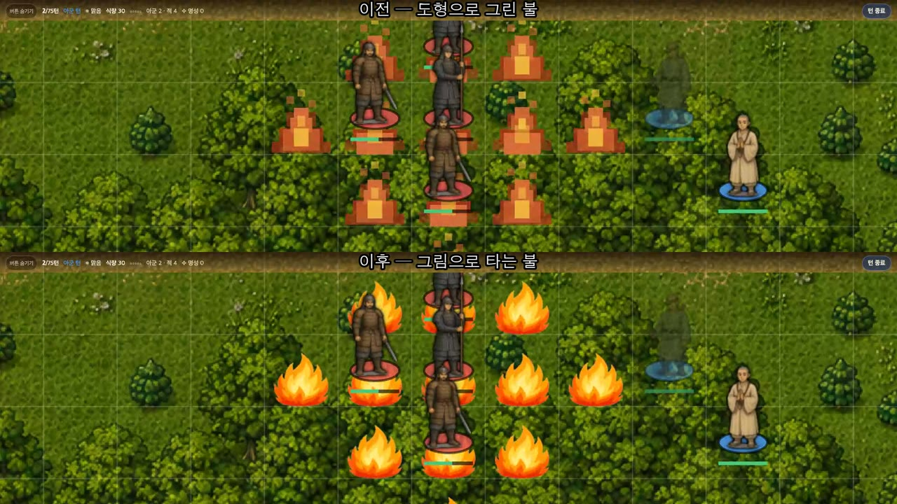
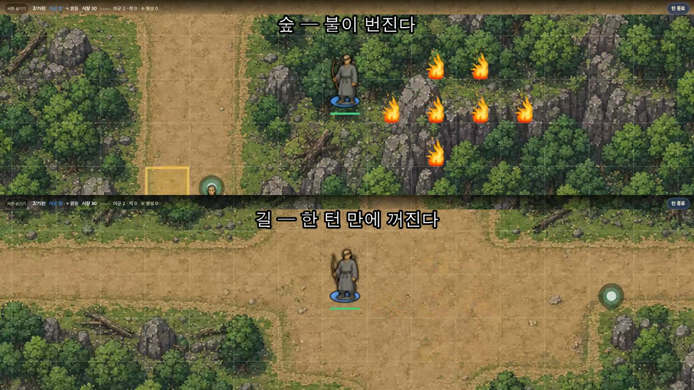
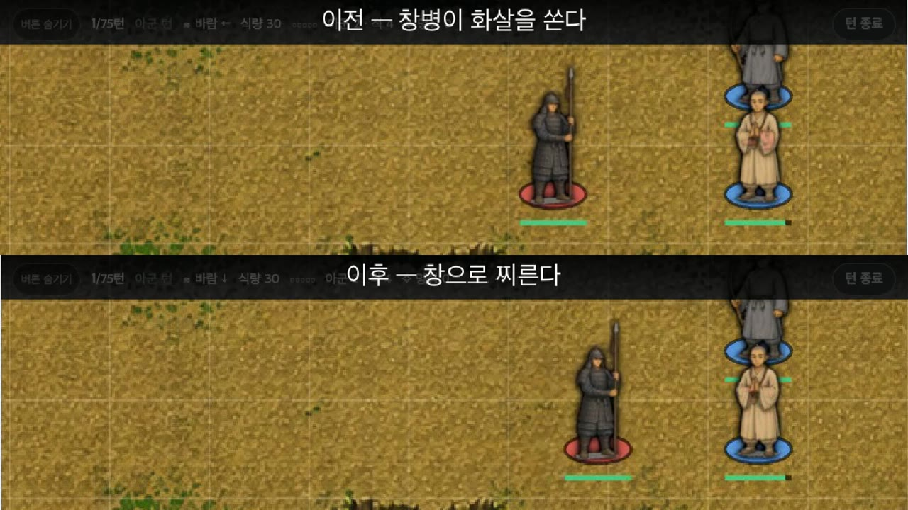
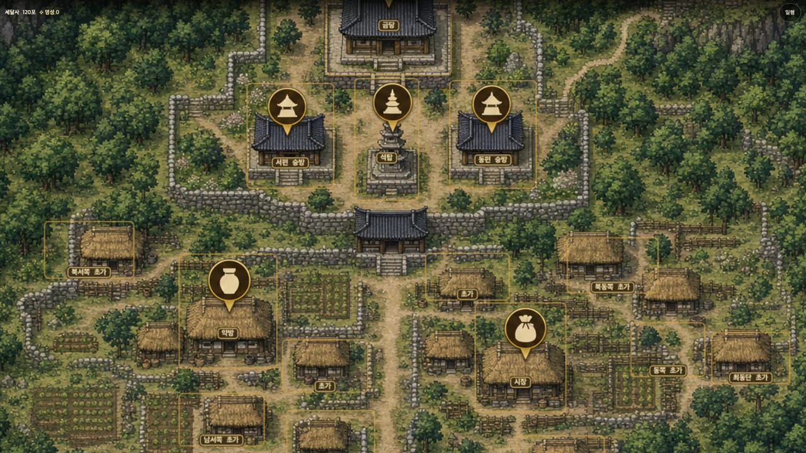

<iframe width="560" height="315" src="https://www.youtube.com/embed/fyu3tDELLaU" title="YouTube video" frameborder="0" allow="accelerometer; autoplay; clipboard-write; encrypted-media; gyroscope; picture-in-picture; web-share" allowfullscreen></iframe>

[1편](/ai-srpg-01)에서 보여 드린 화계, 기억하시나요? 색종이를 오려 붙인 것 같던 그 불이요. 이번 편은 그 불을 바꾼 이야기부터 시작합니다.

## 색종이 불이 진짜 불로

화계를 그림으로 그린 불로 바꿨습니다. 위가 이전, 아래가 지금이에요.

원래 수계도 있었습니다. 물 근처에서만 쓸 수 있는 주문인데, 이것도 처음엔 파란 색종이 같아서 함께 바꿨어요. 그리고 이제 소리도 납니다.

이 주문들은 지형에 따라 결과가 달라집니다. 숲에서는 불이 번지고, 길에서는 한 턴 만에 꺼져요.

그 밖에도 몇 가지를 더 넣었습니다.

- **경험치:** 싸우면 레벨이 오릅니다.
- **줍기:** 전투맵을 돌아다니다 보면 물건을 주울 수 있어요.
- **타격감:** 전에는 맞아도 아무 반응이 없었는데, 이제 흰빛과 함께 움찔합니다.

## 창병이 화살을 쏘고 있었다

버그도 하나 잡았습니다. 창병이 허공에 화살을 쏘고 있었어요. 창병의 사거리 2를 화살이 날아가는 거리로 잘못 읽은 겁니다.

그래서 사거리 숫자가 아니라 병종을 보고 나누도록 고쳤습니다. 활을 든 사람은 여전히 쏩니다.

## 그림 석 장 값, 그리고 자동충전

새 효과에 들어간 그림들은 비용이 얼마였을까요. 1편에서 예산을 10달러로 잡았다고 했었죠.

그림 석 장에 0.486달러, 우리 돈 670원이었습니다. 그런데 이걸 쓰는 순간 API 잔액이 5달러 아래로 떨어졌고, 꺼 두지 않은 자동충전이 돌아갔어요. 670원만 쓰면 될 일이었는데, 쓸 생각이 없던 돈까지 나갔습니다.

## 쓰러진 동료가 다음 전투에 멀쩡히 나타났다

버그는 잡아도 잡아도 또 나옵니다. 이번엔 전투에서 쓰러진 동료가 다음 전투에 멀쩡하게 나타났어요. 당연히 있어야 할 처리를 아예 만들지 않았던 겁니다.

그래서 AI에게 시말서를 쓰게 하고 고치라고 시킨 뒤 집을 나섰습니다. 클로드 원격 기능이 새로 나와서, 휴대폰만 있으면 밖에서도 진행 상황을 볼 수 있거든요.

## 드라마 태조왕건과 다른 궁예

궁예 하면 드라마 태조왕건의 이미지가 강합니다. 저도 재미있게 봤어요. 그런데 이 게임은 드라마와 다르게 잡은 설정이 몇 가지 있습니다.

**스스로 미륵이라 칭했다는 것은 그대로 뒀습니다.** 이건 삼국사기에 실제로 적혀 있어요. 드라마가 지어낸 게 아닙니다.

**그때 같이 나오는 주문은 뺐습니다.** 그 주문은 미륵이 아니라 관세음보살 진언이고, 고려에 들어온 것도 11세기예요. 그래서 게임 대사에는 그 말이 한 번도 나오지 않습니다. 검색해 보면 0건이에요.

**세달사는 영월에 두었습니다.** 드라마에서는 궁예가 송악까지 가서 세달사를 찾는데, 발굴 결과는 영월을 가리킵니다. 단종이 유배된 그 영월이요.

## 게임은 사벌주의 난에서 시작한다

궁예가 처음 활약하던 시절도 살펴봤습니다. 889년, 사벌주에서 원종과 애노가 일어섭니다. 조세가 걷히지 않자 조정이 사람을 보내 독촉했고, 그러자 도적이 벌떼처럼 일어났다고 사서는 적었어요. 역사학자들은 땅이 몇몇에게 몰리면서 살 곳을 잃은 사람들이 떠돌았다고 봅니다.

그렇다면 그 난 때문에 길이 막혔을 수도 있겠다는 상상이 가능하죠. 그래서 게임은 이렇게 시작합니다. 주지 스님의 심부름으로 다른 종파의 큰 절에 서찰을 전하고 돌아오는 길, 사벌주에 난이 일어나 관문이 막혔습니다. 돌아갈 세달사는 북쪽 영월이고, 아직 갈 길이 멉니다.

다만 모든 걸 고증대로 하지는 못했습니다. 게임 속 기와지붕은 사실 조선시대 양식이에요. AI가 시대에 맞게까지 그려 주지는 못했습니다. "신라시대"라는 키워드를 넣어 다시 돌려 볼 수는 있지만, 그러려면 그림 값이 또 듭니다.

## 다음 편

다음 편에서는 실제 시나리오 분기 하나를 잡아서 게임을 플레이해 보겠습니다.
