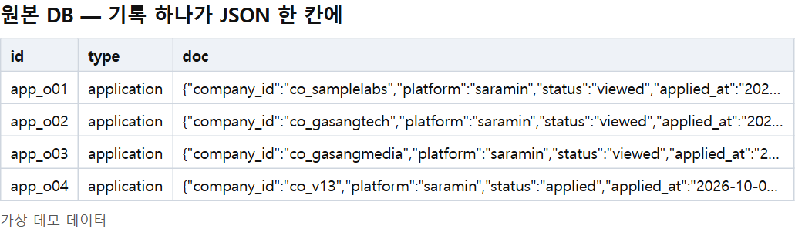
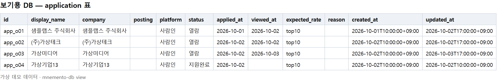
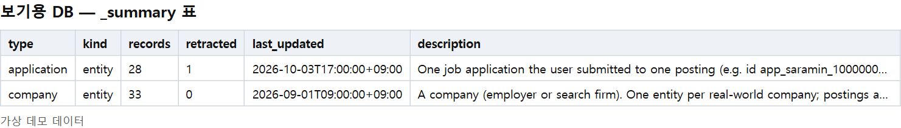

[Mnemento(네멘토)](/mnemento)는 여러 LLM 에이전트가 사실을 한 장부에 기록하고, 자연어로 물으면 근거와 함께 답하게 해 주는 MCP 서버입니다. 이번에 장부 내용을 **LLM 없이** 사람이 직접 볼 수 있는 명령 `mnemento-db`를 추가했습니다.

## 왜 만들었나

장부를 쓰다 보니 불편한 점이 세 가지 있었습니다.

1. **들어 있는 걸 확인하는 데도 토큰이 든다.** 에이전트에게 물으면 답은 오지만, 장부에 실제로 뭐가 들어 있는지 그냥 눈으로 확인하고 싶을 때도 LLM을 거쳐야 했습니다.
2. **원본을 열어도 읽기 어렵다.** 원본 DB는 기록 하나를 JSON 한 칸에 넣고, 값은 `saramin`, `viewed` 같은 코드로, 다른 기록은 `co_004` 같은 id로 가리킵니다. SQLite 뷰어로 열어도 정보로서 가치가 떨어졌습니다.
3. **DB 파일이 여기저기 흩어져 있다.** MCP 설정마다 다른 DB를 쓰고, 백업과 벤치마크용 DB도 있어서 매번 찾아 들어가기가 번거로웠습니다.

아래가 원본 DB를 그대로 연 모습입니다(저장소의 가상 데모 데이터).

## 명령 세 개

| 명령 | 하는 일 |
|---|---|
| `mnemento-db list` | 이 PC의 Mnemento DB를 찾아 목록으로 보여 줍니다. 보기용 DB를 만든 뒤 원본이 바뀌었으면 `(stale)`을 붙입니다. |
| `mnemento-db view <이름·번호·경로>` | 사람이 읽는 보기용 DB를 만들어 뷰어로 엽니다. |
| `mnemento-db open <이름·번호·경로>` | 원본 DB를 뷰어로 엽니다. |

`list`는 Claude Code·Claude Desktop의 MCP 설정과 환경 변수에 적힌 `MNEMENTO_DB`, 그리고 `~/.mnemento/*.db`를 찾아봅니다. 백업이나 벤치마크 DB처럼 다른 폴더에 있는 것은 `--scan DIR`로 찾게 할 수 있는데, 이때는 entities·events·schemas 표가 있는 파일만 Mnemento DB로 인정합니다.

뷰어는 VS Code의 `code` 명령이 있으면 그것으로 열고(SQLite 뷰어 확장과 함께 쓰는 것을 전제로 했습니다), 없으면 OS 기본 앱으로 엽니다. `--no-open`을 주면 만들기만 하고, `--out FILE`로 저장 위치를 바꿀 수 있습니다.

## 보기용 DB는 이렇게 만든다

`view`를 실행하면 같은 데이터가 이렇게 바뀝니다.

핵심은 **질의할 때 LLM에게 보여 주던 스키마 사전을 코드가 그대로 적용한다**는 점입니다. 필드 순서, 값의 라벨, 참조 관계, 설명이 이미 사전에 있으니, 그걸로 표를 펼치면 LLM이 필요 없습니다.

- 기록 종류마다 평평한 표를 하나씩 만들고, 필드가 컬럼이 됩니다.
- 코드는 첫 번째 라벨로 바꿉니다. `saramin`은 사람인, `viewed`는 열람이 됩니다.
- 참조는 대상의 이름으로 보여 줍니다. `company_id` 컬럼은 `_id`를 뗀 `company` 컬럼이 되고, 회사명이 들어갑니다.
- `display_name`에는 기록의 이름이 들어가고, 이름이 없는 기록(지원 건)은 회사명이 들어갑니다.
- 정정된 기록은 정정이 반영된 상태로 보이고, 무효화된 기록은 표에서 빼되 건수는 남깁니다.
- 아직 사전에 정식으로 등록되지 않은 필드(draft)는 뒤쪽 컬럼에 붙입니다. 시계열은 측정점 하나가 한 줄입니다.

보조 표도 네 개 만듭니다. `_summary`(종류별 건수), `_fields`(필드 설명과 라벨, 정식 필드인지 draft인지), `_history`(모든 변경 이력, 라벨 적용), `_meta`(원본 경로와 만든 시각)입니다.

데모 데이터에서는 중복으로 무효화된 지원 건 1건이 `application` 표에서 빠지고, `_summary`의 `retracted` 칸에 1로만 남았습니다.

부수 효과도 있었습니다. 사전에 라벨이 없는 값은 코드 그대로 보이기 때문에, 사전을 정리해야 할 곳이 눈에 바로 띕니다.

## 원본은 건드리지 않는다

원본 DB 안에 SQL 뷰를 만드는 방법도 있었지만 택하지 않았습니다. Mnemento는 장부에 쓰는 주체를 Keeper 하나로 제한한다는 원칙이 있어서, 보기용 기능이 원본에 무언가를 쓰게 하고 싶지 않았습니다.

- 원본은 SQLite 읽기 전용 모드(`mode=ro`)로 엽니다. 실행 전후 원본 파일의 해시가 같다는 것을 테스트로 확인합니다.
- 보기용 DB는 별도 파일(`<DB 폴더>/views/<이름>-view.db`)이고, `view`를 실행할 때마다 새로 만드는 스냅숏입니다.
- MCP 세션은 보기용 DB를 읽지 않으므로, 에이전트의 기존 조회 동작은 그대로입니다.

기록 약 800건과 시계열 약 5,800점 규모에서 보기용 DB를 만드는 데 1초가 걸리지 않았습니다.

## 개발하면서 한 실수

첫 커밋은 CI의 6개 환경(Windows·Ubuntu × Python 3.11~3.13)에서 전부 실패했습니다. 찾아 둔 DB가 하나도 없으면 경로를 직접 줘도 멈추는 버그였어요. 개발 PC에는 DB가 이미 있어서 로컬 테스트로는 드러나지 않았습니다. 테스트가 빈 홈 폴더에서 돌도록 바꾸고 버그를 고친 뒤 6개 환경 모두 통과했습니다. 이번 기능에는 테스트 8개를 새로 추가했습니다.

## 링크

- 저장소: [https://github.com/reddol18/mnemento](https://github.com/reddol18/mnemento)
- 설계 기록(ADR-0031): [readable-view-export](https://github.com/reddol18/mnemento/blob/main/docs/adr/0031-readable-view-export.md)
- 커밋: [기능 추가 36aac12](https://github.com/reddol18/mnemento/commit/36aac12) · [경로 버그 수정 3779461](https://github.com/reddol18/mnemento/commit/3779461) · [README 정리 0c1a87b](https://github.com/reddol18/mnemento/commit/0c1a87b)

앞으로의 계획은 아직 정해진 것이 없습니다. 설계 기록에는 HTML 보고서가 필요해지면 이 보기용 DB 위에 얹을 수 있다는 정도만 대안으로 적어 두었습니다.
