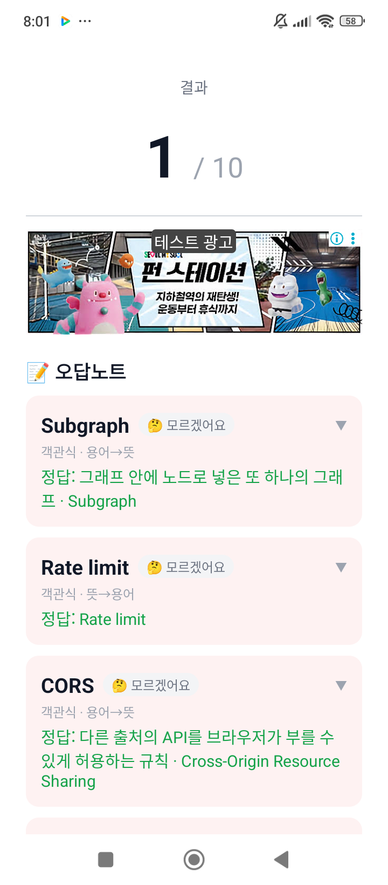
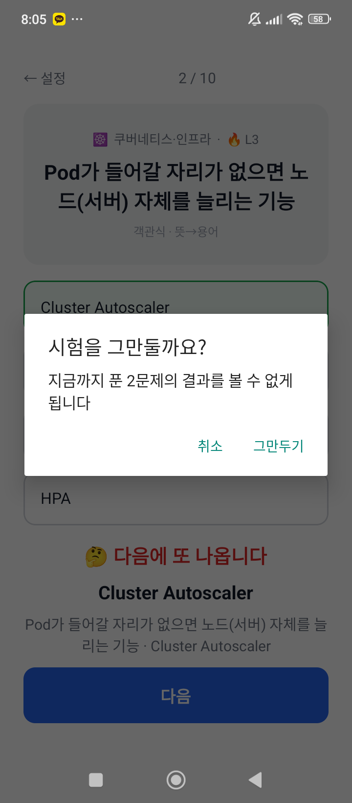
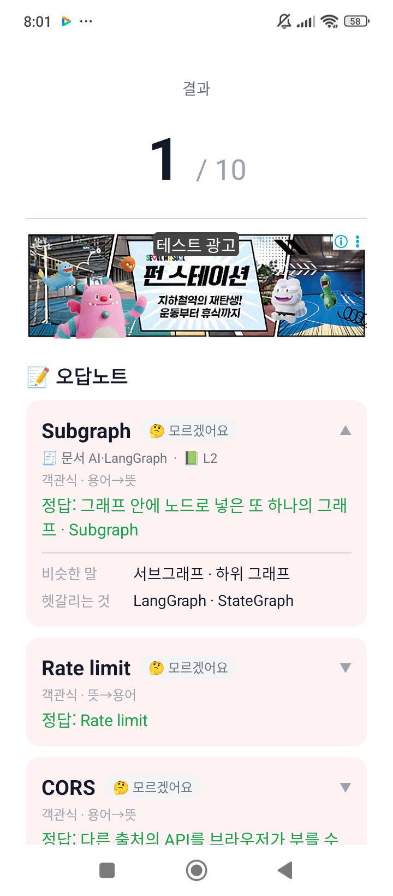
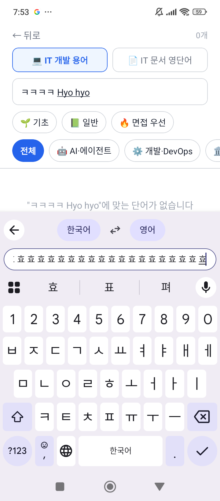

[지난 글](/yongeo-hama)에서 폰 안에서 AI가 채점하는 IT 용어 암기 앱 **용어먹는하마**를 소개했습니다. 이번 글은 그 앱에 광고를 달고 플레이스토어에 올릴 준비를 하면서 AI(Claude Code)를 어떻게 썼는지에 대한 기록입니다.

> 11월 17일 추가: 앱이 [플레이스토어](https://play.google.com/store/apps/details?id=io.github.reddol18.wordbook&referrer=utm_source%3Dtechblog%26utm_medium%3Dpost%26utm_campaign%3Dyongeo-hama-02)에 공개됐습니다. 출시까지의 과정은 [글 끝](#launch)에 이어 붙였습니다.

출시 준비는 기능 개발과 성격이 다릅니다. 서명 키, 정책 문서, 스토어 심사, 광고 SDK처럼 한 번도 안 해 본 일이 섞여 있고, 그중 몇 가지는 틀리면 되돌릴 수 없습니다. 그래서 이번에는 AI에게 "만들어 줘"보다 **"이게 맞는지 근거를 찾아 줘"**를 더 많이 시켰습니다.

## 1. AdMob 배너 — 위치를 정책 문서로 검증하다

배너는 시험이 끝난 뒤 나오는 결과 화면에 하나만 넣기로 했습니다. 처음 생각한 자리는 화면 맨 아래였는데, 거기에는 버튼이 둘 있었습니다.

구글 AdMob 고객센터의 [바람직하지 않은 배너 구현 사례](https://support.google.com/admob/answer/6275345?hl=ko)를 확인해 보니, 금지 사례 세 가지 중 첫 번째가 **"양방향 요소 바로 옆에 게재"**였고, 그 예로 "다음" 버튼 같은 **탐색 버튼 근처**가 명시돼 있었습니다. 실수로 누르게 만드는 배치라서요. 그래서 배너를 점수와 오답노트 사이로 옮겼습니다.



광고를 버튼 옆이 아니라 점수 아래, 오답노트 위에 두었습니다. 배너의 좌우 폭도 아래 카드와 맞췄습니다.

배너 크기도 처음 고른 게 틀렸습니다.

- **처음 고른 것:** `LARGE_ANCHORED_ADAPTIVE_BANNER`. 이건 화면 위나 아래에 **고정**하는 광고용입니다.
- **실제 자리:** 결과 화면은 `ScrollView`라 배너가 내용과 함께 스크롤됩니다. 구글은 이런 자리에 `INLINE_ADAPTIVE_BANNER`를 쓰라고 안내합니다. 그래서 바꿨습니다.
- **함정:** 인라인 배너는 `maxHeight`를 주지 않으면 기본값이 **기기 화면 높이**입니다. 그대로 두면 광고 하나가 결과 화면 전체를 덮을 수 있었습니다.

이런 세부 사항은 인터넷 예제가 아니라 **설치된 패키지의 타입 정의 파일**에서 확인했습니다. 예제 상당수가 쓰는 `ANCHORED_ADAPTIVE_BANNER`는 타입 정의에 2026년 2월 구글 발표를 근거로 `@deprecated` 표시가 붙어 있었고, 위의 `maxHeight` 기본값도 타입 정의 주석에 적혀 있던 내용입니다.

처음에는 테스트 광고 ID로 붙여 확인하고, 실제 광고 ID는 `.env`로 빼서 저장소에 올라가지 않게 했습니다.

## 2. 릴리스 서명 — 출시를 막던 진짜 문제

광고보다 더 큰 문제는 서명이었습니다.

**릴리스 APK가 디버그 키로 서명되고 있었습니다.** Expo가 만드는 기본 설정이 그렇고, 설정 파일 주석에 경고도 적혀 있었는데 아무도 보지 않았습니다. 플레이스토어는 같은 키로 서명된 패키지만 같은 앱의 업데이트로 받기 때문에, 키 문제는 출시 뒤에 바로잡을 방법이 없습니다.

**올릴 파일도 없었습니다.** 플레이스토어는 신규 앱에 APK가 아니라 **AAB(Android App Bundle)**를 요구합니다. 그런데 빌드 스크립트는 APK를 만드는 `assembleRelease`만 부르고 있었습니다. 빌드는 성공하는데 출시는 안 되는 상태였죠.

고치는 데도 함정이 있었습니다. 이 프로젝트는 `expo prebuild`를 할 때마다 `android/` 폴더를 새로 만듭니다. 그래서 `build.gradle`을 직접 고치면 다음 prebuild에서 사라집니다. 서명 설정은 **커스텀 config plugin**으로 넣었고, `--clean` prebuild를 두 번 돌려서 설정이 살아남는지 확인했습니다. AAB를 만드는 `bundleRelease`도 빌드 스크립트에 추가했습니다.

### 비밀번호가 맞는데 틀렸다는 에러

첫 AAB 빌드는 마지막 단계에서 이렇게 죽었습니다.

```
> Task :app:signReleaseBundle FAILED
  keystore password was incorrect
```

비밀번호는 맞았습니다. 원인은 비밀번호가 아니라 **파일 포맷**이었습니다. 비밀번호를 담는 `gradle.properties`는 자바 `.properties` 포맷인데, 여기서는 `#`이 주석의 시작입니다. 비밀번호에 `#`이 들어 있으면 그 뒤가 잘려서 저장됩니다.

에러 메시지는 "비밀번호가 틀렸다"고만 말하고, 빌드가 2분을 다 쓴 뒤 맨 마지막에 죽어서 확인도 느렸습니다. 지금은 plugin이 값을 쓸 때 영숫자가 아닌 글자를 유니코드 이스케이프(`\uXXXX`)로 바꿔서, 비밀번호에 무엇이 들어가도 그대로 전달되게 했습니다.

### 서명을 바로잡자 이번엔 검증이 막혔다

서명 문제는 실기기 검증 단계에서 한 번 더 발목을 잡았습니다. 테스트 폰에 깔린 앱은 디버그 키로 서명돼 있었고, 새로 만든 릴리스 APK는 릴리스 키로 서명돼 있습니다. 키가 다르니 덮어 설치가 되지 않았습니다.

```
INSTALL_FAILED_UPDATE_INCOMPATIBLE
```

앱을 지우고 새로 깔면 되지만, 그러면 검증하려던 **기존 학습 데이터(저장 구조 변경 전 데이터)**가 함께 사라집니다. 보안을 바로잡은 조치가 검증을 막은 셈입니다.

- `assembleDebug`로 디버그 빌드를 만들면 설치는 되지만, JS 번들이 APK에 들어가지 않아(개발 서버 전제) `Unable to load script` 흰 화면만 나왔습니다.
- 번들만 따로 넣으려고 `createBundleDebugJsAndAssets`를 부르게 했는데, **그런 태스크는 없었습니다.** Release용 이름을 보고 Debug용도 있으리라 AI가 짐작한 것이었습니다.
- `debugOptimized` 변종은 네이티브를 처음부터 빌드하느라 30분 넘게 진척이 없어 중단했습니다.

결국 **릴리스 APK를 테스트 폰용으로만 디버그 키로 다시 서명**해서 덮어 설치했습니다. 네이티브 캐시가 있어 빌드는 2분 30초였고, `apksigner sign --ks debug.keystore`로 서명만 바꿔 끼우니 데이터를 지우지 않고 업데이트됐습니다. 스토어에 올리는 AAB는 그대로 릴리스 키입니다.

## 3. 코드 검토 — 출시 뒤엔 못 고치는 것 찾기

출시 전에 코드 품질과 UX·출시 준비를 각각 훑어서 이슈 10개를 등록했습니다. 그중 두 개는 성격이 달랐습니다. **출시 전에 고치면 공짜인데, 출시 뒤에 고치면 사용자 데이터 마이그레이션이 필요한 것**들이었습니다.

- **간격 반복(SRS) 기록이 덱을 구분하지 않았습니다.** 두 덱에 같은 단어가 있으면 학습 기록을 공유하는 구조였습니다.
- **저장 구조에 스키마 버전이 없었습니다.** 버전은 저장 키 이름(`srs-v1`)에만 있었고, 읽을 때는 내용이 어떤 모양인지 확인하지 않았습니다.

두 번째가 특히 위험했습니다. 다음 업데이트에서 카드 데이터에 필드 하나만 추가해도, 기존 사용자의 저장 데이터에는 그 필드가 없습니다. 복습할 카드를 고르는 비교가 그 값으로 `due <= now`를 하는데, 값이 `undefined`면 결과가 항상 `false`라 **모든 카드가 "나중에"로 분류되고 복습이 통째로 멈춥니다.** 에러도 로그도 없어서, 리뷰에 "업데이트하니 복습이 안 돼요"가 올라오기 전까지는 알 수 없었을 겁니다.

출시 전이라 두 가지 모두 저장 구조에 버전을 넣고 카드 키를 덱별로 나누는 것으로 정리했습니다.

## 4. 테스트 — 0개에서 127개로

채점과 간격 반복 로직은 이미 테스트하기 좋은 순수 함수로 나뉘어 있었습니다. 코드 주석에도 "순수 함수라 테스트하기 쉽고"라고 적혀 있었어요. 그런데 테스트는 0개였습니다.

테스트 127개와 CI를 추가했고, 그 과정에서 **실제 버그 하나를 잡았습니다.** 저장소에서 읽은 기록이 깨져 있으면 연속 정답 수(`streak`)를 가지고 `INTERVALS[-1]`을 읽게 되고, 다음 복습일이 `"NaN-NaN-NaN"`이 되어 그대로 영구 저장되는 경로였습니다.

테스트가 정말 뭔가를 잡는지도 확인했습니다. 지금 테스트는 133개(그 뒤 진도 내보내기 테스트가 더해짐)이고, 코드를 한 군데씩 일부러 깨뜨려 봤습니다.

| 깨뜨린 곳 | 실패한 테스트 |
|---|---|
| 어미 목록(`ENDINGS`) 순서 뒤집기 | 5개 |
| 깨진 `streak`를 막는 처리(`safeStreak`) 지우기 | 10개 |
| 객관식 정답 위치(`answerIndex`)를 0으로 고정 | 4개 |
| 셋 동시에 | 19개 (114개 통과) |

로직과 관계없는 데이터 품질 테스트 28개는 네 경우 모두 통과했습니다.

`safeStreak` 쪽 숫자가 처음 측정 때(5개)보다 늘어난 이유도 있었습니다. 3번에서 저장 구조를 바꾸면서 옛 데이터를 새 구조로 옮기는 경로가 생겼는데, 이 경로도 같은 처리를 지나갑니다. 테스트가 그 경로까지 덮게 되면서 같은 안전장치를 확인하는 테스트가 늘었습니다. **먼저 깔아 둔 테스트가 나중에 추가된 코드까지 함께 지켜 준 셈**입니다.

## 5. 뒤로가기와 진도 백업 — 버그를 고치다 같은 버그를 만들 뻔하다

출시 전 마지막으로 두 가지를 더 넣었습니다. 시험 중 안드로이드 뒤로가기를 누르면 앱이 꺼지며 결과가 날아가던 문제를 막는 확인 창, 그리고 앱을 지워도 학습 기록을 살릴 수 있는 진도 내보내기입니다.

**옛 예제를 따라 했다면 바로 에러였습니다.** 인터넷 예제 상당수가 `BackHandler.removeEventListener`로 핸들러를 해제하는데, 이 앱이 쓰는 React Native 0.86에는 이 함수가 아예 없습니다. RN 0.86 소스와 타입 정의를 대조해 보니, 핸들러를 등록하면 돌려받는 구독 객체의 `remove()`를 써야 했습니다. 배너 상수와 같은 종류의 함정이죠. 문서나 예제가 아니라 타입 정의를 읽어야 알 수 있었습니다.

**고치려던 사고를 다시 만들 뻔했습니다.** 화면이 바뀔 때 뒤로가기 핸들러를 비우는 처리를 부모 컴포넌트에 넣었는데, React는 **자식의 effect를 부모보다 먼저** 실행합니다. 그래서 시작 화면에서 시험 화면으로 넘어갈 때, 시험 화면이 방금 등록한 핸들러를 부모가 곧바로 지워 버렸습니다. 그대로 나갔다면 확인 창이 아예 뜨지 않았을 겁니다. 이번 작업이 막으려던 바로 그 사고입니다. 단위 테스트로는 잡히지 않았고, 별도로 정적 코드 리뷰를 돌려서 커밋 전에 찾았습니다.

**새 패키지 대신 내장 기능을 골랐습니다.** 진도 내보내기에 처음엔 `expo-sharing`을 쓰려 했는데, 이 패키지는 로컬 파일만 공유할 수 있어서 JSON을 파일로 쓰려면 `expo-file-system`까지 필요했습니다. 출시 직전에 네이티브 의존성을 두 개나 더하는 건 위험에 비해 얻는 게 적어서, React Native에 내장된 `Share`로 바꿨습니다.



확인 창에는 지금까지 푼 문제 수가 함께 나옵니다. 무엇을 잃게 되는지 보고 고를 수 있게 했습니다.

## 6. 실기기 검증 — 가장 위험한 것부터

마지막으로 실제 폰에서 전부 확인했고, 모두 통과했습니다. 그중 가장 위험했던 것은 두 가지입니다.

- **설정 화면에서 뒤로가기 → 앱이 정상적으로 종료되는가.** 뒤로가기 핸들러가 잘못 남아 있으면 앱을 닫을 수 없는 상태가 됩니다.
- **카드 424개 분량의 진도 JSON이 공유 창으로 넘어가는가.** 안드로이드에는 앱끼리 주고받는 데이터(Intent)에 크기 제한이 있는데, 걸리지 않았습니다.

저장 구조를 바꾼 업데이트에서 기존 데이터가 그대로 넘어왔는지도 확인했습니다.

```
업데이트 전:  복습 61개 / 처음 362개
업데이트 후:  복습 61개 / 처음 362개
```

영단어 덱은 업데이트 뒤에도 복습 0개를 유지했습니다. IT 용어 덱의 기록이 영단어 덱으로 새지 않았다는 뜻이라, 3번에서 덱별로 기록을 나눈 수정이 실제 데이터에서도 맞게 동작한다는 확인이 됐습니다.



## 7. AI가 틀린 것들

이 글에서 가장 적고 싶었던 부분입니다. AI가 찾은 것이 다 맞지는 않았습니다.

- **재현 시나리오가 틀렸습니다.** AI가 "두 덱에 `Rollback`이 있어서 기록이 충돌한다"고 이슈를 썼습니다. 그런데 실제 데이터를 세어 보니 한쪽은 `Rollback`, 다른 쪽은 `rollback`이라 대소문자가 달라서 **지금은 충돌이 일어나지 않았습니다.** 우연히 갈려 있었던 거죠. 덱이 늘어나면 실제로 문제가 되니 고친 것 자체는 맞았지만, 이슈에 적힌 재현 방법은 지금 데이터에서 성립하지 않았습니다.
- **숫자가 틀렸습니다.** 모델 크기를 87MB라고 했는데 실제로는 106MB였습니다.
- **스크린샷 한 장은 버렸습니다.** 고정 헤더에 내용이 잘린 채로 찍혀서 다시 찍었습니다.
- **맞았지만 확인하지 않고 쓴 문장이 있었습니다.** 개인정보처리방침에 "안드로이드 자동 백업이 켜져 있으면 구글 계정 백업에 포함될 수 있다"고 적었는데, 쓸 때는 실제 설정을 보지 않았습니다. 진도 백업 작업 중에 확인해 보니 `AndroidManifest.xml`에 `android:allowBackup="true"`로 실제로 켜져 있었습니다. 결과적으로 맞았지만, 근거 없이 단정한 문장이었습니다.
- **조심하려다 일을 키운 적도 있습니다.** 테스트를 다시 돌려 보려고 별도 작업 폴더(git worktree)를 만들고 `node_modules`를 윈도우 정크션으로 연결했습니다. 작업이 끝나 그 폴더를 정리하자 정크션을 타고 **원본 `node_modules`의 파일까지 지워졌고**, 테스트가 아예 돌지 않게 됐습니다. `npm ci`로 다시 설치해 복구했습니다. 작업 트리가 깨끗했으니 원래 저장소에서 바로 고치고 `git checkout`으로 되돌리면 될 일이었습니다.
- **화면을 보지 않고 좌표만 믿었습니다.** 실기기 검증을 자동으로 돌리면서, 화면 구조를 읽어 주는 도구(`uiautomator`)가 알려 준 좌표를 그대로 탭했습니다. 그런데 그 자리는 이미 올라온 키보드에 가려져 있었습니다. 검색창에는 `ㅋㅋㅋㅋ`가 들어갔고, 화면을 넘기려던 스와이프는 자판을 긁어서 `효`를 잔뜩 입력했습니다. 지금은 탭하기 전에 `dumpsys input_method`의 `mInputShown` 값으로 키보드가 떠 있는지부터 확인합니다.



- **없는 빌드 태스크를 있다고 짐작했습니다.** 2번에서 적은 `createBundleDebugJsAndAssets`입니다.

이런 것들은 사람이 실제 데이터와 결과물을 다시 확인하거나, 실제 설정을 열어 보거나, 테스트가 안 돌게 된 걸 보고서야 드러났습니다. 출시 준비처럼 되돌리기 어려운 일일수록 AI의 결론보다 **AI가 내놓은 근거를 직접 확인하는 것**이 중요하다는 걸 다시 느꼈습니다.

## 정리 — 출시 준비에서 AI를 쓴 방식

- **정책과 API는 공식 문서와 패키지 소스로 확인했습니다.** 인터넷 예제는 낡은 경우가 많았습니다(배너 상수, `BackHandler`).
- **단위 테스트가 못 잡는 건 별도 리뷰로 찾았습니다.** effect 실행 순서 문제가 그랬습니다.
- **"출시 뒤엔 못 고치는 것"을 따로 찾게 했습니다.** 서명 키, 저장 구조 버전이 그랬습니다.
- **테스트로 AI의 수정도 검증했습니다.** 테스트를 일부러 깨뜨려서 테스트 자체도 확인했습니다.
- **AI의 재현 시나리오와 숫자는 실제 데이터로 다시 셌습니다.**
- **마지막은 실기기에서 직접 확인했습니다.** 앱을 닫을 수 없게 되는 경우와 데이터가 사라지는 경우부터 봤습니다.

## 이어서 — 플레이스토어 출시 (11월 17일)
{: #launch}

위 내용을 쓴 다음 날, 남은 검증과 플레이 콘솔 등록을 마치고 출시했습니다.

### 느린 폰에서만 생기던 이슈 두 건

출시 전에 열어 둔 이슈 중 두 건은 **느린 기기에서만** 드러나는 문제라 일반 폰으로는 확인이 어려웠습니다. 갤럭시 S8을 USB로 연결해 확인하고 닫았습니다.

- **[채점 중에 문제가 바뀌면 이전 답이 다음 문제에 기록될 수 있다](https://github.com/reddol18/dev_keyword_test/issues/22)** — S8에서도 AI 채점은 1초 안에 끝났습니다(확인 버튼 후 약 0.7초). 채점이 도는 사이, 확인을 누르고 0.12초 뒤에 뒤로가기를 보내 봤습니다. 확인 창은 한 겹만 떴고, 문구의 푼 문제 수도 정확했습니다. 그만두지 않고 끝까지 풀었을 때 답은 자기 문제에 제대로 붙어 있었고, 답하지 않은 문제가 오답으로 기록되는 일은 없었습니다.
- **[모델 로딩에 실패해도 '로딩 중'으로 영원히 표시된다](https://github.com/reddol18/dev_keyword_test/issues/23)** — S8에서는 모델이 정상적으로 올라갔습니다(네이티브 메모리 약 168MB). 실패 경로는 이 기기로 재현할 수 없었지만, 실패하면 "규칙 기반으로 채점합니다"라고 알리고 다음에 다시 시도하는 코드는 이미 들어가 있습니다.

### 스토어 스크린샷 — 비율부터 틀렸다

스토어 스크린샷은 S8에서 다시 찍었습니다. 결과 화면에 광고가 찍히지 않도록 `adb shell svc wifi disable`로 와이파이를 끄고 찍었습니다. USB로 연결했기 때문에 와이파이를 꺼도 연결은 유지됩니다.

처음에는 원본(1080×2220, 약 9:18.5) 그대로 올렸는데, 콘솔은 **16:9나 9:16만** 받았습니다. 위의 상태 표시줄과 아래 내비게이션 바를 잘라 1080×1920으로 맞췄습니다. 화면마다 내용이 잘리지 않게 자르는 위치를 따로 정했습니다. 객관식, 정답 채점, 오답노트, 시작 화면, 단어 목록, 이렇게 5장입니다. 올리면 순서가 섞여 들어와서 직접 끌어서 맞췄습니다.

### 플레이 콘솔 — 기억으로 쓴 가이드는 버렸다

처음에 AI는 콘솔 화면을 보기 전에 **기억만으로** 등록 가이드를 썼습니다. 그런데 실제 화면과 여러 군데가 달랐습니다.

- 메뉴 경로가 달랐습니다. 실제로는 대시보드의 할 일 목록을 누르면 바로 들어갑니다.
- "교육 > 학습"이라는 태그를 고르라고 했는데, 그런 항목은 목록에 없었습니다.
- 테스터 12명·14일 요건이 걸린다고 했지만, 이 계정의 대시보드에는 그 요건이 없었고 프로덕션이 바로 열려 있었습니다.
- 광고 ID 사용 목적에 "애널리틱스"를 넣으라고 했는데, 화면 설명을 읽어 보니 앱이 직접 쓰는 분석 도구를 뜻했습니다. 이 앱은 "광고 또는 마케팅" 하나만 해당합니다.
- 스크린샷 비율도 위에서 적은 대로 틀렸습니다.

그래서 그 가이드는 지우고 방식을 바꿨습니다. **사용자가 화면을 캡처하면 → 그 화면의 항목 하나를 → 입력값과 근거를 붙여 답하고 → 다음 캡처로** 넘어갔습니다. 시간은 더 걸렸지만 그 뒤로는 화면과 어긋나는 일이 없었습니다.

스토어 설명 문안도 앱 코드와 대조해 보니 실제 동작과 다른 서술이 세 곳 있었습니다. 오답노트를 펼치면 보이는 항목, 영단어 덱에 객관식이 있다는 점, 예시로 든 단어가 실제 덱에 없는 옛 데이터였던 점입니다. 모두 고쳐서 올렸습니다.

### 업로드에서 막힌 두 가지

**"앱이 16KB 메모리 페이지 크기를 지원하지 않습니다."** 이 오류가 나면 출시 버전을 저장할 수 없습니다. 앱 번들 안의 64비트 네이티브 라이브러리 17개를 하나씩 검사해 보니(ELF의 `PT_LOAD` 정렬), `libonnxruntimejsi.so` 하나만 4KB 정렬이었습니다. 이 파일은 `onnxruntime-react-native`가 우리 빌드 안에서 직접 컴파일하는데, 사용 중인 NDK의 기본값이 4KB였습니다. 설치 후 스크립트(postinstall)가 CMake 설정에 `-Wl,-z,max-page-size=16384` 링커 옵션을 넣도록 패치하고 다시 빌드하니 17개 모두 16KB가 됐습니다. 콘솔에 "무시하고 계속하기"도 있었지만 쓰지 않았습니다. 16KB 페이지를 쓰는 기기에서는 앱이 시작하자마자 죽을 수 있기 때문입니다.

**버전 코드 1을 다시 쓸 수 없었습니다.** 16KB 오류가 난 첫 번들이 업로드되면서 버전 코드 1을 이미 차지했고, 출시하지 않고 지워도 그 번호는 다시 쓸 수 없습니다. `app.json`과 빌드 설정에서 2로 올려 다시 빌드했습니다. 번들을 바꿀 때 미리 올렸으면 됐을 일인데, 알고도 "문제가 나면 대응하자"고 미뤄서 업로드를 한 번 더 했습니다.

### 제출, 그리고 공개

프로덕션 트랙에 대한민국 대상으로 제출했습니다. 관리형 게시를 꺼 둬서 심사를 통과하면 바로 공개되는 설정이었는데, **같은 날 심사를 통과해 공개됐습니다.**

- 플레이스토어: [용어먹는하마 설치하기](https://play.google.com/store/apps/details?id=io.github.reddol18.wordbook&referrer=utm_source%3Dtechblog%26utm_medium%3Dpost%26utm_campaign%3Dyongeo-hama-02)

### 남은 것 — 광고 연결

광고 연결만 남았습니다. 앱은 공개됐지만 AdMob에서는 아직 "검토 필요" 상태이고, 스토어 연결 화면에서 앱을 검색해도 나오지 않습니다. AdMob 도움말에 따르면 스토어에 방금 등록한 앱은 연결되기까지 24~48시간, 길게는 일주일까지 걸릴 수 있습니다. 그래서 지금은 앱에 광고가 나오지 않습니다.

### 이번에도 같은 교훈

출시 당일 AI가 틀린 것들의 공통 원인은 하나였습니다. **화면이나 코드를 확인하기 전에 답했다**는 것입니다. 콘솔 화면은 자주 바뀌고, AI의 기억은 그보다 오래된 경우가 많습니다. 처음 해 보는 등록 절차일수록 AI에게 "어떻게 하는지"를 묻기보다 **지금 보이는 화면을 주고 그 화면에 대해 묻는 쪽**이 빨랐습니다.

- 저장소: [https://github.com/reddol18/dev_keyword_test](https://github.com/reddol18/dev_keyword_test)
- 구글 플레이: [용어먹는하마 설치하기](https://play.google.com/store/apps/details?id=io.github.reddol18.wordbook&referrer=utm_source%3Dtechblog%26utm_medium%3Dpost%26utm_campaign%3Dyongeo-hama-02)
- 개인정보처리방침: [https://reddol18.pe.kr/privacy/yongeo-hama.html](https://reddol18.pe.kr/privacy/yongeo-hama.html)
