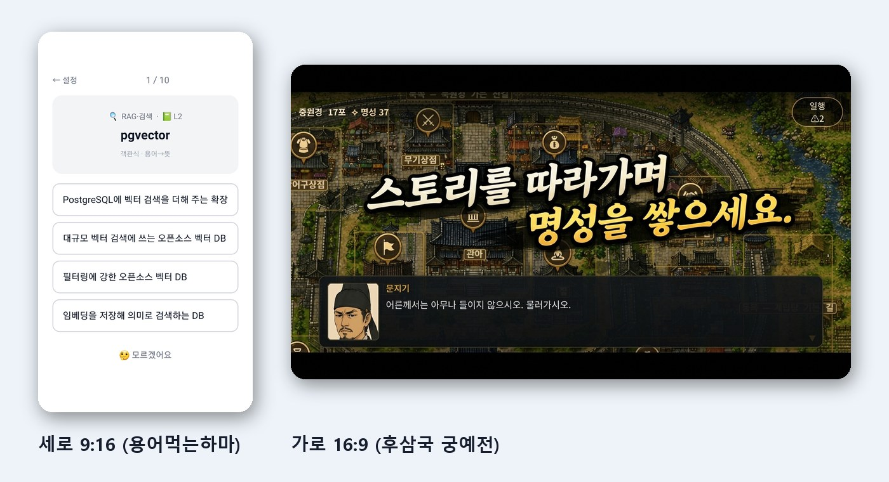
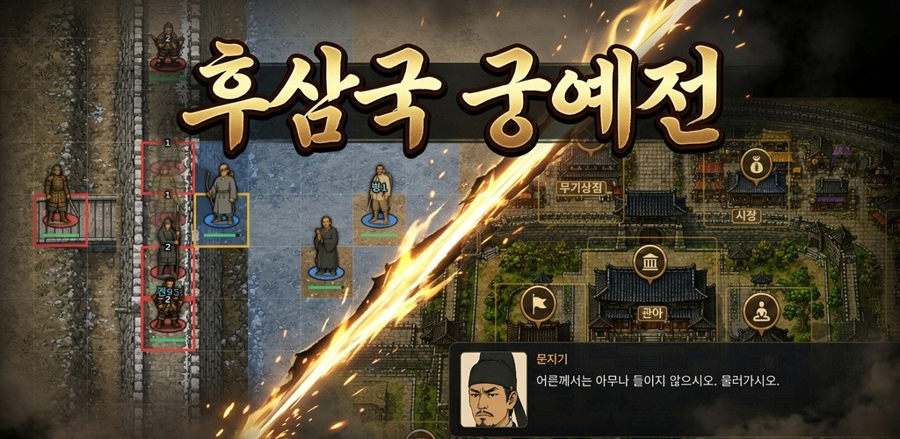

이번 달에 앱 두 개를 구글 플레이에 올렸습니다. IT 용어 암기 앱 [용어먹는하마](/yongeo-hama)와 가로 화면 시뮬레이션 롤플레잉 게임 **후삼국 궁예전**입니다. 두 번 다 Claude Code와 함께 진행했고, 그 과정에서 배운 것을 **play-launch**라는 Claude Code 스킬로 묶어 GitHub에 공개했습니다.

- 저장소: [github.com/reddol18/play-launch-skill](https://github.com/reddol18/play-launch-skill) (MIT)

이 글은 스킬 소개이면서, "AI에게 처음 해 보는 일을 안내받을 때 무엇이 틀리는가"에 대한 기록입니다.

## AI는 플레이 콘솔을 '기억'으로 안내했다

첫 출시(용어먹는하마) 때 Claude에게 플레이 콘솔 등록 순서를 물었더니, 메뉴 경로와 입력값을 그럴듯하게 쭉 정리해 줬습니다. 그런데 실제 콘솔과 맞지 않는 곳이 계속 나왔습니다. 그 과정은 [용어먹는하마 2편](/yongeo-hama-02#launch)에 적었는데, 틀린 것들을 모아 보니 이랬습니다.

| 틀린 것 | 원인 |
|---|---|
| 메뉴 경로를 기억으로 안내 | 화면을 보기 전에 답함 |
| 콘솔 목록에 없는 태그를 추천 | 목록을 보기 전에 추측함 |
| 테스터 12명 요건이 걸린다고 안내 | 일반론을 이 계정에 그대로 적용함 |
| 광고 ID 목적에 '애널리틱스'까지 포함 | 선택지 설명을 읽지 않음 |
| 스크린샷 비율이 안 맞아 업로드 실패 | 조건을 미리 대조하지 않음 |
| 16KB 메모리 페이지 오류로 버전 저장 실패 | 네이티브 빌드를 미리 검사하지 않음 |
| 이미 쓴 버전 코드로 다시 업로드 | 알고도 미룸 |

공통점은 하나였습니다. **확인하기 전에 답했다**는 것입니다. 콘솔 화면은 자주 바뀌고 계정마다 다르게 나오는데, 모델은 학습 시점의 일반론을 지금 이 계정의 사실처럼 말했습니다.

그래서 중간부터 진행 방식을 바꿨습니다. 제가 콘솔 화면을 캡처해 보여 주면, Claude는 **그 화면에 보이는 항목 하나**에 대해서만 입력값과 근거를 말합니다. 제가 입력하고 다음 화면을 캡처하면 다시 다음 항목으로 넘어갑니다. 느려 보이지만, 이렇게 바꾼 뒤로는 되돌아가는 일이 거의 없었습니다.

## play-launch가 하는 일

스킬은 이 진행 방식을 그대로 규칙으로 만든 것입니다. 세 단계로 움직입니다.

**1. 사전 점검 — 콘솔을 열기 전에 Claude가 직접 한다**

첫 출시 때 콘솔에서 막힌 것들(16KB, 버전 코드, 스크린샷)은 전부 미리 알 수 있는 것이었습니다. 그래서 콘솔에 들어가기 전에 코드와 빌드부터 봅니다.

- 패키지 이름(한 번 정하면 못 바꾼다는 안내 포함)
- 버전 코드와 **그 값이 실제로 어디서 오는지** (gradle 변수까지 추적)
- 64비트 `.so`의 16KB 정렬 — 스킬에 들어 있는 `check16k.mjs`로 검사
- 서명 키, 광고 ID(테스트 ID가 남아 있지 않은지), `AD_ID` 권한
- 개인정보처리방침 URL, 개발자 웹사이트와 `app-ads.txt`
- 스크린샷 규격(9:16 또는 16:9, 알파 없음), 아이콘·그래픽 이미지
- 스토어 설명문의 기능·예시를 **코드와 하나씩 대조**

결과는 표로 보고하고, 실패나 누락이 있으면 콘솔 단계로 넘어가지 않습니다.



스크린샷 규격은 첫 출시 때 실제로 막힌 곳입니다. 요즘 폰 원본(예: 1080×2220)은 9:16이 아니라서 그대로 올라가지 않았고, 상태 표시줄과 내비게이션 바를 잘라 1080×1920으로 맞췄습니다. 가로 게임은 반대로 16:9가 필요합니다.

16KB 검사는 Node만 있으면 따로 돌릴 수 있습니다.

```bash
node <스킬 폴더>/scripts/check16k.mjs <풀어 둔 AAB 폴더>
```

AAB 안의 64비트 `.so`마다 ELF `PT_LOAD` 정렬값을 읽어 `OK`/`FAIL`을 찍습니다. 용어먹는하마는 `onnxruntime-react-native`의 JSI 라이브러리 하나가 4KB 정렬이라 버전 저장이 막혔고, CMake에 `-Wl,-z,max-page-size=16384`를 넣어 해결했습니다. 고친 뒤 빌드에서는 64비트 `.so` 29개가 모두 `OK 16384`로 나왔습니다. 반대로 궁예전처럼 Capacitor(WebView) 기반 앱은 `.so`가 0개라 이 검사가 해당 없음이었습니다.

**2. 콘솔 진행 — 캡처 한 장, 항목 하나**

```
1. 사용자: 화면 캡처
2. Claude: 그 화면에서 지금 채울 항목 하나 → 입력값 → 근거
3. 사용자: 입력 후 다음 캡처
```

근거는 코드 경로, 구글 도움말 원문, 화면에 적힌 문구 중 하나입니다. 캡처 없이 "다음 뭐 해?"라고 물으면 추측하지 않고 지금 화면을 보여 달라고 합니다. 콘텐츠 등급과 데이터 보안 설문은 문항마다 캡처를 보고 답하게 했습니다. 첫 출시에서 기억으로 답했다가 틀린 곳이기 때문입니다.

**3. 제출 후 — 공개 확인과 AdMob 연결**

광고가 있는 앱은 플레이 공개로 끝나지 않습니다. AdMob에 스토어를 연결하고 `app-ads.txt` 인증을 통과해야 합니다. 이 부분은 두 번 다 시간이 걸린 곳이라 따로 정리했습니다. 공개 당일에는 AdMob에서 패키지 이름으로 검색해도 앱이 나오지 않고, 이때 대화상자에 뜨는 "새 AdMob 앱을 만드세요"를 누르면 앱 ID가 바뀌어 재빌드·재심사를 해야 한다는 것 같은 내용입니다.

스킬은 무엇을 왜 넣는지 알려 줄 뿐이고, **콘솔 입력과 제출은 언제나 사람이 합니다.** Claude가 콘솔을 직접 조작하지 않습니다.

## 절대 규칙 몇 가지

`SKILL.md`의 규칙 중 실제로 효과가 컸던 것들입니다.

- 화면이나 코드를 확인하기 전에 답하지 않는다. 메뉴 경로, 선택지 이름, 요건을 기억으로 말하지 않는다
- 한 번에 한 항목만 안내한다. 다음 단계를 미리 말하지 않는다
- 선택지가 있는 항목은 화면에 실제로 나온 목록에서만 고른다
- 예견되는 오류는 미리 처리한다. "나면 대응"으로 미루지 않는다 (버전 코드처럼)
- 사용자가 이미 답한 것은 다시 묻지 않는다
- 실제 광고를 누르라고 하지 않는다. 자기 앱 광고 클릭은 계정 정지 사유다

"다음 단계를 미리 말하지 않는다"가 의외로 중요했습니다. 다음 단계를 미리 말하는 순간 그건 화면을 보지 않은 안내가 되고, 첫 출시에서 틀린 안내 대부분이 거기서 나왔습니다.

## 두 번째 출시에서 다시 확인한 것

스킬의 바탕 문서(`reference/guide.md`)는 첫 출시 뒤에 쓰고, 궁예전을 출시하면서 다시 고쳤습니다. 궁예전은 11월 18일에 제출해 약 5일 뒤에 공개됐습니다(용어먹는하마는 제출 당일 통과). 이번에 새로 들어간 것들입니다.



- **버전 코드가 엉뚱한 곳에 있었습니다.** Capacitor 프로젝트의 `build.gradle`에서 `versionCode`가 상단에 따로 정의한 변수를 읽고 있었습니다. 그래서 점검 항목을 "버전 코드 값"이 아니라 "그 값이 적힌 곳까지 따라간다"로 바꿨습니다.
- **가로형 게임 스크린샷**은 실기기 캡처를 자르는 것보다 PC에서 1920×1080 창으로 띄워 찍는 편이 빨랐습니다. 이미지 생성 AI로 꾸며 보려 했더니 UI 글자와 버튼까지 다시 그려 버려서, 원본과 나란히 놓고 대조하라는 항목을 넣었습니다.
- **앱 서명.** 새 앱에서 콘솔은 따로 묻지 않고 "Google이 생성한 앱 서명 키"로 진행했습니다. 이러면 내가 가진 키는 업로드 키가 되고, 내가 직접 서명한 APK는 Play 설치본 위에 덮어 깔 수 없습니다. 개발용 폰에 직접 설치본이 있다면 세이브 내보내기 → 삭제 → Play 판 설치 → 가져오기가 필요합니다.
- **콘텐츠 등급**이 "15세 이상 · 약물"로 나왔습니다. 대사 속 술 언급 때문으로 추정하지만 확인하지는 못했습니다. 등급을 바꾸고 싶다면 콘텐츠를 먼저 고치고 설문을 다시 내야 합니다. 설문 답만 바꾸는 건 허위 신고입니다.
- **"앱 업데이트가 게시되었습니다" 알림은 첫 출시에도 옵니다.** 이 문구만 보고 기존 앱이 업데이트된 줄 알았습니다.
- **공개 직후에는 플레이 스토어 검색에 안 나옵니다.** 확인과 공유는 스토어 직접 링크로 합니다.
- **`app-ads.txt` 인증**은 파일이 정상으로 열리는데도 "세부정보가 일치하지 않습니다"가 났습니다. 첫 출시 때도 하루 이상 걸렸고, 이번에도 기다리는 중입니다. 그래서 "몇 시간이면 된다"가 아니라 "저장 시각 + 24시간"을 정확한 시각으로 알려 주게 했습니다.

  > 11월 25일 추가: 궁예전의 `app-ads.txt` 인증도 통과됐습니다.

## 어디까지 믿어도 되는지 표시해 두었다

가이드의 문장마다 근거 수준을 붙였습니다.

- **[확인]** 실제 화면이나 빌드 결과로 확인한 사실
- **[이 계정]** 이 계정에서는 그랬지만 계정마다 다를 수 있는 것
- **[문서]** 구글 도움말 원문 기준
- **[가설]** 한 번 겪었거나 추정한 것
- **[문서 확인 필요]** 공식 기준을 아직 확인하지 못한 것

표시가 없는 문장은 다음에 읽는 사람이, 그리고 다음에 읽는 AI가 전부 확인된 사실로 받아들입니다. 실제로 궁예전 출시 중에 "약물 등급은 술 언급 때문"이라는 추정이 체크리스트에 단정형으로 들어간 일이 있었고, 출시 기록의 【가설】 표시와 어긋난다는 지적을 받고 고쳤습니다. 경험이 두 번뿐이라, 읽는 쪽이 믿을 수 있는 문장과 아닌 문장을 가를 수 있어야 했습니다.

## 한계 — 테스터 12명·14일 단계는 검증하지 못했다

2023년 11월 13일 이후에 만든 개인 개발자 계정은 프로덕션 출시 전에 **테스터 12명 이상이 14일 이상 연속 참여한 비공개 테스트**를 거쳐야 합니다([Play Console 고객센터](https://support.google.com/googleplay/android-developer/answer/14151465?hl=ko)). 제가 출시한 두 앱은 이 요건이 적용되지 않는 계정이었습니다. 그래서 이 단계는 스킬에서 도움말을 옮긴 것과 가설뿐이고, README에도 맨 위에 적어 두었습니다. 요건이 적용되는 계정이라면 이 단계만큼은 도움말 원문과 지금 보이는 화면을 기준으로 진행해 주세요.

그 밖에도 한국어 콘솔 화면 기준이고, 앱 둘·계정 둘 이하의 경험을 일반화한 것이며, 법률·정책 자문이 아닙니다.

## 설치와 사용

Claude Code 세션에서 플러그인으로 설치합니다.

```
/plugin marketplace add reddol18/play-launch-skill
/plugin install play-launch@play-launch-skill
```

또는 저장소의 `plugins/play-launch/skills/play-launch/` 폴더만 `~/.claude/skills/`에 복사해도 됩니다. 설치한 뒤에는 이렇게 말을 걸면 됩니다.

```
이 앱 구글 플레이에 올리려고 해. 사전 점검부터 해 줘
```

```
AdMob에 스토어 연결하는 중인데 막혔어 (캡처 첨부)
```

## 다시 한다면

처음부터 "AI에게 순서를 물어보고 따라간다"가 아니라 "화면을 보여 주고 하나씩 묻는다"로 시작했을 겁니다. 처음 해 보는 일일수록 AI의 그럴듯한 전체 안내가 더 위험했습니다. 내가 틀린 곳을 알아챌 수 없으니까요.

테스터 요건이 적용되는 계정으로 출시해 보면 그 단계도 채워 넣을 생각입니다. 바뀐 콘솔 화면이나 틀린 안내를 발견하시면 [GitHub 이슈](https://github.com/reddol18/play-launch-skill/issues)로 알려 주세요. 근거(화면 캡처, 도움말 원문 URL)를 함께 붙여 주시면 바로 반영하겠습니다.

이 스킬로 출시한 앱:

- [용어먹는하마](https://play.google.com/store/apps/details?id=io.github.reddol18.wordbook&referrer=utm_source%3Dtechblog%26utm_medium%3Dpost%26utm_campaign%3Dplay-launch-skill) — 면접에 나오는 IT 용어 424개
- [후삼국 궁예전](https://play.google.com/store/apps/details?id=com.aidothat.gungyejeon&referrer=utm_source%3Dtechblog%26utm_medium%3Dpost%26utm_campaign%3Dplay-launch-skill) — 가로 화면 시뮬레이션 롤플레잉(SRPG)
