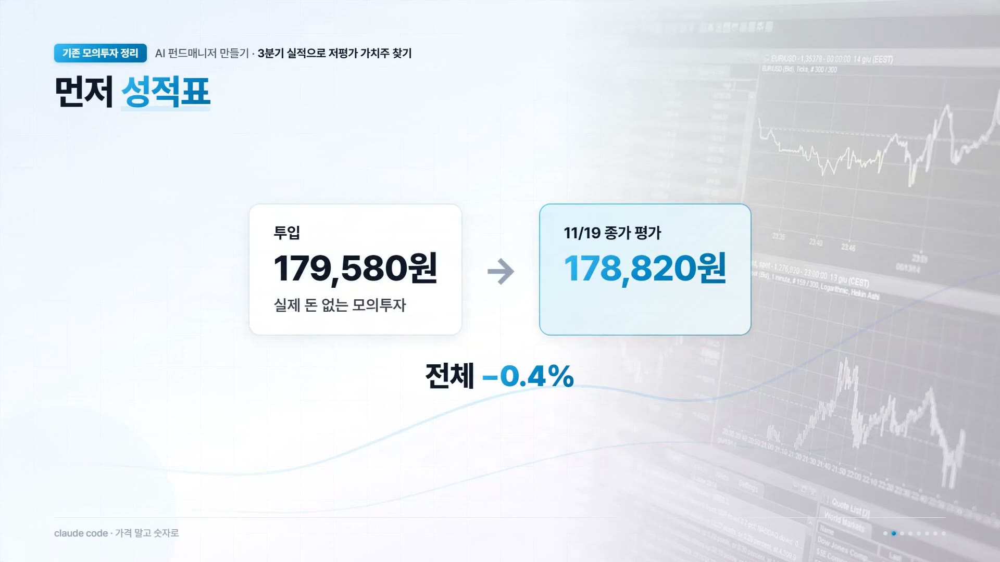
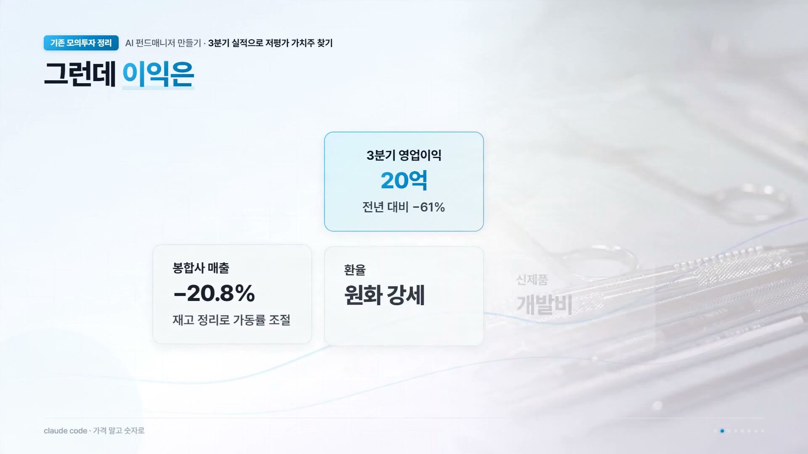
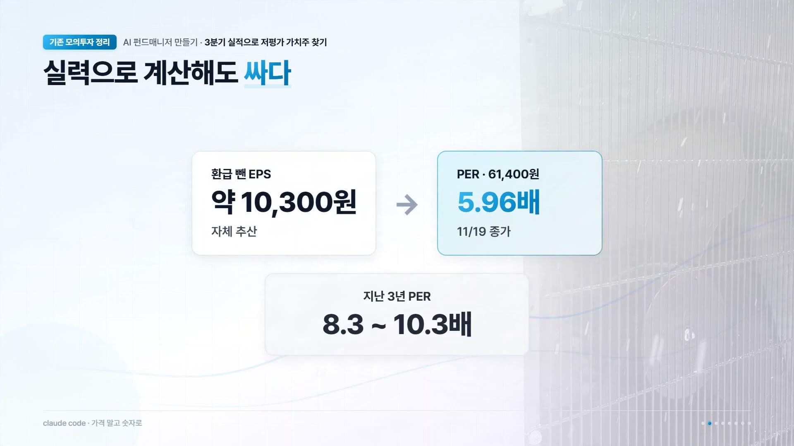
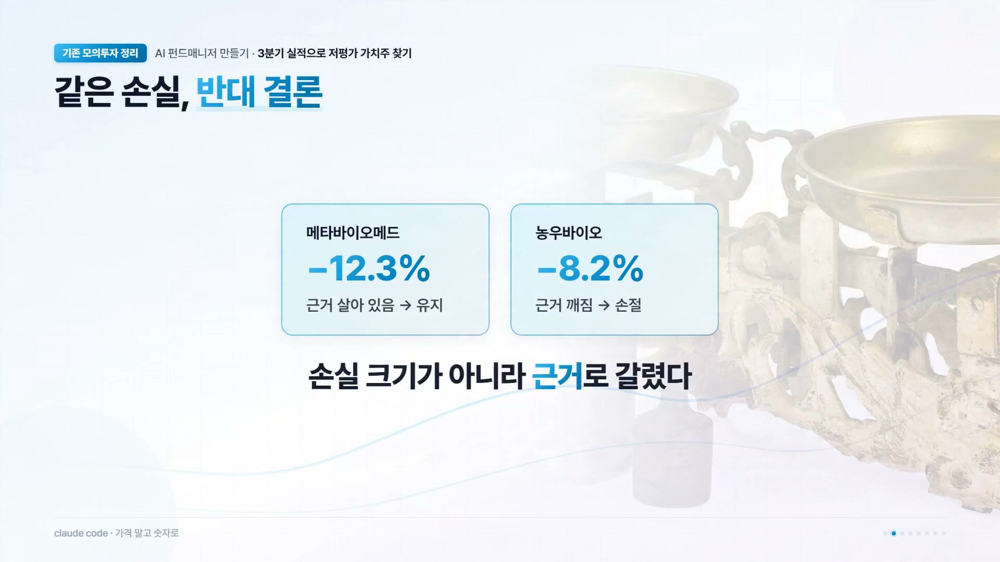
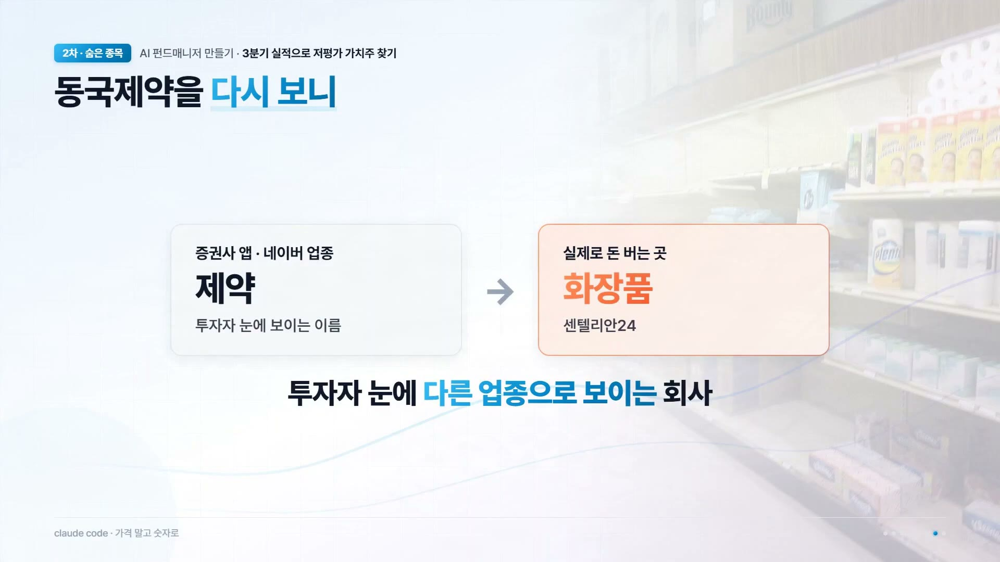
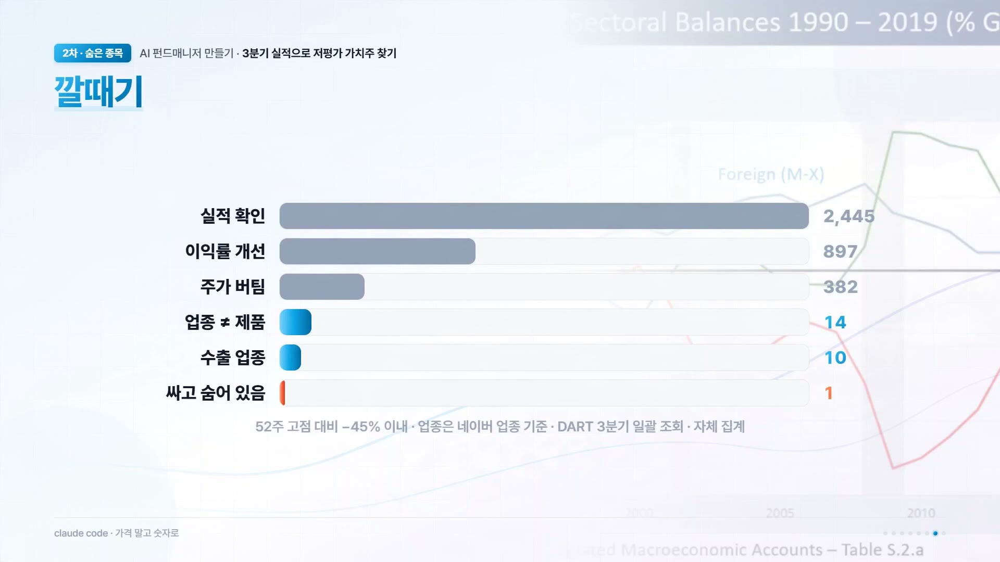
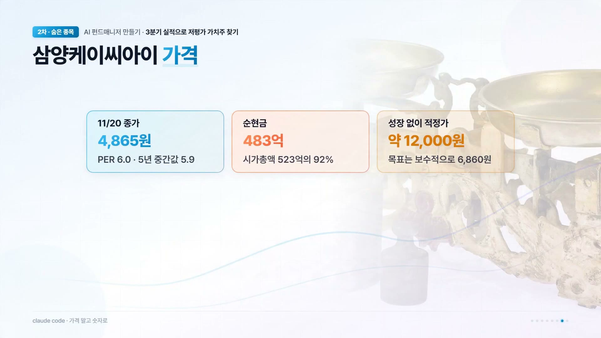

<iframe width="560" height="315" src="https://www.youtube.com/embed/VFB9aNL3hUg" title="YouTube video" frameborder="0" allow="accelerometer; autoplay; clipboard-write; encrypted-media; gyroscope; picture-in-picture; web-share" allowfullscreen></iframe>

> 이 영상은 2026년 11월 21일에 올린 것입니다. 글 속의 숫자도 그때 기준이에요.

> **[정정] 11월 24일, 삼양케이씨아이 편입을 철회했습니다.** 영상에서 편입 근거로 든 수출 증가와 이익률 개선이 둘 다 잘못 읽은 데이터였습니다. 실제 체결 전이라 성적표에는 영향이 없습니다. 자세한 내용은 [글 끝의 추가 내용](#update-1125)에 적었습니다.

[13편](/ai-fund-manager-13)에서 11월 16일 주를 달력에 동그라미 쳐 뒀었죠. 3분기 숫자가 다 나왔으니 약속대로 다시 걸러 봤습니다. 이번 편은 기존 모의투자 종목을 정리하고, 새로 걸러 낸 종목과 새로 편입한 종목까지 다룹니다.

## 성적표 — 거의 본전

11월 19일 종가 기준으로 모의투자 전체는 **-0.4%**입니다. 179,580원을 넣어 178,820원이 됐어요.

기존 종목을 유지할지 손절할지 판단 기준은 하나로 잡았습니다. **가격이 얼마나 빠졌냐가 아니라, 처음 산 이유가 아직 살아 있느냐**예요.

## 메타바이오메드 — 이익은 줄었지만 산 이유는 살아 있다

메타바이오메드는 치과 재료가 크는 걸 보고 샀습니다. 3분기 보고서를 보니 치과 매출은 12% 늘었어요.

그런데 영업이익은 20억 원으로 작년보다 61% 줄었습니다. 원인은 산 이유와 상관없는 곳에 있었어요. 봉합사 매출이 재고 정리로 20.8% 줄었고, 원화 강세도 겹쳤습니다.

지금 -12% 정도지만 손절하지 않습니다. 바닥이 확인되면 그때 더 사려고 해요.

## 경동나비엔 — 환급을 빼고 재도 싸다

경동나비엔은 [13편](/ai-fund-manager-13)에서 말씀드린 관세 환급이 숫자로 확인됐습니다. 그러니 환급이 없는 3분기가 진짜 실력이에요.

그 실력으로 계산해도 PER은 6배가 안 됩니다. 환급을 뺀 EPS를 약 10,300원으로 추산하면 11월 19일 종가 61,400원에서 5.96배예요. 지난 3년 동안은 8.3~10.3배 사이였습니다.

솔직히 히트펌프 이야기는 아직 숫자가 없습니다. 그래서 지금 보유 근거는 **싸다는 것 하나**예요. 만료일이 돼서 사는 가격도 다시 계산했는데, 올리지 않고 일회성을 뺀 이익을 기준으로 오히려 낮췄습니다.

## 농우바이오 — 덜 빠졌는데 손절했다

농우바이오는 손절했습니다. -8% 정도였는데, 가격 때문이 아니라 근거가 깨져서예요.

- 3분기 이익률이 오른 건 일회성 원가 감소였습니다.
- 누적 이익은 줄었습니다.
- 기후에 강한 종자가 팔린다는 증거도 없었어요.

손실은 메타바이오메드가 더 큰데 결론은 반대가 됐습니다. 하나는 근거가 살아 있고, 하나는 깨졌거든요.

## 유일한 성공, 동국제약에서 다시 출발했다

지금까지 유일한 성공은 동국제약이었습니다. 26% 수익을 내고 팔았죠([10편](/ai-fund-manager-10)). 이번 필터링은 여기서 출발합니다.

동국제약은 이렇게 올랐어요. 수출이 늘고, 이익이 좋아지고, 업종에 기대가 붙자 뒤늦게 숨은 종목에 돈이 몰렸습니다. 그런데 동국제약은 증권사 앱에서 제약회사로 보입니다. 실제로 돈은 화장품(센텔리안24)에서 벌었고요.

**투자자 눈에 다른 업종으로 보이는 회사.** 이런 회사를 다시 찾아봤습니다.

## 2,445개에서 1개까지

찾는 순서는 이렇습니다.

1. 실적이 좋아진 회사를 고른다.
2. 업종 이름과 주력 제품이 다른 곳을 찾는다.
3. 그 제품의 수출이 느는지 본다.

3분기 실적이 확인된 2,445개 종목을 이익률과 주가로 거르니 382개가 남았습니다. 그중 업종과 제품이 다른 회사는 14곳이었어요.

공식에 잘 맞아도 뺀 곳이 있습니다. 이미 많이 오른 곳, 그리고 대주주가 해외 경쟁 그룹인 곳이에요.

## 삼양케이씨아이

> **[정정]** 아래는 영상 당시의 판단입니다. 11월 24일에 편입을 철회했어요([이유](#update-1125)).

그렇게 남은 곳이 삼양케이씨아이입니다. 화학 회사로 보이지만, 샴푸와 화장품 원료를 세계적인 회사들에 팝니다.

- 11월 20일 종가 4,865원, PER 6.0배(5년 중간값 5.9배)
- 순현금이 483억 원으로 시가총액 523억 원의 92%
- 성장이 없다고 쳐도 적정가는 약 12,000원으로 봤고, 목표가는 보수적으로 6,860원

다만 **하루 거래가 아주 적은 소형주**라는 점은 꼭 기억해 두세요.

사는 규칙도 정했습니다. 공식에 맞는 한 종목이라 전체 27.5만 원을 세 번에 나눠 사고, 바닥에서 가장 크게 삽니다. 연간 실적이 나오는 2027년 3월 31일에 다시 계산해요.

## 정리, 그리고 배운 것

- **유지:** 메타바이오메드, 경동나비엔
- **손절:** 농우바이오
- **새 편입:** 삼양케이씨아이 → **11월 24일 철회**

이번에 배운 건 두 가지입니다. **가격 말고 근거**를 보고, **업종 이름 말고 실제로 파는 것**을 봐야 한다는 거예요. 새로 들어온 삼양케이씨아이도 숫자로 계속 확인해 보겠습니다.

그리고 바로 그 확인에서 삼양케이씨아이의 근거가 무너졌습니다. 아래에 이어서 적었습니다.

<h2 id="update-1125">11월 25일 추가</h2>

### [정정] 삼양케이씨아이 편입 철회 (11월 24일)

영상과 이 글에서 편입 근거로 든 것을 다시 확인해 보니, 두 가지 모두 잘못 읽은 데이터였습니다. 그래서 11월 24일 저녁 모의투자 대상에서 뺐습니다. 실제 체결 전이라 성적표에는 영향이 없습니다.

- **"수출 +56%"는 다른 품목의 숫자였습니다.** 샴푸 같은 완제품(HS3305) 통계였거든요. 삼양케이씨아이가 파는 건 계면활성제 같은 원료이고, 원료 품목코드로 보면 1~9월 수출 증가율이 +2%, +44%, +7%로 제각각입니다. 회사가 공시한 수출액을 연환산하면 약 +4%에 그칩니다.
- **"3분기 영업이익률 3.9% → 9.5%"는 기저효과였습니다.** 작년 3분기 한 분기만 유독 낮아서 크게 좋아진 것처럼 보였어요. 1~9월 누적으로는 9.9%에서 9.2%로 오히려 내렸고, 연간으로도 13.6%(2024년)에서 9.3%(2025년)로 떨어진 뒤 제자리입니다.
- **남은 근거인 "싸다"도 특별하지 않았습니다.** 11월 24일 DART로 전 종목을 비교해 보니, PER 7배 이하이면서 순유동자산이 시가총액의 80% 이상인 회사가 181곳이었고 삼양케이씨아이는 그중 52위였습니다. 1~9월 순이익은 -12%인데, 같은 181곳 중 112곳은 순이익이 늘었어요.

여기서 얻은 확인 순서 세 가지를 이후 모든 종목 판단에 적용하고 있습니다.

1. 산업 통계를 쓸 때는 **그 회사 제품의 품목코드인지** 확인하고, 회사 공시와 대조한다.
2. 이익률은 한 분기의 전년 대비가 아니라 **누적·연간 흐름**으로 본다.
3. 근거마다 **"이게 틀렸다면 무엇이 보일까"**를 한 번 확인한다.

### 성적표 (11월 24일 종가)

| 종목 | 수익률 | 상태 |
|---|---|---|
| 메타바이오메드 | -14.71% | 보유 |
| 경동나비엔 | -3.63% | 보유 |
| 동국제약 | +26.34% | 매도 완료 |
| 농우바이오 | — | 손절 확정 |
| **전체** | **-1.17%** | 179,580원 → 177,470원 |

11월 19일 종가 기준 -0.4%에서 조금 더 내렸습니다. 메타바이오메드와 경동나비엔의 하락은 가격 변동이라 판정은 바꾸지 않고 둘 다 보유합니다.

### 메타바이오메드·경동나비엔에서 더 볼 것 (11월 25일)

"지금 주가가 앞으로 10년 동안 몇 % 성장을 전제하고 있나"를 거꾸로 계산해 봤습니다(역DCF, 할인율 8~10%).

- **경동나비엔:** 어떤 기준으로 계산해도 지금 주가는 성장 0% 이하를 전제합니다. 히트펌프 성장 기대가 가격에 들어 있지 않다는 뜻이에요. 대신 시장이 할인하는 이유도 분명합니다. 2025년 설비투자가 1,622억 원이라 2024~25년 잉여현금흐름이 마이너스였고, 순차입금이 약 1,620억 원이며, 2025년 순이익도 1,243억 원에서 897억 원으로 줄었습니다.
- **메타바이오메드:** 지금 주가는 연 7~15% 성장을 전제합니다. 그런데 설비투자가 영업현금을 거의 다 쓰고 있어요(2025년 영업현금흐름 198억 원, 설비투자 205억 원). 영업이익 중 실제 순이익으로 남는 비율도 0.53에 그칩니다.

그래서 2027년 3월 연간 실적에서 두 가지를 확인합니다.

- **경동나비엔:** 관세 환급 같은 일회성을 뺀 순이익과 잉여현금흐름이 플러스로 유지되는지
- **메타바이오메드:** 덴탈 성장이 순이익과 현금으로 실제로 남는지

### 다시 찾아본 결과: 0개 (11월 25일)

고전 가치주, 성장 대비 저평가(PEG), 숫자만으로 거르는 품질주, 세 가지 방식으로 다시 찾아봤습니다. 위의 세 가지 확인을 통과한 종목은 **0개**였습니다. 주로 이런 이유로 떨어졌어요.

- 업황이 정점일 때의 이익
- 한 고객에 의존
- 영업 외 이익
- 기저효과

억지로 고르지 않고, 4분기 실적이 나오는 2027년 3월쯤 다시 돌려 보겠습니다.

> 이 글과 영상은 모의투자 기록이며 투자 권유가 아닙니다.
