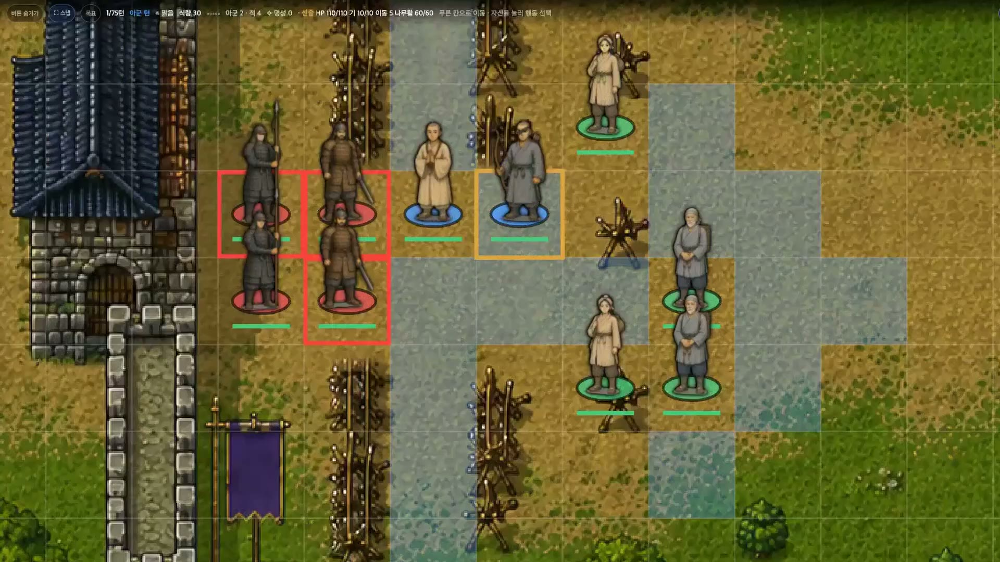
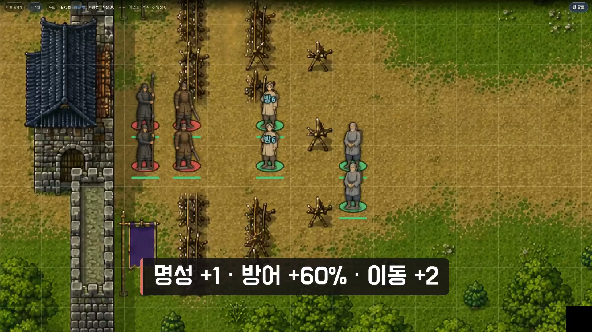
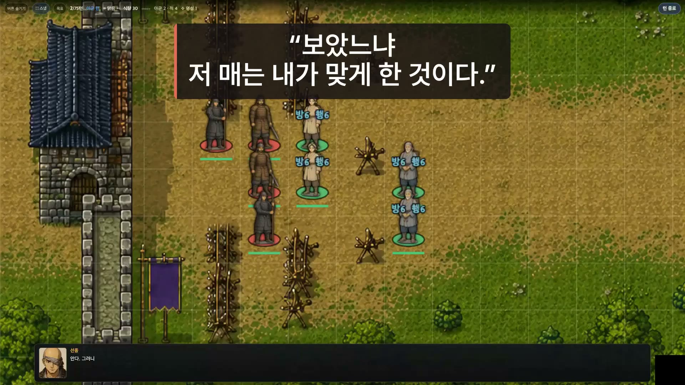
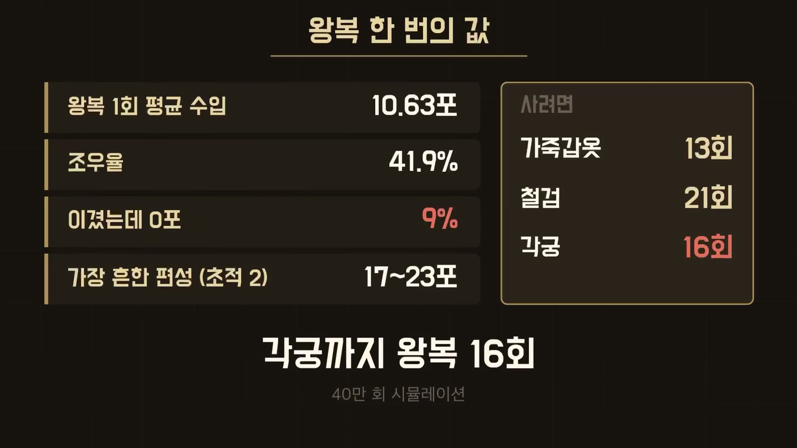
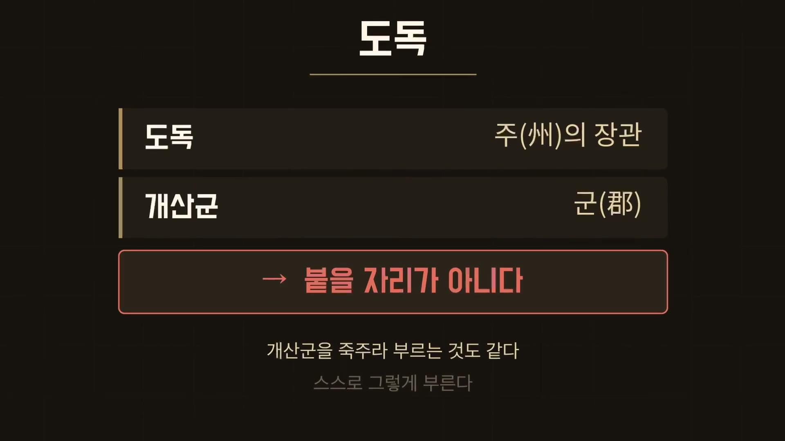
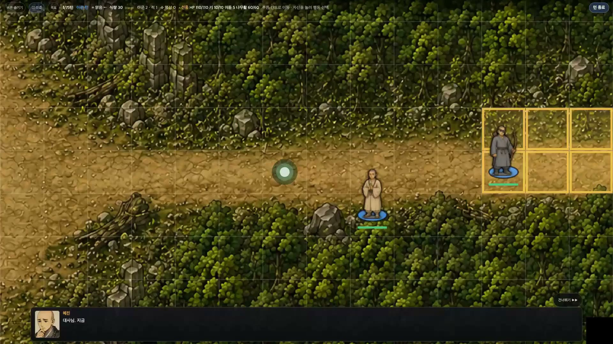

<iframe width="560" height="315" src="https://www.youtube.com/embed/kIpUX3R4S4o" title="YouTube video" frameborder="0" allow="accelerometer; autoplay; clipboard-write; encrypted-media; gyroscope; picture-in-picture; web-share" allowfullscreen></iframe>

[2편](/ai-srpg-02) 끝에서 실제 시나리오 분기를 하나 잡아 플레이해 보겠다고 했었죠. 혼자 하면 재미가 없을 것 같아서 이번에는 손님을 한 분 모셨습니다. 저는 사회자로 설명만 하고, 플레이는 손님이 합니다. 첫마디가 "제가 솔직하게 말해도 되는 자리 맞죠?"였는데, 정말 솔직하셨어요.

## 마을 없이 바로 전투

새 게임을 누르면 오프닝과 제목 화면이 지나고 바로 첫 전투입니다. 튜토리얼도 마을도 없어요. 손님은 이게 좋다고 하셨습니다.

일행은 둘입니다. 궁병 **선종**(어린 궁예)과 책사 **혜진**. 적은 관문 병졸 둘에 창병 둘이고, 백성 넷이 있는데 이쪽은 조작이 안 됩니다. 아군이 아니라 동맹이라 도망만 다니게 되어 있어요.

조작은 간단합니다. 아군을 탭하면 파란 칸이 이동 범위이고, 움직여도 턴이 끝나지 않아 그 자리에서 바로 공격할 수 있어요. 선종은 사거리가 2~3칸이라 멀리서 쏘고, 혜진은 1칸이라 달려듭니다.

손님이 바로 물으셨습니다. "주인공이 스님인데 활을 쏘네요. 나중에 문제 되는 거 아닙니까?" 그리고 앞에 서는 쪽도 스님이라는 것도요. 혜진은 주문을 다섯 개 쓰는 군사인데, 일반 공격 사거리까지 넓으면 사기 캐릭터가 되니 1칸으로 묶었습니다.

## 연좌를 골랐더니 아무도 오지 않았다

대사가 끝나면 선택지가 셋 뜹니다. **연좌하거나, 싸워서 뚫거나, 산길로 돌아가거나.** 손님은 "스님이면 연좌죠"라며 바로 골랐어요.

앉으면 명성이 하나 오르고, 백성에게 6턴 동안 방어와 이동 보너스가 붙습니다.

그런데 앉고 나면 병졸끼리 귓속말을 합니다. "대나마 어른의 전갈이오. 이놈들을 다 쓸어버리라는 명령이시다." 앉으라고 해 놓고 앉으니까 쓸어버리라는 거죠. 붙어 있는 백성을 치고 나면 이런 대사도 뜹니다.

손님은 "그럼 저는 여기서 아무것도 안 해 보겠습니다"라며 턴 종료를 눌렀습니다. 쓸어버린다고 했으니 찾아오겠지, 턴 제한이 75턴이니 하루 종일 앉아 있어도 된다면서요.

**그런데 적이 안 옵니다.** 열 턴을 넘겨도 한 발도 안 나와요. "쓸어버리라고 명령까지 받아 놓고 한 발도 안 나옵니다. 옛날 286 컴퓨터 게임도 이것보단 적이 똑똑했겠는데요."

변명하자면 이건 일부러였습니다. 관문을 지키는 병졸이 백성을 쫓아 북쪽으로 달려가 버리면, 관문을 지킨다는 장면 자체가 무너지거든요. 그런데 손님 말이 맞았습니다. **지키라고 한 게 아니라 쓸어버리라고 했고, 방금 화면에 그렇게 떴어요.** 대사와 행동이 어긋난 겁니다. 이런 걸 확인하려고 손님을 모신 거라, 개발자에게 전달하기로 하고 다시 시작했습니다.

두 번째로는 "싸워서 뚫는다"를 골랐습니다. 업보가 하나 오르고, "이 중놈이 미쳤나" 하며 병졸이 이번엔 정말 달려듭니다. 그런데 궁병이 너무 셌어요. 두 칸 밖에서 일방적으로 쏘는데 상대가 쫓아오지 않아서, 두 대에 하나씩 쓰러졌습니다.

## 10포가 모자라서 시작된 노가다

관문을 뚫으면 첫 마을 중원경입니다. 소지금은 120포. 손님이 가죽갑옷을 사려고 보니 130포였습니다. **10포가 모자랐어요.** 여기 오기까지 돈을 주는 이벤트가 관문에도, 산길에도, 고갯길에도 하나도 없거든요.

그래서 손님은 뒷문으로 나가 잡몹을 잡기 시작했습니다. 그리고 곧 불만이 나왔어요. 나가도 두 번에 한 번은 아무도 안 나오고, 이겨도 돈을 못 버는 판이 있다고요. 실제로 재 보니 이랬습니다.

40만 회 시뮬레이션으로 계산해 보니 왕복 한 번에 평균 10포 남짓이고, 각궁 하나를 사려면 왕복을 16번 해야 합니다. 게다가 그동안 식량이 거의 줄지 않아서, 게임이 그만하라고 말리지도 않아요. 손님 표현으로는 "노가다를 시키는 게 아니라 노가다인 줄 모르게 두는 것"이었습니다.

## 자칭 도독, 그리고 칠 수 없는 악당

장비를 갖추면 서쪽 들길로 나가 개산군으로 갑니다. 이 소식은 마을의 빈 곳을 누르면 나오는 잡담에서 듣는데, 장사치가 이렇게 말해요. "도적이 곳간을 열고 관가가 곳간을 잠그니 세상이 뒤집힌 게지요."

그런데 관아 문지기가 막습니다. "이름이 있는 자면 이름을 대고 없으면 물러가시오. 댈 이름이 없으시오? 그럼 하나 만들어 오시오." 명성이 모자라면 들어갈 수 없어요.

손님이 여기서 고증을 짚었습니다. "도독이요? 여기 개산군 아닙니까. 군에 도독이 왜 있어요. 그거 주(州) 장관 아닙니까."

이건 일부러입니다. 스스로 도독이라 부르는 거예요. 개산군을 죽주라고 부르는 것도 같습니다. 그래서 기획 문서에 "고증 검수에서 지적하지 말 것"이라고 적어 뒀습니다.

손님은 인정하고 나서 다음 질문을 하셨어요. "그럼 이 참칭하는 양반을 쓸어버려도 됩니까?" **안 됩니다.** 기훤이 적으로 서는 맵은 하나도 없어요. 이유가 있는데, 지금 말씀드리면 안 되는 이유입니다. 손님은 "나쁜 놈이 보이는데 못 친다"며 자유도가 없다고 하셨습니다.

## 막아 둔 세달사 길

중원경 북문으로 나가 고개를 올라서면 길이 셋으로 갈립니다. 북쪽은 북원경(지금의 원주)이고, 동쪽은 궁예가 사는 절 세달사예요. 게임이 카메라로 세 길을 다 보여 줍니다. 그러니 손님은 당연히 동쪽이 궁금해지셨죠.

그 전에 사건이 하나 생깁니다. 나뭇짐을 진 아이가 길을 가로지르는데 화살이 날아와요. 쏜 자는 "사슴인 줄 알았다. 덤불이 흔들리기에"라고 하고는 "시끄럽다, 치워라"라고 합니다. 사냥꾼을 눕히면 아이를 업고 들길 맵으로 바로 넘어가고, 거기서부터 **12턴 안에 북원경으로 가야 합니다.**

손님은 버그를 찾겠다며 아이를 업은 채 세달사 쪽으로 가 보셨습니다. 막힌 데 없이 동쪽 발판까지 걸어갈 수는 있었어요. 그런데 발판에 서면 혜진이 이렇게 말하고, 아무 일도 일어나지 않습니다.

다섯 번 밟으면 다섯 번 다 같은 말이에요. 스토리상 지금은 거기 가면 안 되기 때문에 막아 둔 겁니다.

## 이번 베타테스트에서 나온 것

- **명령과 행동이 어긋난 적:** "쓸어버리라"는 대사를 듣고도 관문을 지키느라 움직이지 않는다.
- **궁병 밸런스:** 두 칸 밖에서 일방적으로 쏘고 상대가 쫓아오지 않는다.
- **초반 돈:** 첫 마을까지 돈 주는 이벤트가 없어 10포가 모자라고, 각궁까지 왕복 16번이 필요하다.
- **의도한 설계:** 자칭 도독, 칠 수 없는 기훤, 막아 둔 세달사 길은 일부러 그렇게 만든 것이다.

자꾸 딴짓을 하려는 플레이어와 그걸 막으려는 사회자의 신경전은 다음 편에도 이어집니다. 과연 이들은 궁예를 미륵으로, 아니 대왕으로 키워 낼 수 있을까요.
