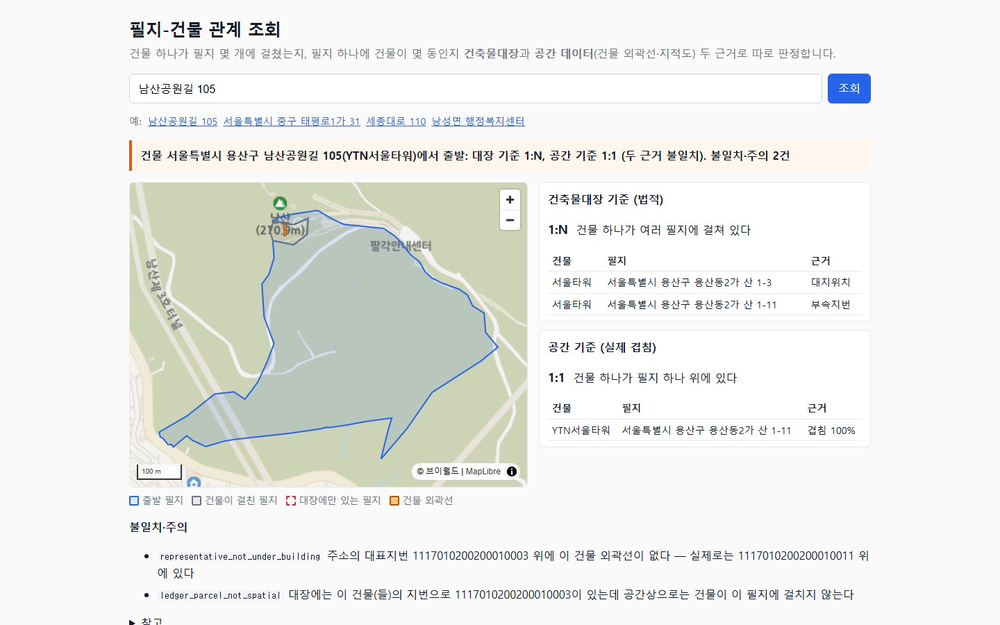
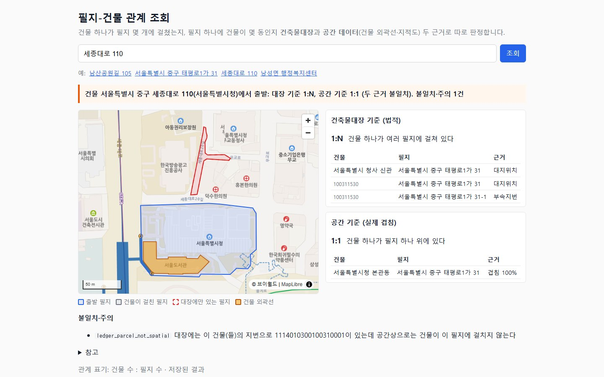
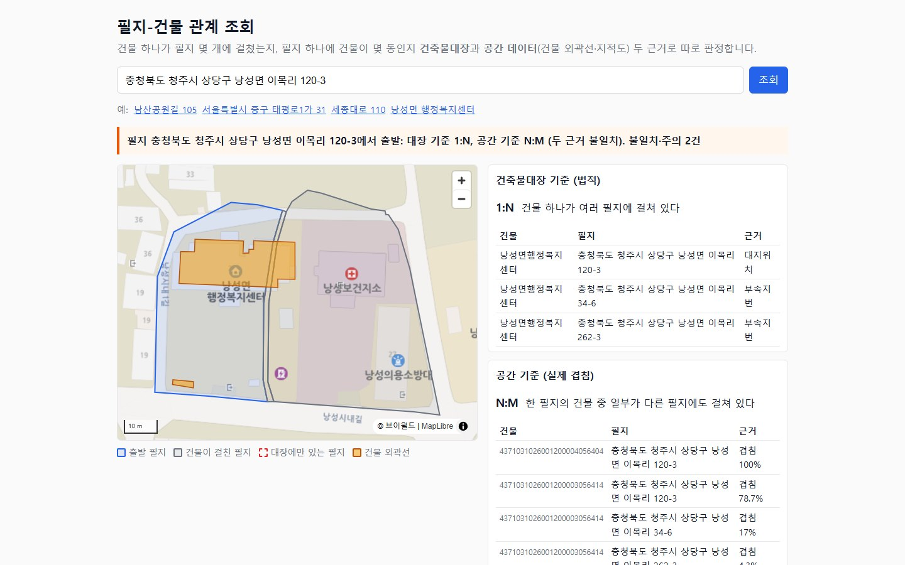

이 블로그에서 검색으로 가장 많이 들어오는 글은 [PNU 코드 만드는 법](/make-pnu-code)입니다. 지번 주소를 19자리 PNU로 바꾸는 방법이죠. 그런데 PNU를 만든 다음에 부딪히는 문제가 있습니다. **PNU로 조회했는데 건물이 안 맞는다**는 겁니다.

공공 API는 대부분 필지(땅) 기준인데, 관리하고 싶은 건 건물입니다. 그리고 건물과 필지는 1:1이 아닙니다. 건물 하나가 여러 필지에 걸치기도 하고, 한 필지에 건물이 여러 동 서 있기도 해요. 그래서 이 관계를 판정하는 도구를 만들어 공개했습니다.

- 저장소: [github.com/reddol18/pnu_api_mcp](https://github.com/reddol18/pnu_api_mcp) (MIT)
- 웹 조회 화면: [pnu.reddol18.pe.kr](https://pnu.reddol18.pe.kr)

Claude Code에서 바로 쓰는 **MCP 서버**와, 누구나 주소를 넣어 볼 수 있는 **웹 화면** 두 가지로 만들었습니다.

## 남산타워는 주소의 지번 위에 없다

먼저 결과부터 보겠습니다. YTN서울타워(남산공원길 105)를 넣으면 이렇게 나옵니다.



- **건축물대장 기준(법적):** 대지위치가 산1-3이고 부속지번이 산1-11이라 **건물 하나가 필지 두 개**(1:N)
- **공간 기준(실제 겹침):** 건물 외곽선은 **100% 산1-11 위**에 있어 1:1

주소가 가리키는 대표지번 산1-3 위에는 타워가 없는 겁니다. 이런 차이를 `discrepancies`(불일치)로 따로 알려 줍니다.

관계 표기는 **건물 수 : 필지 수**입니다.

| 표기 | 뜻 |
|---|---|
| `1:1` | 건물 하나가 필지 하나 위에 |
| `1:N` | 건물 하나가 여러 필지에 걸침 |
| `N:1` | 한 필지에 여러 동, 모두 그 안 |
| `N:M` | 한 필지의 건물 중 일부가 다른 필지에도 걸침 |

## 두 근거로 따로 판정하는 이유

관계를 보는 근거는 두 가지입니다.

- **대장 기준:** 건축물대장 표제부의 대표지번과 **부속지번** 목록. 법적으로 이 건물이 어느 땅에 서 있는지입니다.
- **공간 기준:** 브이월드 연속지적도의 필지 경계와 도로명주소 건물 외곽선을 겹쳐서 계산한 비율. 실제로 어디 서 있는지입니다.

둘이 같으면 좋겠지만 자주 다릅니다. 서울시청(세종대로 110)이 그렇습니다.



대장에는 부속지번 31-1이 붙어 있는데, 지도에 빨간 점선으로 그린 31-1은 **도로 필지**입니다. 건물과는 한 뼘도 겹치지 않아요. 반대로 대장과 공간이 정확히 맞는 경우도 있습니다. 청주 낭성면 행정복지센터는 외곽선이 120-3에 78.7%, 34-6에 17.0%, 262-3에 4.3% 걸쳐 있는데, 이 세 필지가 대장의 대지위치·부속지번과 그대로 일치했습니다.



## 출발점은 주소 종류가 정한다

입력은 주소, PNU, 건물관리번호, 건물명 무엇이든 받습니다. 어떤 걸 넣느냐에 따라 출발점이 달라져요.

| 입력 | 가리키는 것 | 출발점 |
|---|---|---|
| 도로명주소·건물명 | 건물 | 건물 → 걸친 필지들 |
| 지번주소 | 필지 | 필지 → 그 위 건물들 |
| PNU(19자리) | 필지 | 필지 → 그 위 건물들 |

## 공공 API 세 곳을 실제 응답으로 확인했다

데이터는 도로명주소 검색 API(juso), 건축HUB 건축물대장정보(공공데이터포털), 브이월드 2D데이터 API를 씁니다. 엔드포인트와 필드는 기억이나 옛 예제로 쓰지 않고, 포털 명세와 **실제 응답**으로 확인한 뒤 테스트용 샘플로 저장해 두는 걸 규칙으로 했습니다. 그렇게 확인하다 보니 예상과 다른 것이 꽤 나왔습니다.

**건물관리번호 앞 19자리는 PNU가 아니다.** 도로명주소 API가 주는 25자리 건물관리번호는 `법정동코드 10 + 산 여부 1 + 본번 4 + 부번 4 + 일련 6`이라 PNU와 모양이 같습니다. 그래서 앞 19자리를 잘라 PNU로 쓰고 싶어지는데, 안 됩니다. 발급 당시 값이 그대로 남아 있거든요.

- YTN서울타워: 지번은 산1-3인데 건물관리번호의 부번은 `0011`(부속지번 산1-11)
- 낭성면 행정복지센터: 현행 법정동코드는 청주시(`4311131025`)인데 건물관리번호 앞 10자리는 옛 청원군(`4371031026`)

PNU는 검색 결과의 `admCd + mtYn + lnbrMnnm + lnbrSlno`로 따로 만듭니다.

**필지구분 값이 API마다 다르다.** PNU의 11번째 자리는 1=일반, 2=산인데, 건축물대장 API의 `platGbCd`는 0=대지, 1=산(2=블록)입니다. 이 변환은 함수 하나로 고정하고 테스트로 묶었습니다.

**옛 건축물대장 API는 없어졌다.** 예전 「국토교통부_건축물대장정보 서비스」는 페이지가 사라졌고, 건축HUB로 옮기면서 건축데이터 PK도 바뀌었습니다. 인터넷의 옛 예제 코드를 그대로 쓰면 안 됩니다. 또 건축HUB에는 "이 필지를 부속지번으로 쓰는 건물"을 거꾸로 찾는 요청 변수가 없어서, 필지 → 건물 방향은 공간 기준으로 채우고 결과에 그렇게 적습니다.

**지번 검색은 건물 단위다.** 도로명주소 API에 지번을 넣으면, 그 지번을 대표지번으로 하는 건물이 있어야 결과가 나옵니다. 도로, 빈 땅, 없어진 지번은 0건이에요. 그래서 지번주소 → PNU는 도로명주소 API에만 기대지 않고, 저장소에 넣어 둔 법정동코드 표로 직접 만듭니다. 참고로 PNU 글의 예시였던 상봉동 126-39는 지금 연속지적도에도, 건축물대장에도 없습니다. 합필 등으로 없어진 필지로 보입니다.

**브이월드는 서버 호출에도 `domain`이 필요하다.** 키를 받을 때 등록한 서비스 URL을 `domain`으로 함께 보내지 않으면 `INCORRECT_KEY`가 납니다.

**건축HUB는 가끔 5초 뒤 503을 준다.** 20분 동안 52번 불러 보니 결과는 두 가지뿐이었습니다. 성공은 60~131ms, 실패는 언제나 약 5.1초 뒤 HTTP 503(사유코드 05)이요. 1초 안에 응답이 없으면 거의 확실히 실패라서, 한 번에 2초만 기다리고 두 번 다시 시도한 뒤 빨리 포기하게 했습니다. 연속으로 실패하면 30초 동안 아예 건너뛰는 회로 차단기도 넣었습니다. 대신 결과에 `incomplete`로 무엇이 빠졌는지와 "잠시 후 다시 물어보면 된다"는 안내를 붙입니다.

## Claude Code에서 쓰는 법

### 1. 키 세 개 받기 (모두 무료)

| 환경변수 | 어디서 | 신청할 것 |
|---|---|---|
| `JUSO_KEY` | [도로명주소 개발자센터](https://business.juso.go.kr/jst/jstAddressApiList) | 도로명주소 **검색 API** 승인키 |
| `DATA_GO_KR_KEY` | [공공데이터포털](https://www.data.go.kr/data/15134735/openapi.do) | 국토교통부 **건축HUB 건축물대장정보 서비스** 활용신청 |
| `VWORLD_KEY` + `VWORLD_DOMAIN` | [브이월드](https://www.vworld.kr/dev/v4dv_apikey_s001.do) | 인증키 발급(2D데이터 API). `VWORLD_DOMAIN`은 발급 때 등록한 서비스 URL |

MCP 서버는 내 PC에서 돌고 **내 키**로 공공 API를 부릅니다. 서버 비용도, 남과 나눠 쓰는 한도도 없어요.

### 2. 빌드하고 연결하기

Node 22 이상과 pnpm이 필요합니다.

```bash
git clone https://github.com/reddol18/pnu_api_mcp
cd pnu_api_mcp
pnpm install
pnpm turbo run build
cp .env.example .env   # 키 네 개 채우기
```

저장소 폴더에서 Claude Code를 열면 `.mcp.json`이 서버를 띄웁니다(`/mcp`로 승인). 다른 폴더에서 쓰려면 이렇게 등록합니다.

```bash
claude mcp add pnu -e JUSO_KEY=... -e DATA_GO_KR_KEY=... -e VWORLD_KEY=... -e VWORLD_DOMAIN=... -- node <저장소 경로>/packages/mcp/dist/cli.js
```

### 3. 물어보기

```
남산공원길 105 건물이 필지 몇 개에 걸쳐 있어?
```

Claude가 쓰는 도구는 다섯 개입니다.

| 도구 | 입력 | 하는 일 |
|---|---|---|
| `classify_relation` | 주소·PNU·건물관리번호·건물명 | 출발점을 정해 관계 판정. 한 줄 요약 + 대장·공간 근거 + 불일치 |
| `parcel_buildings` | PNU 또는 지번주소 | 이 필지의 건물들, 그 건물들이 걸친 다른 필지 |
| `building_parcels` | 도로명주소·건물관리번호·건물명 | 이 건물이 걸친 필지들(대표·부속지번 + 겹침 비율) |
| `resolve_address` | 주소·건물명 | 후보 목록. 지번주소면 법정동코드 표로 만든 PNU 후보도 |
| `decode_pnu` | PNU | PNU 해독. 키 없이 동작 |

`decode_pnu`는 키 없이도 됩니다. `1126010200101260039`를 넣으면 이렇게 풀어 줍니다.

```json
{
  "sido": "서울특별시",
  "sigungu": "중랑구",
  "eupmyeondong": "상봉동",
  "mountain": false,
  "bonbun": 126,
  "bubun": 39,
  "jibunAddress": "서울특별시 중랑구 상봉동 126-39",
  "ledgerKey": { "sigunguCd": "11260", "bjdongCd": "10200", "platGbCd": "0", "bun": "0126", "ji": "0039" }
}
```

`ledgerKey`는 건축물대장 API에 바로 넣을 수 있는 조회 키입니다. 앞에서 말한 필지구분 값 차이(`platGbCd`)를 이미 바꿔서 줍니다.

## 키 없이 써 보려면: 웹 화면

[pnu.reddol18.pe.kr](https://pnu.reddol18.pe.kr)에 주소를 넣으면 같은 판정을 지도와 함께 보여 줍니다. 출발 필지는 파랑, 건물이 걸친 필지는 회색, **대장에만 있고 실제로는 안 걸친 필지는 빨간 점선**, 건물 외곽선은 주황입니다. 주소창의 `?q=`로 결과를 공유할 수도 있어요.

웹은 AWS Lambda와 CloudFront로 띄웠습니다. 공공 API 키는 서버에만 두고, 배경지도 타일은 CloudFront가 브이월드에서 직접 받아 캐시합니다. 공개 웹이라 누가 몰려와도 제 키의 한도와 요금이 터지지 않게 막는 장치를 몇 겹 넣었는데요. 결과 캐시, IP별 요청 제한, Lambda 동시 실행 상한, 사용량이 튀면 함수를 멈추는 차단 스위치입니다. 넣기 전에 트래픽 급증과 건축HUB 장애 상황을 [breakscale_wrap](/breakscale-wrap)으로 모의해서 효과를 먼저 재 봤습니다. 이 과정은 따로 정리해 보겠습니다.

## 한계

- 법정동코드 표는 2022년 4월판입니다. 최신판으로 바꿀 예정입니다.
- 집합건물은 동 단위까지만 봅니다. 호(전유부)는 아직입니다.
- 도로명주소가 없는 부속건축물은 외곽선 데이터에 없어 공간 기준에서 빠집니다.
- "경계 접촉"으로 볼 겹침 기준(지금 1%)은 사례를 더 모아 정해야 합니다. 측량 오차로 보이는 접촉은 0.1~0.8%, 대장으로 확인된 걸침 중 가장 작은 것은 4.3%였습니다.
- 각 공공 API의 일일 호출 한도를 아직 확인하지 못했습니다. 실제 수용량은 Lambda가 아니라 이 한도가 정할 가능성이 큽니다.

PNU 만드는 법은 [이 글](/make-pnu-code)에, 토지이용계획 API로 땅 정보를 보는 법은 [이 글](/land-use-api)에 있습니다.
