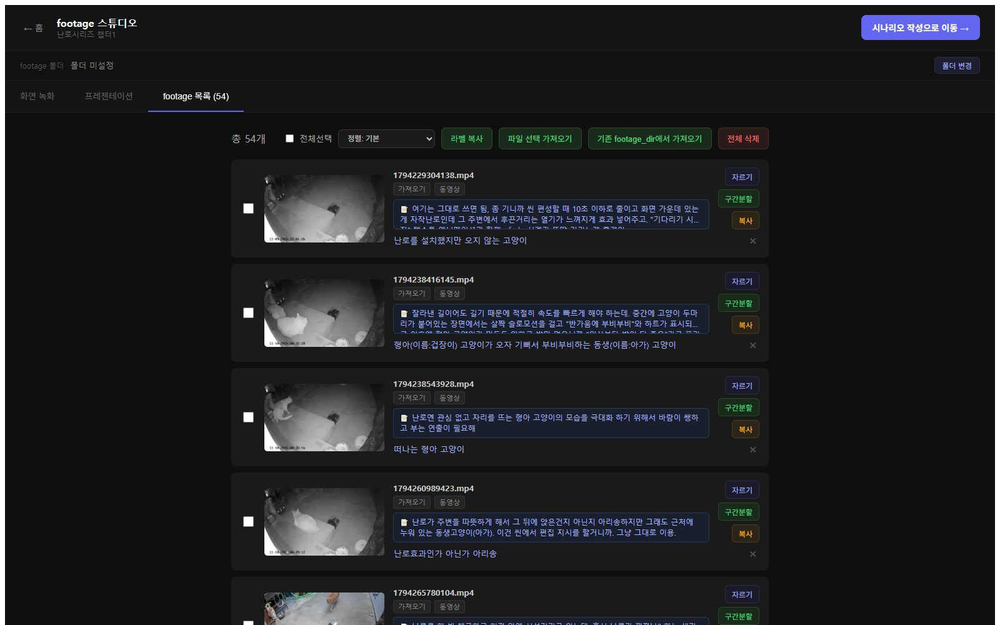
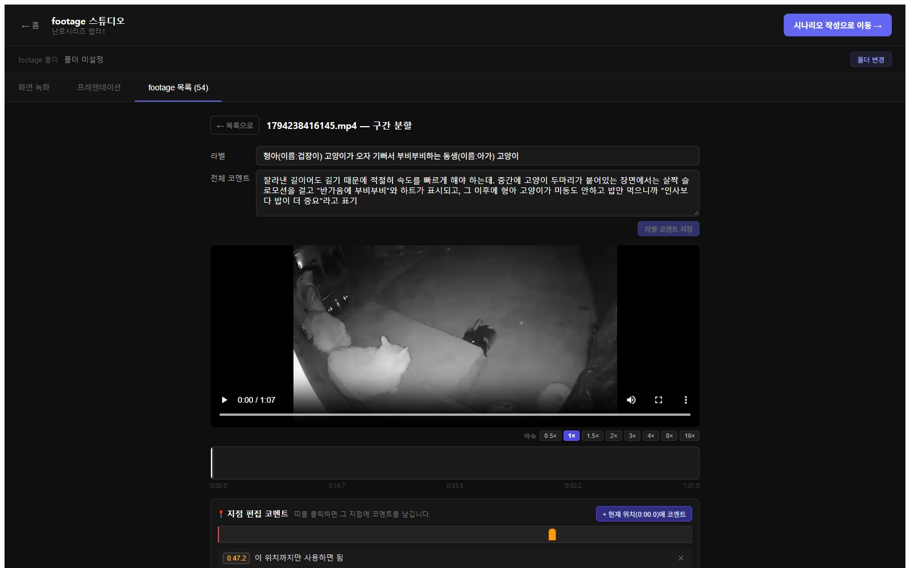
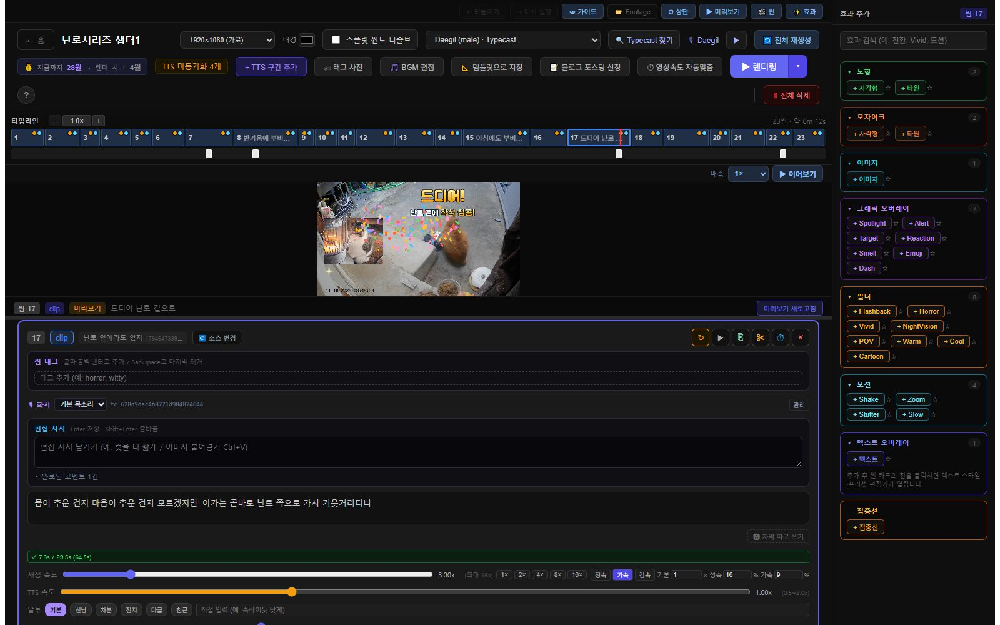
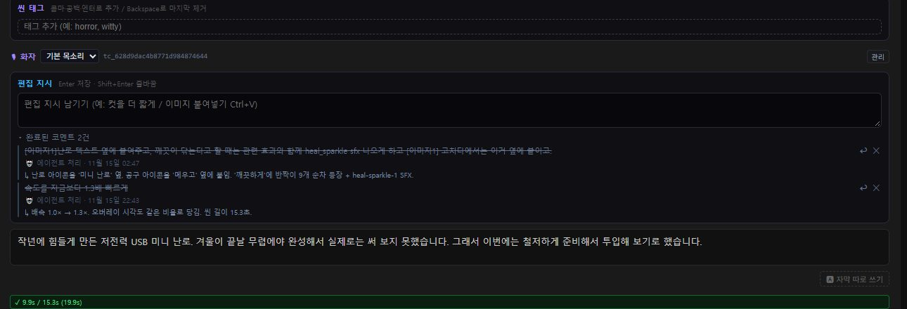

쓰던 영상 제작 툴은 유료였고, AI 편집 기능은 돈을 더 내야 했습니다. 그래서 "한 번 직접 만들어 보자"고 시작한 편집 도구를 오늘 공개했습니다.

- 저장소: [github.com/reddol18/video-agent](https://github.com/reddol18/video-agent) (MIT)

**video-agent**는 시나리오와 재료 영상(footage)을 넣으면 나레이션(TTS)·자막·효과음·BGM이 붙은 영상을 만드는 편집 도구입니다. 화면은 브라우저 편집기(React), 렌더는 로컬 백엔드(FastAPI + ffmpeg)가 맡습니다. 가장 큰 특징은 **편집을 사람이 직접 하지 않는다**는 점입니다. 사람은 화면에 "여기 2초 줄여 줘" 같은 코멘트를 남기고, Claude Code가 그 코멘트를 읽어 API로 고칩니다.

## 이 도구로 만든 영상

요즘 올리고 있는 유튜브 시리즈 "마당냥이 혹한기 생존 프로젝트"가 이 도구로 만든 것입니다. 마당 CCTV 영상을 스튜디오에서 구간별로 나누고, 쓸 장면을 코멘트로 정했습니다. 씬 구성·배속·자막·효과음은 편집 지시 코멘트를 Claude Code가 반영해 다듬었습니다.

<iframe width="560" height="315" src="https://www.youtube.com/embed/7YWJJfEv0Mg" title="길고양이 겨울나기, 작년 외면받았던 DIY 미니 난로 옆에 드디어 앉았습니다!" frameborder="0" allow="accelerometer; autoplay; clipboard-write; encrypted-media; gyroscope; picture-in-picture; web-share" allowfullscreen></iframe>

이 글의 캡처도 모두 이 영상을 편집하던 화면입니다.

## 영상 하나가 만들어지는 순서

**1. 스튜디오 — 재료를 올리고 코멘트를 단다**

footage 스튜디오에 영상을 올립니다. 화면 녹화, 파일 업로드, 기존 폴더 가져오기 중 하나로 넣습니다.



영상을 열면 구간 분할 화면이 나옵니다. 여기서 두 종류의 코멘트를 남깁니다.

- **📍 지점 코멘트:** 특정 시각에 꽂는 지시. 예: `이 지점 앞 3초~뒤 5초 잘라서 "드디어 난로 곁으로" 씬으로`
- **영상 전체 코멘트:** 이 영상이 무슨 내용이고 어디에 쓸지에 대한 메모



재료가 많을 때는 Claude에게 장면 설명부터 만들게 할 수 있습니다. 10초 구간마다 가장 선명한 프레임을 뽑아 직접 보고 설명을 씁니다. 이 설명으로 원하는 장면을 검색할 수 있습니다.

**2. Claude가 코멘트대로 씬을 짠다**

```
푸티지 코멘트대로 프로젝트 만들어줘 (프로젝트 ID: ...)
```

Claude는 자산 목록·코멘트·장면 설명을 API로 읽고, 씬마다 쓸 구간과 나레이션 문장, 자막을 정해 프로젝트를 등록합니다.

**3. 편집기 — 씬별로 다듬는다**

편집기에서는 씬마다 영상·나레이션·자막·텍스트·이미지·효과음을 다듬고, 바로 미리보기로 확인합니다.



**4. 렌더링**

상단의 `▶ 렌더링`을 누르면 최종 영상과 자막 파일(`.sbv`)이 나옵니다. 렌더 단계별 소요 시간도 파일로 남습니다.

## 편집은 코멘트로 남기고, 고치는 건 Claude가 한다

다듬는 단계에서도 사람은 씬 카드의 **편집 지시** 칸에 고칠 점만 적습니다. `컷을 2초 더 짧게`, `7초부터 1.5배속`, `이 자막은 화면 위쪽으로` 같은 식입니다. 스크린샷을 붙여 넣으면 Claude가 그 이미지도 직접 엽니다.

그다음 Claude Code에 "편집 지시 반영해줘"라고 하면, 처리할 코멘트 목록을 API로 받아 씬을 수정하고 완료 처리까지 합니다. 완료된 코멘트에는 무엇을 어떻게 바꿨는지 처리 메모가 붙습니다.



결과가 마음에 안 들면 "다시 열기"를 누르고 지시를 보충하면 됩니다. 완료된 코멘트는 지워지지 않고 접힌 이력으로 남아서, 언제 무엇을 고쳤는지 씬 카드에서 볼 수 있습니다.

Claude가 쓰는 API는 네 가지가 핵심입니다.

| 순서 | 요청 | 용도 |
|---|---|---|
| 1 | `GET /api/projects/{pid}/comments/agent-queue` | 처리할 코멘트 목록 |
| 2 | `GET /api/projects/{pid}` | 현재 씬 상태 |
| 3 | `PATCH /api/projects/{pid}/scenes/{scene_id}` | 씬 부분 수정 |
| 4 | `POST .../comments/{comment_id}/resolve` | 완료 처리 |

에이전트는 프로젝트 데이터 파일을 직접 고치지 않고 이 API로만 읽고 씁니다. 그래서 이 저장소 폴더에서 실행할 필요가 없습니다. 서버에 HTTP로 닿기만 하면 다른 프로젝트에서 일하던 에이전트도 붙여 쓸 수 있습니다.

처음부터 이 방식은 아니었습니다. 초기에는 Gemini(2.5 Flash)가 시나리오 파싱 → 재료 영상 인덱싱 → 클립 매칭을 자동으로 하는 파이프라인이었습니다. 11월 19일에 Gemini 기반 기능을 화면에서 빼고, 지금의 코멘트 → Claude Code 방식으로 바꿨습니다.

## 오늘 반영한 것: 렌더 속도와 효과음

**렌더 속도**

- **클립 캐시:** 씬 클립을 자르고 배속을 건 결과를 저장해 두고, 원본·구간·배속·해상도가 그대로면 다음 렌더에서 재사용합니다. 고배속 씬처럼 오래 걸리는 씬에서 효과가 큽니다.
- **디졸브 연결:** 예전에는 디졸브를 넣으려고 영상 전체를 두 번 다시 인코딩했습니다. 지금은 씬 가운데는 그대로 복사하고 디졸브가 걸리는 경계 구간만 다시 인코딩합니다. 합성 클립 시험(1080p, 12개, 약 93초)에서 **27.4초 → 8.2초**로 줄었습니다.

다만 짧은 클립이 아주 많거나 형식이 제각각이면 경계 방식이 오히려 느릴 수 있습니다. 경계 구간을 CPU로 인코딩하기 때문입니다. 그럴 때는 `RENDER_DISSOLVE_MODE=full`로 예전 방식을 쓸 수 있고, 프레임 수·형식 검사에 어긋나면 자동으로 예전 방식으로 돌아갑니다.

**효과음·BGM**

- 기본 효과음 프리셋을 저장소 안에 넣었습니다. 다른 프로젝트 폴더가 없어도 목록·미리듣기·렌더가 됩니다. 재배포 허용을 확인하지 못한 외부 출처 파일 몇 개는 넣지 않았습니다.
- BGM은 프로젝트에 등록한 오디오만 씁니다.
- 프로젝트를 템플릿으로 저장하면 BGM 파일도 같이 저장되고, 그 템플릿으로 만든 새 프로젝트에 자동으로 연결됩니다.

## 눈에 안 보이는 제작자 표식

렌더 버튼 옆의 `🔏 워터마크`를 켜면 최종 영상에 눈에 보이지 않는 256비트 표식을 넣습니다. Meta의 [Video Seal](https://github.com/facebookresearch/videoseal) 저장소에 있는 **PixelSeal** 모델을 씁니다(코드·모델 모두 MIT). 넣는 값은 제작자 ID의 SHA-256이라, 검사할 때 같은 ID로 다시 계산해 대조할 수 있습니다.

의심 파일은 명령 하나로 검사합니다.

```powershell
$env:UV_NO_SYNC='1'; uv run python -m src.watermark "의심파일.mp4"
```

이 도구로 만든 영상으로 재 본 결과는 이렇습니다(비트 일치율 0.70 이상이면 "있음").

- 720p 재압축(CRF 32), 480p 축소, 80% 크롭, 1.25배속, 30→24fps 변환, 일부만 잘라 내기까지는 검출됐습니다.
- 워터마크 없는 영상 124개 구간에서는 평균 0.495, 최대 0.582가 나왔습니다.

한계도 분명합니다.

- **화면의 절반 이상을 잘라 내면** 검출되지 않습니다.
- **밝은 단색 면이 많은 슬라이드에서 밝기·대비를 조금만 바꿔도** 실패했습니다.
- **같은 모델로 다른 메시지를 덧넣으면 덮입니다.** 모델이 공개돼 있어 막을 수 없고, 이때는 넣을 때 남긴 기록(원본·결과 해시와 시각)이 먼저 만들었다는 근거가 됩니다.

출처를 추적하는 보조 수단이지, 복제를 막는 장치는 아닙니다.

## 만든 방식 — PDCA로 설계한 에이전트 하네스

개발은 Claude 에이전트들이 했습니다. 다만 에이전트 하나에게 "만들어 줘"라고 맡기면 스스로 잘 됐다고 보고하고 끝나기 쉽습니다. 그래서 품질 관리의 PDCA(Plan-Do-Check-Act) 순환을 하네스의 뼈대로 잡고, 단계마다 역할과 권한이 다른 에이전트를 붙였습니다.

| 단계 | 담당 | 하는 일 |
|---|---|---|
| **Plan** | 이슈 + 설계 문서 | 할 일을 GitHub 이슈로 쪼개고 우선순위 레이블을 붙임. 기술 설계 문서가 기준 |
| **Do** | 노팀장(구현) | `needs-implementation` 이슈를 우선순위 순으로 묶어 구현, 작업 브랜치에 커밋 |
| **Check** ① | 이팀장(설계·리뷰) | 구현이 끝나면 자동으로 이어서 실행. 노팀장의 완료 보고를 믿지 않고 원본 이슈를 먼저 직접 해석한 뒤 코드와 1:1 대조 |
| **Check** ② | 박테스터(감사) | 코드가 "돌았는지"가 아니라 **산출물이 맞는 값을 담고 있는지** 검증. 파이프라인 단계별 감사 항목(씬 번호 연속성, 자막 타임코드와 나레이션 시각 일치 등)이 정해져 있음 |
| **Act** | 리뷰·감사 결과 | 문제가 나오면 새 이슈로 만들어 다시 Plan으로. 통과하면 PR을 `test` → `main`으로 올리고 사람이 머지 |

이 하네스에서 지킨 원칙은 세 가지입니다.

- **만든 쪽과 검사하는 쪽을 나눴습니다.** 노팀장은 기술 설계 문서를 못 고치고, 이팀장과 박테스터는 소스 코드를 못 고칩니다. 검사하는 에이전트가 직접 고쳐 버리면 Check가 Do로 섞이기 때문입니다.
- **검사 결과는 반드시 이슈로 남깁니다.** 지적이 말로 끝나지 않고 다음 순환의 Plan 입력이 됩니다.
- **사람은 세 군데에서만 개입합니다.** 리뷰 결과 확인, 감사 시작 지시, 최종 머지입니다. 나머지 연결은 레이블과 상태 파일로 자동으로 이어집니다.

각 역할의 규칙은 저장소의 `CLAUDE.md`와 `.claude/agents/`에 그대로 들어 있습니다. 첫 커밋은 2026년 3월 16일이고, 지금까지 이 순환으로 쌓인 커밋이 약 1,170개입니다. 5월 한 달에만 550개로 가장 바빴습니다.

## 실행해 보려면

Python 3.11 이상과 [uv](https://docs.astral.sh/uv/), Node.js 20 이상, ffmpeg 4.4 이상이 필요합니다.

```bash
uv sync
cd web/frontend && npm install
cp .env.example .env   # 저장소 루트에서. 키 값 채우기
```

백엔드(8000번)와 프론트(5173번)를 각각 띄우고 `http://localhost:5173`을 열면 됩니다. Windows에서 지켜야 할 것(`PYTHONUTF8=1`, Git Bash 경로 등)은 README 3장에 표로 정리해 두었습니다.

에이전트에게는 처음에 API 사용법부터 익히게 합니다.

```
video-agent API 사용법을 먼저 익혀줘. README 5장, 명세는 http://localhost:8000/openapi.json.
그다음 편집 지시 반영해줘 (프로젝트 ID: ...)
```

이 저장소는 GitHub 이슈와 PR을 받지 않습니다. 버그 제보나 기능 요청은 README에 적힌 이메일로 보내 주세요.
